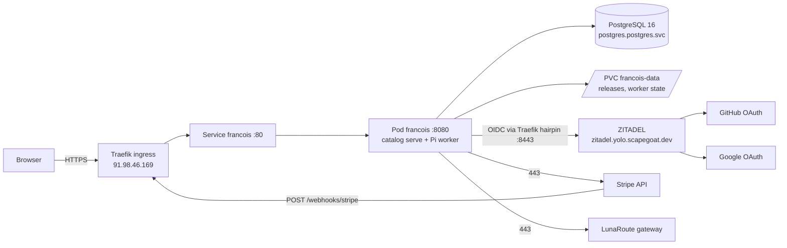
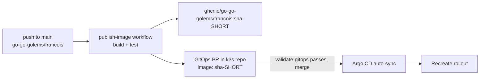

# Francois in production

This playbook describes the hosted catalog (`francois catalog serve`) as it runs
on the scapegoat yolo k3s cluster, and the steps to operate, change and rebuild
it. It records names, paths and identifiers, never secret values: every
credential lives in Vault and is referenced here by path.

The deployment history, design rationale and evidence are in ticket
FRANCOIS-003 (`ttmp/2026/10/13/FRANCOIS-003--…/`): the design document, the
investigation diary and the E2E scripts.

## 1. What runs where

| Concern | Lives in | Path |
| --- | --- | --- |
| Application code, image build, GitOps target | `go-go-golems/francois` (this repo, public) | `Dockerfile`, `.github/workflows/publish-image.yaml`, `deploy/gitops-targets.json` |
| Kubernetes package and Argo CD Application | `wesen/2026-03-27--hetzner-k3s` | `gitops/kustomize/francois/`, `gitops/applications/francois.yaml` |
| Vault policies, roles, secret seeding | `wesen/2026-03-27--hetzner-k3s` | `vault/policies/*/francois-*.hcl`, `vault/roles/*/francois-*.json`, `scripts/bootstrap-francois-secrets.sh` |
| Delegated DNS-01 issuer | `wesen/2026-03-27--hetzner-k3s` | `gitops/kustomize/platform-cert-issuer/clusterissuer-dns01-digitalocean-follow.yaml` |
| ZITADEL organization, client, login policy, GitHub/Google IdPs | `wesen/terraform` | `zitadel/francois/envs/prod` |
| Stripe Product and Price (sandbox) | `wesen/terraform` | `stripe/apps/francois/envs/sandbox` |
| `*.apps.francois.yolo` DNS record | `wesen/terraform` | `dns/zones/scapegoat-dev/envs/prod` |
| Stripe webhook endpoint | Stripe account, created with the Stripe CLI | not in Terraform (its secret would enter state) |
| GitHub and Google OAuth clients | GitHub account, Google project `slop-boutique` | created with `surf` (§7) |
| `slop.boutique` zone | the domain owner's Cloudflare account | §6 |
| Users, admin roles, releases, model settings | Francois PostgreSQL database | §5 |

Operator environment for every command below:

```bash
export VAULT_ADDR=https://vault.yolo.scapegoat.dev
export AWS_PROFILE=manuel                     # Terraform S3 backend
export KUBECONFIG=~/code/wesen/2026-03-27--hetzner-k3s/.cache/kubeconfig-tailnet.yaml
vault login -method=oidc
```

`kubectl` reaches the cluster over Tailscale. There is no Argo CD API token in
Vault; inspect and repair Argo through `kubectl -n argocd` on the
`Application` object.

## 2. Topology

Francois serves one catalog under two sites. Each site is a portal origin plus
an instance domain; an instance always runs on its own origin
`i-<id>.<instance domain>`, never on the portal origin.

| Site | Portal | Instances | Certificate (namespace `francois`) | Issuer |
| --- | --- | --- | --- | --- |
| primary | `https://francois.yolo.scapegoat.dev` | `i-<id>.apps.francois.yolo.scapegoat.dev` | `francois-tls` | `letsencrypt-prod-dns01-digitalocean` |
| second | `https://slop.boutique` | `i-<id>.slop.boutique` | `francois-slop-boutique-tls` | `letsencrypt-prod-dns01-digitalocean-follow` |

`www.slop.boutique` redirects (308) to `https://slop.boutique/`. The server picks
the site from the request's `Host`; sign-in, the Origin check, launch codes,
frame policy and Stripe return URLs follow it. Sessions are per domain.



Server flags (k3s `gitops/kustomize/francois/deployment.yaml`):

```text
catalog serve --listen=0.0.0.0:8080
  --public-url=https://francois.yolo.scapegoat.dev
  --app-domain=apps.francois.yolo.scapegoat.dev
  --site=https://slop.boutique=slop.boutique
  --legal-contact=manuel@scapegoat.dev
  --migrate --database-url-file=/run/secrets/francois/database-url
  --release-dir=/var/lib/francois/releases --worker-dir=/var/lib/francois/worker
  --oidc-issuer=https://zitadel.yolo.scapegoat.dev
  --oidc-client-id-file=/run/secrets/francois/oidc-client-id
  --oidc-extra-scopes=urn:zitadel:iam:org:id:$(FRANCOIS_ZITADEL_ORG_ID)
  --stripe-secret-key-file=… --stripe-webhook-secret-files=… (current, previous)
  --grant-ttl=30m --trust-proxy-headers
  --backend=pi --worker=/app/worker/dist/main.js --pi-agent-dir=/var/lib/francois/pi
```

Prices are not a flag: they belong to the plans in the settings document
(§5.5). `--trust-proxy-headers` makes the demo rate limit use Traefik's
`X-Real-Ip`; without it every visitor appears as the Traefik pod.

One replica, `Recreate` strategy (the PVC is `ReadWriteOnce`). The container
command copies the Pi provider files from the read-only Secret mount
`/etc/francois/pi` to `/var/lib/francois/pi` with mode 0600 before `exec`.
This is a shell wrapper rather than an init container because the release
automation only rewrites the `image:` of entries under `containers:`.
Probes call `/readyz` and `/healthz` with `Host: francois.yolo.scapegoat.dev`;
without it, host routing answers 421.

## 3. Inventory

### 3.1 Kubernetes package and sync waves

Argo CD Application `francois` (project `prod-apps`, automated sync with prune
and self-heal, `ServerSideApply=true`) renders `gitops/kustomize/francois`.

| Wave | Resources |
| --- | --- |
| -3 | Namespace |
| -2 | ServiceAccounts `francois`, `francois-db-bootstrap`, `francois-backup`; VaultConnection; a VaultAuth for each ServiceAccount |
| -1 | VaultStaticSecrets `francois-runtime`, `francois-pi`, `francois-postgres-admin`, `francois-backup-storage` |
| 0 | ConfigMap `francois-db-bootstrap-script` |
| 1 | Job `francois-db-bootstrap` (Sync hook: creates role `francois_app` and database `francois`) |
| 2 | PVC `francois-data` (10Gi `local-path`), Deployment, Service, CronJob `francois-backup`, Certificates `francois-tls` and `francois-slop-boutique-tls` |
| 3 | Ingress, NetworkPolicy |

Argo waits for every resource in a wave to be healthy before the next wave, and
a Certificate is healthy only once it is Ready. A Certificate that cannot be
issued therefore holds every later sync, including image rollouts (§9.1).

NetworkPolicy `francois`: ingress on 8080 from Traefik and from the node IP;
egress to kube-dns, the PostgreSQL primary on 5432, Traefik on 8443 (the
in-cluster path to ZITADEL), and any address on 443 (Stripe, LunaRoute,
ZITADEL discovery). The Kubernetes API is not reachable from the pod.

### 3.2 Vault

| Path (`kv` v2) | Contents | Read by |
| --- | --- | --- |
| `kv/apps/francois/prod/runtime` | `database`, `username`, `password`, `database-url`, `oidc-client-id`, `oidc-org-id`, `stripe-secret-key`, `stripe-webhook-secret`, `stripe-webhook-secret-previous`, `stripe-price-id` | pod (role `francois-prod`), bootstrap Job |
| `kv/apps/francois/prod/pi` | `auth.json` (LunaRoute key only), `models-store.json` (LunaRoute catalog), `settings.json` | pod (role `francois-prod`) |
| `kv/infra/postgres/cluster` | shared PostgreSQL admin credential | bootstrap Job (role `francois-db-bootstrap`) |
| `kv/infra/backups/object-storage` | shared bucket credentials, key `francois-prefix` | backup CronJob (role `francois-backup`) |
| `kv/apps/francois/prod/idp-github` | `client_id`, `client_secret` | Terraform (ephemeral) |
| `kv/apps/francois/prod/idp-google` | `client_id`, `client_secret` | Terraform (ephemeral) |
| `kv/apps/zitadel/prod/terraform` | `access_token` (ZITADEL admin PAT) | Terraform; user API calls |
| `kv/apps/francois/prod/e2e-users` | E2E account names and passwords | E2E script |
| `kv/ci/github/francois/gitops-pr-app` | shared GitHub App credential | CI (JWT role `francois-gitops-pr`, `main` pushes of this repo only) |

Each workload has its own ServiceAccount, Kubernetes auth role and policy; the
serving pod cannot read the PostgreSQL admin or bucket credentials. The
platform's Vault bootstrap rewrites every application's policies, so write only
the Francois ones when they change:

```bash
cd ~/code/wesen/2026-03-27--hetzner-k3s
vault policy write francois-prod vault/policies/kubernetes/francois-prod.hcl
vault write auth/kubernetes/role/francois-prod @vault/roles/kubernetes/francois-prod.json
vault read auth/kubernetes/role/francois-prod     # read back
```

Refresh intervals: `francois-runtime` 30s (and restarts the Deployment),
`francois-pi` 5m, `francois-postgres-admin` 30s, `francois-backup-storage` 30m.

### 3.3 Identity (ZITADEL)

| Object | Value |
| --- | --- |
| Instance | `https://zitadel.yolo.scapegoat.dev` |
| Organization `Francois` | `394966170567966836` |
| Project `francois` | `394966174242177140` (role checks off; roles live in Francois) |
| Client `francois-portal` | `394966177899610228`, Authorization Code + PKCE, public |
| Redirect URIs | `<portal>/auth/callback` for both portals |
| Post-logout URIs | `<portal>/` for both portals |
| Login policy | `allow_register = false` (invite-only); GitHub and Google IdPs, link-only |
| IdP callback (both providers) | `https://zitadel.yolo.scapegoat.dev/idps/callback` |

Francois sends the scope `urn:zitadel:iam:org:id:<org>`, so only users of the
Francois organization can sign in. Sign-out ends the ZITADEL session through
the end-session endpoint with `id_token_hint`.

### 3.4 External OAuth clients

| Provider | Client | Notes |
| --- | --- | --- |
| GitHub OAuth app "slop.boutique" | `Ov23liiQNAcZ10sCVkAw` | callback `…/idps/callback` |
| Google project `slop-boutique` | `380971648284-0n7bvtg3d5fh61dot4nl9e7u17e8otmh.apps.googleusercontent.com` | consent screen External, In production; authorized domains `slop.boutique`, `scapegoat.dev`; home, privacy and terms on `https://slop.boutique` |

The client IDs are Terraform variable defaults; the secrets are only in Vault.

### 3.5 Billing (Stripe sandbox)

| Object | Value |
| --- | --- |
| Product | `prod_VQpH0Crg2Ztp5I` (Terraform) |
| Price | `price_1UPxdFLeHmcfmvuCg0zsScj5`, lookup key prefix `francois-subscriber` (Terraform); listed in the `subscriber` plan |
| Webhook endpoint | `we_1UQ9zfLeHmcfmvuC639e6BPZ` → `https://francois.yolo.scapegoat.dev/webhooks/stripe` |
| Webhook events | `checkout.session.completed`, `checkout.session.expired`, `customer.subscription.created`, `customer.subscription.updated`, `customer.subscription.deleted`, `invoice.paid`, `invoice.payment_failed` |

The sandbox account is shared with other deployments. Francois tags its
customers with `francois_deployment` and ignores events for other customers.
`bootstrap-francois-secrets.sh` refuses live keys (`sk_test_*`/`rk_test_*` only).
The runtime record's `stripe-price-id` key is no longer read by the server.

Plan changes happen in the Stripe billing portal, which must allow switching
between the plans' products and prices (Stripe Dashboard → Settings →
Billing → Customer portal → Subscriptions). Each Stripe Price a plan sells
must be listed in that plan in Settings, or subscribers paying it resolve to
the free plan.

### 3.6 Models

The worker uses LunaRoute only, with a key issued for Francois. The Pi
directory in Vault contains no other provider credential, so approving a
selector for another provider in the admin settings cannot work. Approved
models, credit weights, tiers and allowances are a versioned settings revision
in the database (admin UI → Settings). Production values at setup:

| Selector | Credits per call | Tier |
| --- | --- | --- |
| `lunaroute/glm-5.3-flash` | 1 | quick |
| `lunaroute/glm-5.3` | 3 | default, complex |
| `lunaroute/deepseek-4.1-flash` | 1 | — |

Credits are per plan (Settings → Plans): at the FRANCOIS-004 rollout the
`subscriber` plan carries the earlier 2000 credits per month and 200 per day.

### 3.7 Storefront content

| Content | Stored in | Edited in |
| --- | --- | --- |
| Artifact page (write-up, cover, gallery) | `catalog_artifacts.page` / `page_draft` | Studio → artifact → Page |
| Creator profiles | `creators`, `artifact_creators` | Studio → Creators (admins create and link accounts) |
| Journal | `posts` | Studio → Journal |
| Images and videos (with video posters) | `catalog_media` + blobs in `/var/lib/francois/releases/blobs` | Studio → Media |
| Release attachments (manuals, archives, notes) | `release_attachments` + the same blobs | Studio → artifact → Releases → Attachments, or `push --attach` |
| Plans, demo limits, storefront wording | settings revision | Admin → Settings |

Media and attachment blobs share the release blob directory, so the nightly
backup covers them. Upload limits are settings (Admin → Settings → Limits):
`maxMediaBytes` (default 25 MiB, up to 1 GiB) and `maxAttachmentBytes`
(default 100 MiB, up to 2 GiB); a release holds at most 20 attachments.
Uploads stream to disk and `/media/{id}` and attachment downloads answer Range
requests from the file, so large videos and archives do not load into memory.
Attachments are downloaded under the release's rule (free sample, or a plan
that can run the artifact) at
`/api/releases/{release}/attachments/{id}/download`; unlike the HTML they can
be changed after publishing. Deleting media or attachments leaves their blobs
(there is no blob garbage collector yet). Public pages: `/`, `/apps`, `/apps/{id}`, `/creators/{slug}`,
`/journal`, `/journal/{slug}`, `/journal/feed.xml`, `/pricing`, `/media/{id}`.

## 4. Releasing code



1. Merge to `main` in this repository. Commits that only touch `ttmp/**` or
   `*.md` do not build an image.
2. The workflow pushes `ghcr.io/go-go-golems/francois:sha-<short>` and opens a
   PR in `wesen/2026-03-27--hetzner-k3s` that changes only the `image:` line of
   container `francois`. It authenticates with a GitHub App token minted from
   the Vault credential, not a personal token.
3. Wait for the PR's `validate-gitops` check, then merge it.
4. Watch the rollout. `kubectl rollout status` returns immediately if Argo has
   not synced yet, so wait for the image first:

```bash
want=ghcr.io/go-go-golems/francois:sha-<short>
until [ "$(kubectl -n francois get deploy francois -o jsonpath='{.spec.template.spec.containers[0].image}')" = "$want" ]; do sleep 5; done
kubectl -n francois rollout status deploy/francois --timeout=5m
kubectl -n argocd get app francois -o jsonpath='{.status.sync.revision} {.status.sync.status} {.status.health.status} {.status.operationState.phase}{"\n"}'
```

5. Smoke test (§8). Portal sessions are in PostgreSQL and survive the rollout.

Changes to flags, resources or other manifests go through a hand-written PR in
the k3s repository and roll out the same way. Run
`scripts/validate_gitops.sh` there before pushing.

When a Vault value and a manifest change must land together (for example a new
key name), write Vault first, wait until the VaultStaticSecret has refreshed the
cluster Secret, then merge. Otherwise the new pod starts with the old value.

### 3.8 Typeface (ABC Areal)

The storefront is set in ABC Areal, a free typeface by Dinamo made for
Are.na (download: https://abcdinamo.com/free/areal). Its license covers web
use with self-hosted WOFF2 files but forbids putting the fonts "in public
repositories" or "on public servers" as files to download, so this public
repository contains none (`.gitignore` blocks `ABCAreal*` and `*.woff2`).

`--font-dir` points the server at a private directory of the WOFF2 files.
The server serves only known file names under `/fonts/`, generates
`/fonts/fonts.css`, and shows the footer credit; without the flag it serves
an empty stylesheet and pages fall back to Helvetica. A configured directory
without any known file stops the server at startup.

- Locally: keep the files in `~/.config/francois/fonts` and set
  `FONT_DIR=~/.config/francois/fonts` in `deploy/compose/.env`.
- On the cluster: five WOFF2 files (Regular, Italic, Medium, Bold, Mono)
  are in `kv/apps/francois/prod/fonts`, base64-encoded because KV values are
  text; the `francois-fonts` VaultStaticSecret decodes them with a `b64dec`
  template into Secret `francois-fonts`, mounted at `/etc/francois/fonts`
  with `--font-dir=/etc/francois/fonts` (k3s PR #353, merged with the
  storefront rollout). `francois-prod` may read the path.

### 4.1 First rollout of the storefront (FRANCOIS-004)

The FRANCOIS-004 binary removes `--stripe-price-id` (an unknown flag stops the
server) and runs migrations 004 and 005. The automated GitOps PR changes only
the image, so it must not be merged on its own:

1. The k3s PR for the rollout is wesen/2026-03-27--hetzner-k3s#353 (draft):
   in `deployment.yaml` it removes `--stripe-price-id=$(STRIPE_PRICE_ID)` and
   the `STRIPE_PRICE_ID` environment variable and adds
   `--trust-proxy-headers` and `--font-dir` with the fonts Secret.
2. Merge the francois branch. When the image PR appears, either add its
   `image:` change to the PR from step 1 or merge both together (the step 1 PR
   first). Never let the image roll out with the old arguments.
3. On start, migration 005 rewrites the settings: a `free` plan and a
   `subscriber` plan with the previous instance, member and credit limits and
   the price existing subscriptions pay. Check Admin → Settings → Plans, rename
   or reprice as needed, and add further plans with their Stripe prices.
4. Create creator profiles (Studio → Creators), link them to the creators'
   accounts, and set those accounts' role to Creator (Admin → Users).
5. Fill the storefront wording (Admin → Settings → Storefront) and, if wanted,
   enable demos (Settings → Demos, then per artifact in the studio).
6. Smoke test: `/`, `/pricing`, an artifact page, a demo, a studio edit.

FRANCOIS-005 (videos and attachments) adds migration 006: a poster column on
media, the `release_attachments` table, and `limits.maxAttachmentBytes`
written into every stored settings revision (settings parse strictly). No
flags change. Uploads can now be as large as the limits allow; if a request
body limit is ever added to the ingress (Traefik has none by default), keep
it above both limits.

## 5. Day-to-day operations

Run catalog commands inside the pod; they need the database URL file:

```bash
fc() { kubectl -n francois exec deploy/francois -- francois catalog "$@" --database-url-file /run/secrets/francois/database-url; }
```

### 5.1 Invite a user

Sign-up is disabled. Create the user in the Francois organization with a
verified email. In the ZITADEL console: organization Francois → Users → New.
Through the API, with the admin token in a header file so it never appears on a
command line:

```bash
umask 077; h=$(mktemp)
printf 'Authorization: Bearer %s\n' "$(vault kv get -field=access_token kv/apps/zitadel/prod/terraform)" > "$h"
curl -sS -H @"$h" -H 'Content-Type: application/json' \
  -X POST https://zitadel.yolo.scapegoat.dev/v2/users/human -d '{
    "organization": {"orgId": "394966170567966836"},
    "username": "<unique username>",
    "profile": {"givenName": "…", "familyName": "…"},
    "email": {"email": "<address>", "isVerified": true}
  }'
rm -f "$h"
```

- Usernames are unique across the whole ZITADEL instance, email addresses are
  not. If the address is already a username in another organization, choose a
  different username with the same email (error `V3-DKcYh`).
- With no password, the user signs in with GitHub or Google. On first login
  ZITADEL offers to link the external account to the user with the matching
  verified email. The IdPs never create users.

### 5.2 Administrators and access

```bash
fc users list
fc users promote --issuer https://zitadel.yolo.scapegoat.dev --subject <zitadel user id>
fc users grant-access --user-id usr_… --days 30 --reason pilot [--plan supporter]
fc users disable --user-id usr_…          # also revokes runtime grants
fc users enable --user-id usr_…
fc users revoke-sessions --user-id usr_…
```

`promote` by issuer and subject creates the identity row if the user has not
signed in yet, so the first login already has the admin role. Use the ZITADEL
user ID as the subject. Roles (subscriber, creator, administrator),
complimentary access (optionally for a named plan; without one, the highest
plan), credit adjustments and suspensions are also in the admin UI (`/admin`).
Creators and administrators have the highest plan without paying.

### 5.3 Publish a release of an artifact

Creators publish their own artifacts; administrators publish any. In the
studio (`/studio`): artifact → Releases → upload HTML → check → draft →
preview on an isolated origin → publish. From a laptop, with a personal API
token created in Studio → Tokens:

```bash
francois catalog push --server https://slop.boutique --token-file ~/.config/francois/token \
  --artifact-id polis --version 1.2.0 --html dist/polis.html \
  [--manifest polis.manifest.json] [--changelog "…"] [--check] [--publish] \
  [--attach docs/manual.pdf --attach plates.zip]
```

`--attach` files are uploaded to the draft before it is published; a missing
file stops the push before anything is created.

Tokens work only on `/api/studio/*`; a token cannot reach accounts, billing or
instances, and cannot create tokens. Revoke one in Studio → Tokens.

As an operator, from inside the pod, with files that exist in the image:

```bash
fc publish --artifact-id polis --version 1.0.1 \
  --release-dir /var/lib/francois/releases \
  --html /app/examples/polis.html --manifest /app/examples/polis.manifest.json \
  --actor-user-id usr_…
```

Release files are content-addressed blobs under
`/var/lib/francois/releases/blobs/<xx>/<sha256>`; the database refers to them by
hash. `--release-dir` is required in the pod: its default
(`./var/catalog/releases`) is outside the PVC. `--draft` stops at a draft to
publish later from the admin UI.

### 5.4 Model settings and the LunaRoute catalog

Change approved models, credits, tiers and allowances in the admin UI
(Settings); each save is a new revision with history. `fc settings` shows the
active revision; `fc settings --file <path>` validates and activates a revision
from a JSON file, which must be readable inside the pod (`kubectl cp` it first).

The worker never fetches the model list (`allowModelNetwork: false`); it reads
`models-store.json`. When LunaRoute adds or renames models, refresh the catalog
locally through Pi, then replace the file in Vault without touching the key:

```bash
vault kv patch kv/apps/francois/prod/pi models-store.json=@<dir>/models-store.json
# wait ≤5m for francois-pi to refresh, then:
kubectl -n francois rollout restart deploy/francois
```

Check the directory locally before writing it: `francois models list --pi-agent-dir <dir>` must list only LunaRoute models.

### 5.5 Plans and pricing

Plans live in Admin → Settings → Plans: key, name, rank, Stripe prices
(`month|year price_… label`), instances, people per instance, monthly and daily
credits, allowed models, and whether `/pricing` shows the plan. Rank orders
plans; an artifact's required plan (studio → Details) is the lowest plan that
may run it, by default the lowest paid plan. A plan above free without prices
can only be granted. After a downgrade, the oldest workspaces up to the new
limit keep working; the others stop launching (`over_plan_limit`) until the
subscriber upgrades or deletes some.

### 5.6 Demos

Settings → Demos sets the lifetime, the number of live demos, demos per
address per hour, credits per demo and a daily credit budget for all demos;
each artifact opts in (studio → Demo). Anonymous visitors get a guest account
and a session that ends with the demo; guests do not appear in the admin user
list. Expired demos are suspended within a minute and deleted after a week.

### 5.7 Logs and status

```bash
kubectl -n francois logs deploy/francois --since=1h
kubectl -n francois get pods,certificate,vaultstaticsecret,job,cronjob
kubectl -n argocd get app francois
```

A ready pod logs `Francois catalog ready`. The worker fails to start when no
authenticated model exists for a tier, so a ready pod means the Pi files were
accepted.

## 6. Domains and certificates

### 6.1 How the second domain is validated

The `slop.boutique` zone belongs to another person's Cloudflare account, so
cert-manager cannot write to it. The owner delegates only the ACME challenge:

```text
_acme-challenge.slop.boutique  CNAME  slop-boutique.acme.scapegoat.dev   (DNS only)
```

The issuer `letsencrypt-prod-dns01-digitalocean-follow` uses
`cnameStrategy: Follow`, so cert-manager writes the challenge TXT record at
`slop-boutique.acme.scapegoat.dev` in the DigitalOcean `scapegoat.dev` zone.
This CNAME must stay in place permanently; every renewal uses it.

Traffic records at the owner, after the certificate is Ready:

```text
@  CNAME  francois.yolo.scapegoat.dev   (DNS only)
*  CNAME  francois.yolo.scapegoat.dev   (DNS only)
```

They must be DNS only: TLS terminates at Traefik with our certificate, and a
proxied record or a Cloudflare redirect rule would put Cloudflare in front.

### 6.2 Adding another domain

1. Code and flags: add `--site https://<domain>=<domain>` to the Deployment
   (instances at `i-<id>.<domain>`, so one wildcard certificate covers portal
   and instances). Add an Ingress TLS entry and rules for `<domain>` and
   `*.<domain>`.
2. ZITADEL: add `https://<domain>` to `alias_urls` in
   `zitadel/francois/envs/prod` and apply; this registers the redirect and
   post-logout URIs.
3. Ask the owner for the `_acme-challenge` CNAME to
   `<label>.acme.scapegoat.dev`. Do not add the Certificate to the
   kustomization yet.
4. When `dig +short CNAME _acme-challenge.<domain>` answers, create the
   Certificate. To keep a slow order out of Argo's wave gate, apply it once by
   hand and wait for Ready, then add the file to `kustomization.yaml` so Argo
   adopts it:

   ```bash
   kubectl kustomize gitops/kustomize/francois | yq 'select(.kind=="Certificate" and .metadata.name=="francois-<label>-tls")' | kubectl apply -f -
   kubectl -n francois wait certificate/francois-<label>-tls --for=condition=Ready --timeout=10m
   ```

5. Test before public DNS exists:

   ```bash
   curl -sS -o /dev/null -w '%{http_code}\n' --resolve <domain>:443:91.98.46.169 https://<domain>/
   echo | openssl s_client -connect 91.98.46.169:443 -servername <domain> 2>/dev/null | openssl x509 -noout -subject -ext subjectAltName
   ```

6. Ask the owner for the `@` and `*` records (DNS only), then run the browser
   test on the new portal.
7. If the domain should offer Google sign-in, add it to the Google consent
   screen's authorized domains.

## 7. Identity providers

Create or rotate OAuth clients with `surf` (`~/code/wesen/surf-cli`), using the
ZITADEL IdP callback as the only redirect URI. Pipe each secret from a shell
variable straight into Vault:

```bash
surf github oauth register …   # callback https://zitadel.yolo.scapegoat.dev/idps/callback
surf google oauth consent --project slop-boutique --app-name … --support-email … \
  --home-page https://slop.boutique --privacy-policy https://slop.boutique/privacy \
  --terms-of-service https://slop.boutique/terms --authorized-domains slop.boutique,scapegoat.dev --publish
surf google oauth register …
printf '%s' "$secret" | vault kv put kv/apps/francois/prod/idp-google client_id=<id> client_secret=-
unset secret
```

Then set the client ID variable in `zitadel/francois/envs/prod` and apply. The
secrets are write-only attributes read from Vault ephemerally, so Terraform
cannot detect a rotated secret: after updating Vault, apply with
`-replace='zitadel_org_idp_google.francois[0]'` (or the GitHub resource).

Google cannot leave "Testing" without reachable home, privacy and terms pages.
Francois serves `/privacy` and `/terms` on every portal; the contact address is
`--legal-contact`.

## 8. Verification

Smoke tests after any change:

```bash
for u in https://francois.yolo.scapegoat.dev https://slop.boutique; do
  curl -sS -o /dev/null -w "$u %{http_code}\n" "$u/"
  curl -sS "$u/readyz"; echo
  curl -sS -o /dev/null -w "$u/privacy %{http_code}\n" "$u/privacy"
done
```

`/readyz` returns `{"status":"ready","models":true}` when the database answers
and the worker has models.

Browser test with the E2E accounts (credentials read from Vault into the
process only; needs Playwright 1.61.1 and its Chromium):

```bash
s=ttmp/2026/10/13/FRANCOIS-003--deploy-the-hosted-francois-catalog-to-the-scapegoat-yolo-k3s-cluster-with-argo-cd/scripts/05-yolo-e2e.sh
$s admin          # admin signs in, admin pages load
$s alice-run      # subscriber launches Polis on an instance origin
$s alice-sample   # a real model call from the instance through LunaRoute
$s control        # without sign-out, /auth/login is silent (live ZITADEL session)
$s logout         # after sign-out, /auth/login asks for credentials again
```

Other steps: `admin-models` (writes a settings revision; changes production
settings) and `alice-subscribe` (Stripe sandbox Checkout). The script targets
the primary portal.

## 9. Troubleshooting

### 9.1 Merged releases do not deploy

Symptom: the k3s PR is merged but the Deployment keeps the old image, and
`kubectl -n argocd get app francois -o jsonpath='{.status.operationState.message}'`
says it is waiting for healthy state of a wave. Usually a Certificate in wave 2
is not Ready, and the running operation keeps waiting.

```bash
kubectl -n francois get certificate,certificaterequest,order,challenge
kubectl -n francois describe challenge <name>     # reason for the failed check
```

If the cause is outside the cluster (DNS not delegated yet), remove the
Certificate from `kustomization.yaml` in a PR, then stop the stuck operation:

```bash
kubectl -n argocd patch app francois --type merge \
  -p '{"status":{"operationState":{"phase":"Terminating"}}}'
```

Auto-sync may restart on the previously fetched revision and stop at the same
wait; terminate again until it picks up the new revision. Delete the
Certificate by hand if it is still there. Challenges are owned by the
ClusterIssuer and are not deleted with the Certificate; delete them too, and if
a challenge hangs on the `acme.cert-manager.io/finalizer` while nothing was
presented, remove that finalizer.

### 9.2 Other known failures

| Symptom | Cause | Fix |
| --- | --- | --- |
| Probes fail with 421 | Host routing rejects the pod IP | Probes set `Host: francois.yolo.scapegoat.dev` |
| Login shows the wrong organization or branding | Organization scope missing | `--oidc-extra-scopes=urn:zitadel:iam:org:id:<org>` |
| After sign-out, the next sign-in is silent | ZITADEL session survived | Post-logout URI must be registered on the client for that portal |
| `/?login_error=exchange_failed` | Code exchange from the pod to ZITADEL failed | Check the NetworkPolicy egress to Traefik 8443 and the client's redirect URIs |
| `kubectl` times out | Tailscale node offline or key expired | Bring the node back on the tailnet |
| Wildcard renewals stall, DNS plan returns 401 | DigitalOcean token revoked | New token in `kv/platform/cert-manager/prod/digitalocean` and the Terraform path |
| Stripe events retried for unknown customers | Shared sandbox account | Expected; Francois acknowledges and ignores foreign customers |
| New pod uses an old secret value | Merged before VSO refreshed the Secret | Wait for the refresh, then `rollout restart` |
| A model is approved but calls fail | No credential for its provider | Only LunaRoute selectors work (§3.6) |
| Pod crash-loops after an image bump: `unknown flag: --stripe-price-id` | FRANCOIS-004 image with the old arguments | Remove the argument and `STRIPE_PRICE_ID` (§4.1) |
| `plan_required` for a paying subscriber | Their Stripe price is not listed in any plan | Add the price to the plan in Settings |
| `over_plan_limit` when launching | Workspace beyond the owner's (downgraded) plan limit | Upgrade, or delete newer workspaces |
| `model_not_in_plan` | The plan restricts models | Add the model to the plan, or leave the plan's model list empty |
| `demo_limit` | All live demo slots used, or the daily demo budget spent | Raise the limits in Settings → Demos, or wait |
| `token_not_allowed` / `token_invalid` | API token used outside `/api/studio`, or revoked/expired | Use a browser session; create a new token |

## 10. Backups and restore

- **Database:** the platform's nightly `pg_dumpall` of the shared PostgreSQL
  cluster covers database `francois`.
- **Release blobs:** CronJob `francois-backup` (04:40 daily) syncs
  `/var/lib/francois/releases/blobs` to
  `s3://<bucket>/<francois-prefix>releases/blobs/` and fails if the remote has
  fewer files than the local directory. Blobs are immutable and named by
  content, so an additive sync is a complete copy. Run it now with
  `kubectl -n francois create job francois-backup-manual-$(date +%s) --from=cronjob/francois-backup`.
- **Not backed up:** worker state under `/var/lib/francois/worker` and the Pi
  files copied at start (they come from Vault).

A restore needs both halves: a database without the blobs it refers to has
releases that cannot be served. Restore the database from the platform dump,
then copy the blobs back into `releases/blobs/` on the PVC with the same
`aws s3 sync` in the other direction. This procedure has not been rehearsed.

## 11. Building it from scratch

The order follows the dependencies; each step names its check.

1. **Platform access.** `tailscale status` shows the node, `kubectl get nodes`
   works, `vault token lookup` succeeds, the DigitalOcean token in Vault returns
   200 from `/v2/account`.
2. **Terraform.** Apply `zitadel/francois/envs/prod` (outputs give the org and
   client IDs), `stripe/apps/francois/envs/sandbox`, and the DNS record (use
   `-target` if the zone has unrelated drift). Re-plan to zero changes. Terraform
   applies are run by the operator.
3. **Stripe webhook.** Create the endpoint with the events in §3.5, disabled,
   and keep its secret in a shell variable for the next step.
4. **Vault.** Write the Francois policies and roles (§3.2) and read them back.
   Run `scripts/bootstrap-francois-secrets.sh` with the IDs, Stripe values and
   `FRANCOIS_PI_DIR` (a directory holding the LunaRoute-only `auth.json`,
   `models-store.json` and `settings.json`). Copy the shared GitHub App
   credential to `kv/ci/github/francois/gitops-pr-app`.
5. **GitOps package.** Merge `gitops/kustomize/francois` and
   `gitops/applications/francois.yaml`. Leave out any Certificate whose DNS is
   not delegated yet. Run `scripts/validate_gitops.sh`.
6. **First sync.** Apply the Application with `kubectl apply -f
   gitops/applications/francois.yaml` (there is no app-of-apps). Watch the
   waves, the bootstrap Job, the certificates and the pod log. Run the smoke
   tests, then enable the webhook endpoint.
7. **Accounts and content.** Create users (§5.1), promote the first admin
   (§5.2), publish the first release (§5.3), approve models and set allowances
   (§3.6).
8. **Identity providers.** Create the OAuth clients and apply the IdPs (§7).
9. **Verify.** Run the browser test (§8), including `control` and `logout`.
10. **Release loop.** Set `open_gitops_pr` on in the publish workflow and merge
    the first automated PR.
11. **Second domain.** Follow §6.2.

## 12. Known gaps

- Google sign-in has not been exercised by a real login yet. After it works,
  delete the unused older client secret in the Google console.
- The Francois ZITADEL organization has no label policy; login pages show the
  instance's default branding.
- `e2e-admin` and `e2e-alice` are real users in the production organization,
  and Alice has a sandbox subscription.
- Instance origins share the registrable domain with their portal on both
  sites. Isolation relies on separate origins and `__Host-` cookies; a public
  launch should consider a dedicated registrable domain for instances.
- Billing runs in Stripe test mode. A live account needs its own Price with an
  explicit tax decision, and the bootstrap script's test-key check removed.
- Plan changes by subscribers need the Stripe billing portal configured for
  all plan products and prices.
- The demo rate limiter is in memory and per process (correct with one
  replica).
- Migration 005 rewrote all stored settings revisions; a rollback to a
  pre-FRANCOIS-004 image cannot read them. Migration 006 likewise adds
  `limits.maxAttachmentBytes`, which a pre-FRANCOIS-005 image rejects.
- Blobs of deleted media and attachments stay on the volume; there is no
  garbage collector.
- The PDS records in the `scapegoat.dev` zone are not imported into Terraform
  (HK3S-0031), so a full DNS apply would try to recreate them.
