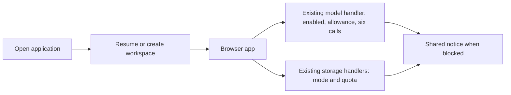

# Minimal site: limits, pause switches and saved work

## What we are changing

Visitors open applications and read the site. Usage accounting stays in administration. When a limit or outage prevents something, show a short message where the action would happen. Keep sign out and subscription management accessible.

Implement this in the existing Go application, PostgreSQL database, Pi worker and React UI. The changes below are proposed; the running local deployment has not been changed by this document.

The [Paper comments](https://app.paper.design/file/01M506DAH3CXP5QS28T2VQ4W3N/p-3-0) call for removing most account/instance/pricing presentation, merging the catalog and journal feeds, and keeping a small warning treatment. Preserve that direction: an application has an Open/Try action, rather than a provisioning flow or usage dashboard.

## 1. Three controls in the existing settings

Add this object to `settings.Document` and expose it in the existing administrator settings editor:

```json
{
  "operations": {
    "acceptNewVisits": true,
    "samplingEnabled": true,
    "storageMode": "read-write",
    "notice": ""
  }
}
```

`storageMode` accepts `read-write`, `read-only`, or `off`. `notice` is optional plain text, at most 500 characters, for the current incident; use the default message for the blocked operation when it is empty. Render it as text.

| Setting | Behavior when restricted | Check it in |
| --- | --- | --- |
| `acceptNewVisits = false` | Refuse creation of new tours/workspaces. Existing eligible workspaces still open. | `createDemo`, `createInstance`, automatic workspace creation |
| `samplingEnabled = false` | Refuse new model calls. Already-running calls finish under the existing timeout. | `Runtime.sample`, before model admission/reservation |
| `storageMode = read-only` | Allow reads; refuse all persistent changes. | RPC mutations and asset upload/delete |
| `storageMode = off` | Refuse persistent reads and writes, including previously signed asset URLs. | Storage RPC methods, uploads and blob reads |

These controls apply to all users. Account-specific abuse continues to use existing account/instance suspension. The public catalog and writing remain available when hosted capabilities are paused. This assumes the database is running; the storage switch is an application control, not a way to serve database-backed pages through a database failure.

Read current settings at the operation, so an already-open tab cannot bypass a pause. Display the notice on its next affected request; extra polling is unnecessary. A model-only pause leaves saved-data access alone. A read-only pause also blocks document/asset deletion, comments and leases; ordinary quota exhaustion should still permit deletion to free space.

Reuse `GET /api/admin/settings` and `PATCH /api/admin/settings`, including the existing `If-Match` revision check and audit trail. Supply explicit initial values when updating the active settings. Keep the checks as small functions in the existing handlers.

## 2. Six model calls, one per person

Set the existing `Allowance.GlobalConcurrency` to 6 and `PerUserConcurrency` to 1. Reuse `Runtime.admit` and `release`. The per-user key already spans instances and browser tabs. When admission fails, return the existing HTTP 429 response with a short busy message. The person can retry.

Keep the existing five-minute call timeout, server-controlled tool-round limit and per-round output cap of 8,192 tokens. Admission remains held for the full application call, including tool waits. This is deliberately conservative for the six available lanes.

Keep the existing credit reservation and daily/monthly limits as private call allowances. Set model credit weights to 1 if the intended policy is simply a number of calls; for example, a daily allowance of 50 then means 50 started calls. Configure smaller allowances for free accounts and tours using the existing plan/demo settings. Preserve current accounting semantics: started calls count even if cancelled, while calls that never start release their reservation. Visitors see a neutral limit message, never a credit balance or upgrade prompt.

Continue recording tokens, model, artifact, timestamps and failures in `model_calls`. Existing start/settle timestamps provide call duration for operator inspection. This is enough to tune limits from actual use.

Cancellation deserves one focused correctness check: `piworker.Client.Sample` currently sends cancel and returns before an acknowledgement. Confirm the worker terminates the generation before treating that slot as reusable. Also verify that the provider's six lanes refer to concurrent generations and that other callers are not consuming the same pool. These checks establish whether the configured six-call limit matches the upstream limit.

```text
sample(request):
    authenticate and validate request
    if sampling is paused: return service notice
    if existing per-user/global admission fails: return busy
    reserve existing call allowance
    if reservation fails: release admission; return limit message
    run with existing timeout and tool/output bounds
    settle usage and release admission exactly once
```

## 3. Short tours and limited starts

Reuse `Demo.TTLMinutes`, `MaxActive`, `PerAddressPerHour`, `Credits` and `DailyBudget`. Start with a 20-minute tour and the existing three starts per address per hour; leave other limits configurable in the current settings. These are initial policy choices, not measured capacity claims. Demo instance count is independent of model-call concurrency: an idle tour consumes no model lane.

When Open/Try finds a live tour for that person and application, resume it without extending `expires_at` or consuming another start. Refreshing the page or renewing a grant must not create a fresh tour allowance. For signed-in callers, add `Demo.PerUserPerHour`, initially 3, and apply the existing limiter with a user-ID key as well as the network key. Anonymous callers retain the network limit. Keep the limiter process-local as it is today; its counters reset on application restart.

Reuse existing expiry handling: it suspends the demo, revokes grants and closes its views. Existing cleanup deletes expired demo data after seven days while model-call history remains. Signed-in saved workspaces are separate from tours and keep their data when a daily model allowance runs out.

## 4. Keep instances internal; open saved work directly

An instance is a PostgreSQL workspace identity: owner, release, hostname, members and stored data. It does not create a container or start a worker. All instances use the same Go service and shared Pi worker; application JavaScript runs in the browser.

Change the normal Open action to find the person's existing workspace for that artifact and open it. If several already exist, use the oldest active one as the default. If none exists, create one under the existing access and instance-count checks. Perform lookup and creation under the existing per-owner transaction lock so simultaneous tabs do not create duplicates. Existing additional instances and their URLs remain intact; remove routine instance management from the default flow without merging or deleting data.

| State | Infrastructure cost |
| --- | --- |
| Saved instance | Small metadata plus whatever data it retains |
| Connected tab | HTTP/SSE connection, event buffer and authorization checks |
| Running model call | One admitted slot, shared worker work and upstream generation |
| Stored content | Database space, query work and backup growth |

The local investigation found 13 instances, seven documents totaling 606 logical bytes and no assets. This is a small development dataset, not a capacity estimate. The practical controls are model-call limits, storage bounds and a small per-user live-view cap; add `Limits.ViewsPerUser`, initially 3, checked under the existing runtime mutex in `createView`.

## 5. Bound storage with the existing store methods

Add `Limits.StorageBytesPerInstance`, initially 16 MiB, and lower the existing document-count default to 500. Apply the byte cap to document bodies, asset bytes, comment text/anchors and lease payloads. Keep existing per-document/per-upload request bounds. Existing instance-count limits bound how many such allowances an account can create.

At each persistent write, take the same instance advisory transaction lock, calculate the resulting logical byte total, and reject growth over the cap. For updates, subtract the old value before adding its replacement. Allow deletions and size-reducing updates when already over quota. Check the document-count limit under this same lock to fix concurrent inserts exceeding it. All mutation methods must participate, including comments and leases.

Do this in the current store methods. The dataset is bounded and small enough to calculate its usage inside the write transaction. Existing data above a new limit remains readable. Switching storage modes must never delete data.

## 6. One notice treatment

Use the site's existing type and spacing, with one short paragraph and at most a retry/back action. Show it inline if the application remains usable, or as a small warning page when entry is blocked. Design these variants in Paper before implementing the UI.

| Reason | Message |
| --- | --- |
| Busy | “All spots are busy. Please try again shortly.” |
| Daily allowance reached | “You've reached today's limit. Please come back tomorrow.” |
| Tour expired | “This visit has ended. You can return later.” |
| AI paused | “AI is temporarily paused.” |
| Saving paused | “Saving is temporarily paused. Your existing work is still available.” |
| Storage off | “Saved work is temporarily unavailable.” |

Reuse the existing JSON error envelope. Add specific paused-storage/AI codes where needed; use HTTP 503 for those temporary pauses and retain existing limit codes. Render the operator notice when supplied. Stop autosave after a saving-pause response and show that edits are unsaved. Do not report success or promise persistence for rejected writes.



## Files and implementation order

| Files | Change |
| --- | --- |
| `pkg/catalog/settings/settings.go`, `pkg/catalog/admin.go`, `ui/catalog/admin.tsx` | Three controls, notice text, view/storage/start limits in the existing settings flow |
| `pkg/catalog/hosted/sample.go`, `pkg/piworker/client.go`, `worker/src/main.ts` | Existing concurrency/allowance path and cancellation completion check |
| `pkg/catalog/demos.go`, `pkg/catalog/store/demos.go` | Resume live tours; reuse TTL/start limiting and cleanup |
| `pkg/catalog/instances.go`, `pkg/catalog/store/instances.go` | Atomic open-or-create using existing ownership, release and origin boundaries |
| `pkg/catalog/hosted/views.go`, `rpc.go`, `routes.go` | View cap, operation checks and notice responses; blob reads check storage mode too |
| `pkg/catalog/store/documents.go`, `assets.go` | Transactional byte/count checks covering documents, assets, comments and leases |
| Existing launch/runtime UI and public templates | Automatic Open flow, small notice and approved Paper removals |

Implement the settings and handler checks first, then tour/workspace opening and storage bounds, then the Paper-approved public simplification. Keep the existing admin analytics. The ticket diary preserves the earlier investigation and measurements; this document is the current implementation direction.

Verify the behaviors that matter: a seventh call and a second call by the same person are refused; cancellation does not overrun upstream slots; already-open tabs obey pauses; read-only blocks every persistent mutation while reads work; refresh cannot extend a tour; simultaneous Open requests return one workspace; parallel writes respect quotas; reopening access preserves data; public pages contain no usage meters.
