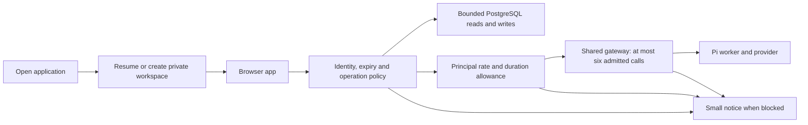

# Minimal public experience and operational capacity controls

## Status and revised direction

This is a proposal based on the user's clarification after local deployment, not an implementation receipt. The deployed RSS and administrator analytics remain as described in the earlier guide. This document revises the proposed public experience: ordinary visitors should see applications, writing and a direct way to open an application, with occasional short service notices. Usage accounting and resource policy remain private operational functions.

The user reports free model hosting with effectively unlimited tokens and six execution lanes. Treat six as the physical concurrency budget, not the number of people allowed to have a workspace or a browser tab open. Token counts remain useful for debugging context growth and expensive applications; occupied lane time, latency, rejection rates, and active users become more useful capacity indicators than monetary cost.

## Paper evidence

Read 20 open threads in [the unified Paper file](https://app.paper.design/file/01M506DAH3CXP5QS28T2VQ4W3N/p-3-0). Every listed thread had one message and its preview was complete. Relevant feedback includes removing Hero, Made by, artifact Intro/Versions, the pricing Plans section, creator Profile, most Account content, Instances, Instance bar and Instance settings; merging Catalog and Journal feeds; retaining subscription management/sign out; considering public support; and using a warning resembling the existing Demo slots full page. The Demo ended design is also marked for removal.

These comments establish the simplification direction. They do not specify the final merged feed contents or the exact copy for an expired tour. No Paper nodes were changed and no thread was resolved in this investigation. The proposed service notice replaces the elaborate expiration/plan screens with a small common treatment.

## What an instance costs today

An instance is a PostgreSQL identity and data namespace: owner, members, pinned release, hostname, state and optional demo expiry. `store.CreateInstance` inserts the instance and its owner membership. `Runtime.Handler` routes requests for that instance through the shared HTTP service. The Pi worker is a shared Node process started by `piworker.Start`; it is not started per instance. Application JavaScript executes in the visitor's browser.

| Resource | When it exists | Main infrastructure burden |
| --- | --- | --- |
| Saved instance | Until deleted | Metadata/index rows and retained content; no model lane or dedicated process |
| Release | Shared by instances pinned to it | Authored HTML/media retained by release, rather than copied for each instance |
| Live view/tab | While connected | HTTP/SSE connection, goroutine, event channel, presence and authorization checks |
| Model call | During sampling | Shared worker request and upstream generation; consumes concurrency admission |
| Stored documents/assets/comments | Until deleted | PostgreSQL storage, query work, WAL/backups and data transfer |

`createView` allocates a 128-event channel; SSE sends a keepalive every 15 seconds and checks authorization every 30 seconds. An idle view therefore costs more than a saved instance but does not itself hold an LLM slot. There is no explicit view-count limit in the inspected creation path. Presence broadcasting scans views repeatedly, which can become costly in a crowded shared room. Keep shared multi-user rooms outside the simple default flow.

`sample` currently holds its admission slot for the entire application call, including tool waits between provider rounds. It has a five-minute timeout; each browser-tool wait can last up to 150 seconds. This is a conservative lane proxy, not a precise measurement of provider occupancy. The worker already caps output at `min(model.maxTokens, 8192)` per round and the server controls tool rounds. Input/context size and duration still matter even when token billing is irrelevant.

### Observed local baseline

A single read-only local snapshot on 2026-10-16 showed 13 instances, seven documents containing 606 logical bytes, zero assets, and a 10,401,459-byte PostgreSQL database. `docker stats --no-stream` reported the app container at 85.15 MiB/0.00% CPU and PostgreSQL at 89.58 MiB/0.29% CPU. These are whole-container, lightly loaded observations, not per-instance memory or a load test; they exclude other stack services and upstream hosting. They support distinguishing saved identities from active work, but do not establish a supported user count.

### Storage gaps

Defaults allow 5,000 documents at up to 256 KiB each, about 1.22 GiB of logical document bodies per instance, plus 256 MiB of assets. PostgreSQL overhead and backups add to this. These are code defaults, not a claim about the active saved configuration. Asset inserts enforce a byte/count quota under an advisory transaction lock. Document insertion checks document count without an equivalent instance-wide lock, so simultaneous new paths can race. Comment creation/replies do not enforce an aggregate instance byte quota in the inspected store path.

Add total bytes and operation rate limits across persistent capabilities, rather than relying on document count. Account-wide limits prevent creating extra workspaces to multiply allowance. Read/query limits also matter: `QueryDocuments` can decode up to 5,000 documents before applying shared filter/order/limit semantics. Large collections can consume substantial memory even without a model request.

## Minimal user experience

Expose “Open” or “Try” from the application. For a signed-in person, resolve their saved workspace automatically. Preserve instances internally for ownership, private state, release pinning and origin isolation; remove their routine provisioning/management burden from the public flow. A stable per-instance origin remains useful even if its identifier is never presented as a product concept.

Start with one default workspace per owner and artifact. Resolve/create it transactionally with a dedicated identity or unique constraint; “list then create” is insufficient under two simultaneous tabs. This is a new default-workspace rule: existing additional workspaces must not be silently merged or deleted. Their eventual reachability and treatment need a separate explicit migration decision before a UI removal strands data. Collaboration and multiple named workspaces can remain future requirements if there is a real application need.

Anonymous visitors receive an expiring private tour workspace. Reopening an existing tour resumes it and must not reset its clock or start allowance. Signed-in free users can keep saved state while their model access observes rolling fairness limits; do not equate saved-data lifetime with an LLM session. A tab/session refresh, grant renewal or repeated “Open” must not grant a fresh usage allowance.

Render one notice component in the existing typography, with plain text and at most a retry/back link:

- Busy: “All spots are busy. Please try again shortly.”
- Cooling down: “You've had a turn. Please come back a little later.” Include a reliable return time when known.
- LLM paused: “AI is temporarily paused. You can still open your saved work.”
- Storage read-only: “Saving is temporarily paused. Your existing work is still available.”
- Tour ended: “This visit has ended. You can return later.”

Use inline notices when the application can still function. Use the small warning page only when entry itself is blocked. A storage pause must disable autosave and communicate unsaved edits; never acknowledge a write that was not persisted. Existing healthy reads/exports can remain available. A complete storage outage must use wording that does not promise access to data.

## Admission and fairness for six lanes

Start with a single authoritative model gateway, global concurrency six, and one active call per principal across all their tabs/artifacts. The code default is currently global eight and per-user two; do not assume it matches the active saved settings. If this site shares provider lanes with other software, its cap must fit the remaining budget or every caller must pass through the same gateway. Paying users and administrators should still respect the physical cap.

Begin with immediate rejection and a retry hint when all slots are busy; no unbounded queue or automatic repeated resubmission. If observation later shows unacceptable contention, a short, bounded, cancellable fair queue is a separate addition. Avoid putting an idle 20-minute visit into a model lane. If paid prioritization is desired, cap the free cohort below six under contention or schedule fairly; do not permanently idle capacity before there is evidence it helps.

For a small single-service deployment, the existing mutex/counters are sufficient for in-process concurrency admission. They are not provider-wide or replica-wide semaphores. Cancellation currently sends a worker cancellation frame and returns, so rigorous physical-slot reuse requires confirming worker/upstream termination, not merely decrementing the local counter. Retain conservative slot holding and validate cancellation before claiming a hard six-generation guarantee. Multiple gateway replicas would need shared leases and crash recovery. Do not add that complexity while deploying just one gateway.

Use a small set of server-owned policies for each audience:

| Control | Tentative starting point | Scope |
| --- | --- | --- |
| Anonymous tour lifetime | 15–20 minutes | Fixed expiry, no refresh extension |
| Tour starts | Small rolling hourly/daily allowance | Visitor identity and coarse network abuse limit |
| Active model requests | One per user/visitor | Shared across tabs, workspaces and artifacts |
| Sustained model access | Rolling start-rate and occupied-seconds budget | Especially anonymous/free; configurable for all users |
| Saved storage | Small total-byte cap plus document/asset count and size limits | Per instance and owning account |
| Live views and RPC/write rates | Small finite bounds | Per principal and instance, plus global emergency cap |

These are starting hypotheses, not capacity measurements or deployed settings. Rate and lane-seconds values should be set from representative application timings. Six continuously occupied lanes yield 360 lane-seconds per minute: with a 30-second mean admitted-call duration that implies about 12 calls/minute; with a 120-second mean, about three. These are theoretical throughput examples with no utilization headroom, not user-count promises.

Count starts as well as completions to limit repeated cancel/retry abuse. Reserve duration allowance for running requests so concurrent calls cannot all spend the same remaining budget; reconcile on settlement, and define how upstream failures affect the fairness ledger separately from provider-start accounting. Existing credit reservations/usage history provide a useful pattern, but fixed per-call credits do not measure lane occupancy.

Keep tour start counters in PostgreSQL for limits that should survive restarts. Use authenticated user identity when available and a server-issued visitor identifier otherwise; clearing cookies cannot be fully prevented, so add a coarse network limit with care for shared networks. Existing per-address demo limiting is process-local and has no principal-wide session-start budget. Do not use traffic analytics identifiers as authorization credentials.

## Reversible operations controls

Extend the existing versioned settings with three explicit service controls and one shared notice payload. Each control can target everyone or just anonymous/free callers. Keep resolution in one policy helper so portal launch, runtime RPC and asset routes agree.

| Control | Modes | Expected effect |
| --- | --- | --- |
| New activity | open / paused | Stop creating tours and saved workspaces; existing eligible work can remain available |
| Model access | open / paused | Reject new model requests; choose ordinary drain or an explicit emergency cancellation action |
| Storage | read-write / read-only / unavailable | Normal writes; reads only; or refuse persistent capability access during an incident |

“Read-only” means all persistent mutations, including comments, leases and asset/document deletion, are refused. Ordinary quota exhaustion is different: permit authorized deletion there so a user can free space. An unavailable storage backend may prevent launching authenticated apps too; keep the public failure page independent of that backend wherever practical. Operations metadata belongs in the existing administrator settings/audit flow, not a public service-control dashboard.

A graceful LLM pause stops new calls and lets admitted calls finish. An emergency action also cancels active calls and waits for worker completion before considering slots reusable. Existing `RevokeInstance` closes views and their calls and is useful for suspension, but is broader than a model-only pause; add a narrowly scoped call cancellation operation to keep healthy saved-data views usable. Affected connected tabs receive the notice, and every sensitive request checks policy, so old grants or already-open tabs cannot bypass a pause.

Return stable codes (`capacity_busy`, `fair_use_cooldown`, `tour_expired`, `sampling_paused`, `storage_read_only`, `storage_unavailable`) with message and optional `retryAt`. Use HTTP 429 for client fairness/capacity rejection and 503 for temporary service pauses; include `Retry-After` when a retry interval is meaningful. Avoid upgrade prompts. RFC 9110 describes `Retry-After` for temporary unavailability: [HTTP semantics](https://www.rfc-editor.org/rfc/rfc9110.html#name-retry-after).



```text
openApplication(principal, artifact):
    if a resumable eligible workspace exists: return it
    check new-activity policy and creation/start limits
    transactionally resolve-or-create the default workspace or bounded tour

sample(principal, workspace, request):
    verify membership, workspace expiry, sampling policy and request bounds
    check principal's rolling start/duration allowance
    acquire global and per-principal admission, or return busy
    reserve usage/fairness allowance; release slot if reservation fails
    run within server timeout and tool/output limits
    on actual termination: reconcile usage and duration; release admission once

storageOperation(principal, workspace, operation):
    verify membership and declared capability
    check operation-specific storage policy
    transactionally check byte/count deltas and apply mutation
```

Serialize quota-check-plus-write with a consistent instance/account locking order. PostgreSQL transaction advisory locks suit application-defined resource boundaries, but require all mutation paths to participate: [PostgreSQL explicit locking](https://www.postgresql.org/docs/current/explicit-locking.html#ADVISORY-LOCKS). Do not hold a transaction lock across a five-minute model call.

## Existing foundations and implementation sequence

Existing foundations are substantial: fixed demo TTL, global demo admission cap, per-address start limiting, per-tour credits, shared daily demo credits, transactional model reservations, global/per-user call counters, active-view revocation and versioned settings. Demo expiry suspends instances, revokes grants and closes their views; instance data is removed after seven days while model calls remain for usage history. Guest-account/session cleanup needs explicit review; instance deletion does not itself guarantee removal of those other rows.

1. Add operational controls, common response codes and the small warning treatment in Paper, then implement gate checks in `createDemo`, `createInstance`, `sample`, RPC mutations, upload and signed-blob access. Distinguish reads from mutations; do not implement a read-only pause as broad entitlement denial.
2. Configure six-lane admission and one call per principal, validate cancellation semantics, and record occupancy/duration/rejection reasons privately. The existing token/artifact report remains useful; add these operational metrics rather than exposing customer-facing meters.
3. Add fixed tour admission counts, bounded views/request rates, and transactional total storage quotas including comments/leases. Keep credential refresh separate from tour start. Test cross-tab, cross-artifact and restart behavior.
4. Add transactional default-workspace resolution, decide treatment of existing extra workspaces, then implement the approved public simplification. Keep sign out and subscription management reachable.

Meaningful checks include: seventh concurrent call refused; a second tab cannot exceed one principal's cap; cancel then immediate retry cannot exceed upstream capacity; paused mode affects already-open tabs; model-only pause keeps healthy reads working; read-only rejects every persistent mutation; refresh cannot reset a tour; parallel creation resolves one default; parallel writes cannot overrun aggregate storage; reopening a paused service preserves data; no usage meter is added to public screens.

## Decisions still needed

The six-lane provider contract needs clarification: is a lane one generation/stream, a whole agent conversation, or a logged-in upstream session, and is the pool exclusively this site's? The proposal assumes concurrent generation and deliberately holds admission through the full application call. Free saved-data retention, exact tour/rate/duration policy, paid-user differentiation, and treatment of existing extra workspaces remain design choices. Measure representative applications before setting final limits. No policy settings, deployment or public designs were changed by this analysis.
