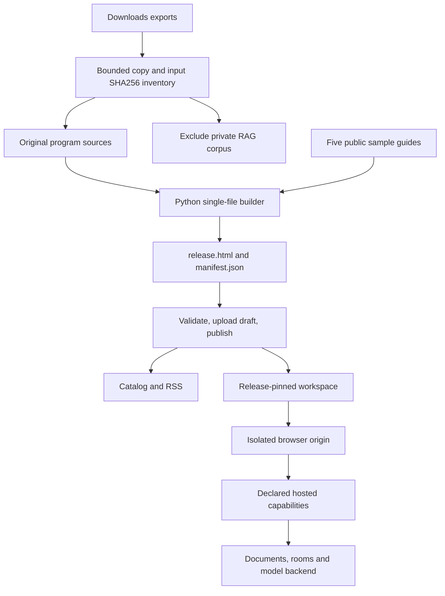

# Artifact import, adaptation and publication guide

## Result and scope

Five actual downloaded applications are packaged and published on slop.boutique: Lattice Rift, Lattice Phantasmagoria, Tabula Workbench, Lattice Deck and RAG Workbench. Downloads contains two separate Lattice ZIPs; both are imported as independent applications. Original Downloads files and copied program sources are preserved. The original private RAG corpus is excluded from both the repository and published HTML.

This is a content import using the existing Francois platform. It adds no backend service, queue, framework build, npm dependency or platform compatibility layer. The release builder uses only Python's standard library. The changes are script/resource embedding, a narrow room-presence correction, a lower default RAG model concurrency and toolbar space for the site's floating Close link.

## What a hosted artifact contains

Francois publishes an immutable release containing one HTML document and a capability manifest. A catalog entry provides the title, description, tags and write-up. A workspace pins a release and opens it on an isolated application origin. Publishing a correction updates the catalog's latest release, while existing workspaces continue using their pinned code until explicitly upgraded.

The downloaded ZIPs contain classic JavaScript files and an index.html. They are not package-manager source projects: there is no package.json or Vite project to compile. Their build consists of embedding files in the right order. The two HTML exports already contain their program bundles.



## Files and source boundary

`examples/imports/<artifact>/source/` contains the original program files. `release.html` is the exact generated upload; `manifest.json` declares requested capabilities. The copy script records original paths, sizes, hashes and archive entries in `sources/inventory.json`. The builder records generated sizes/hashes/manifests in `sources/builds.json`.

`scripts/01-copy-sources.py` validates relative archive paths, rejects unsafe entries, bounds expanded input at 32 MiB and refuses to overwrite changed source copies. It excludes RAG's corpus.json before copying program files. The original ZIP is untouched. Source identity is reviewable against Downloads without exposing the original dataset publicly.

The original RAG corpus contains customer/project notes marked publish:false. None of that corpus is part of these releases. `examples/imports/rag-workbench/demo-corpus.json` contains five authored public guides: hosting, model limits, storage policy, tours/operations and retrieval. An additional public Markdown upload fixture exercises storage in the test workspace. Private uploads by real users remain runtime data, not release contents.

## Exact application adaptations

| Application | Packaging and hosting changes | Requested capabilities |
| --- | --- | --- |
| Lattice Rift | Inline its five local scripts; reserve 96px at the header's right edge for Close | Empty manifest; browser-only app |
| Lattice Phantasmagoria | Inline its five local scripts in export order | Empty manifest; browser-only app |
| Tabula Workbench | Preserve the existing bundled program; add toolbar clearance | sample, downloads |
| Lattice Deck | Preserve bundle; wrap two room.presence call sites in Promise.resolve before .catch; add toolbar clearance | sample, db, profile user, room |
| RAG Workbench | Inline scripts; embed 29 presets, public corpus and library source; replace four local resource fetches; choose minimal lexical search initially; lower default map concurrency from three to one; add toolbar clearance | sample, db, profile user, downloads |

The platform normalizes empty manifests to its default sampling declaration. The graphics applications themselves do not call a model. The table describes application requirements rather than claiming empty input prevents the platform's default grant.

Deck assumed room.presence returns a Promise, but the supported runtime method is fire-and-forget. `Promise.resolve(room.presence(...)).catch(...)` corrects those application call sites without changing the runtime or adding an adapter. Both original call sites are preserved in source; the builder asserts exactly two replacements.

RAG previously fetched presets/index.json, individual preset scripts, corpus.json and rag.js source relative to the document. A single hosted HTML cannot serve those companion files. The builder embeds them in a JSON script block and replaces those four fetch sites explicitly. It does not intercept global fetch or add an asset server. Less-than signs in embedded JSON and closing-script sequences in JavaScript are escaped so the HTML parser cannot terminate the block early. The embedded library source round-trips exactly.

The minimal RAG preset uses lexical retrieval and starts with model concurrency as its query, producing useful results from the public guides without consuming model capacity. Other presets remain available as examples. The existing asynchronous map default is one model call; explicitly configured higher concurrency remains subject to the platform's one-call-per-user admission limit.

Pinned external React/ReactDOM, Three and HTM scripts and Google Fonts are retained from the exports. These releases are self-contained with respect to local application files; they still require those external dependencies where originally used. Their visual design is preserved.

## Build and inspect locally

Run from the Francois repository root:

```sh
python3 ttmp/2026/10/16/FRANCOIS-009--import-real-html-artifacts-as-hosted-proofs-of-concept/scripts/01-copy-sources.py
python3 ttmp/2026/10/16/FRANCOIS-009--import-real-html-artifacts-as-hosted-proofs-of-concept/scripts/02-build-imports.py
```

The first command needs the original Downloads exports; the second builds entirely from tracked program sources and the public corpus. Repeating the build must leave identical release bytes and build inventory. Every generated HTML remains well below the configured release size limit.

The packaging algorithm is intentionally direct:

```text
for each application:
    read its original index.html
    apply the few explicit application edits, asserting expected matches
    for each local script tag in document order:
        read its source and replace the tag with an inline script
    for RAG:
        embed public corpus, preset code and library source
        replace known local resource reads with that bundle
    write release.html, manifest.json and SHA256 receipt
```

The real local test server is http://localhost:8090. Use the catalog launcher and isolated workspace iframe rather than opening release.html as a local file: the latter cannot exercise grants, hosted documents, sampling or collaboration. `scripts/03-local-browser-check.js` runs inside the configured Playwright browser tool, opens all five through Open, records startup errors and captures screenshots.

## Publish through the existing API

An administrator or authorized creator uses the following existing endpoints. Their implementation is in `pkg/catalog/studio.go`; request parsing is in `pkg/catalog/admin.go`, release storage/validation in `pkg/catalog/releases/releases.go`, and workspace upgrade behavior in `pkg/catalog/instances.go`.

| API | Purpose |
| --- | --- |
| GET /api/session | Obtain the signed-in session's CSRF token |
| POST /api/studio/releases/check | Validate multipart artifactId, version, manifestJson and html before upload |
| POST /api/studio/releases | Create an immutable draft from the same multipart upload |
| POST /api/studio/releases/{id}/publish | Publish the draft |
| PATCH /api/studio/artifacts/{id} | Set public description, tags and visibility |
| PUT /api/studio/artifacts/{id}/draft | Save the catalog write-up |
| POST /api/studio/artifacts/{id}/draft/publish | Publish that write-up |
| GET /api/instances/{id} | Inspect the workspace's release pin |
| POST /api/instances/{id}/upgrade | Explicitly move a workspace to the corrected published release |
| GET /api/catalog and /apps/feed.xml | Verify public discovery and release RSS |

Mutating session requests carry X-CSRF-Token; the production request client also sends the matching Origin. Local upload uses a hidden browser file input with the existing browser-held session. Production uses the documented Vault-backed administrator's ordinary ZITADEL sign-in, keeps credentials/cookies in memory and closes the browser when finished. No authenticated browser state is exported to disk.

`scripts/04-publish-production.mjs` is the machine-specific operator entry point. It reads the established Vault E2E-admin credential path internally; do not print or pass those values as command-line arguments. It checks HTML SHA256 before reusing a version, never overwrites an immutable release, publishes descriptions/write-ups, upgrades test workspaces and calls `05-verify-production.mjs`. It saves each successful result immediately. With --verify-only it reuses the existing release receipt and does not publish content again. `06-public-evidence.mjs` needs no credentials and captures public catalog/detail evidence.

The supported CLI equivalent is `go run ./cmd/francois catalog releases push --server ORIGIN --token-file PRIVATE_TOKEN --artifact-id ID --version VERSION --html examples/imports/ID/release.html --manifest examples/imports/ID/manifest.json --publish`. Its existing implementation reads an environment fallback, so notify before using it and keep credentials out of output.

## Validation evidence and limits

The checks exercise actual isolated hosted frames, not a screenshot mockup. Rift toggles Freeze/Thaw through real pointer input. Phantasmagoria advances Boot to Cartridges. Tabula builds 151 nodes, changes Inputs!B2 from 420 to 421, observes 421 after reload and restores 420. Deck's scripted stage agent sets speed to 2.4 with no agent error. RAG retrieves Model Limits / Concurrency for model concurrency and retains an uploaded public document after reload through hosted storage.

Three short sequential uncached sampling probes, one per model-capable app, exercise the real quick-tier LunaRoute path. They are capability tests, not full model-generated code-editing sessions. The production receipt includes bounded ledger records attributed by each tested instance to its artifact, with token counts and model. It omits user email, credentials and prompts.

The production test explicitly waits for initialized workbook/retrieval state after reload. A document can reach readyState complete before asynchronous capability initialization finishes; a fixed sleep caused the Tabula reload test race and was replaced. RAG results use signals.q and top(n); their toJSON() representation instead exposes q and a top array. An initial test incorrectly inspected the serialized shape on the runtime object; the final assertion uses the actual API in rag.js:decorateResult. The receipt retains expected ERR_ABORTED requests from deliberate reload/upgrade and event-stream teardown. Unexpected page errors are asserted absent.

Full multi-user room collaboration, every advanced preset, all export formats and broad device/browser compatibility are not qualified by this PoC. One local Download book browser-event probe timed out; export behavior is therefore not claimed as verified. The final screenshots and caption guidance are indexed in `reference/02-screenshot-and-report-evidence-index.md`. The source tree passed a TruffleHog filesystem scan with zero findings.

## Production release and access state

The initial functional qualification is recorded in `various/production-receipt.json`. The later public versions and curated media are authoritative in `various/gallery-publication-receipt.json`: all five use public 0.1.2 releases with unchanged HTML hashes. One cover per app and the remaining selected views are published in its gallery. These public pages are live:

- https://slop.boutique/apps/lattice-rift
- https://slop.boutique/apps/lattice-phantasmagoria
- https://slop.boutique/apps/tabula-workbench
- https://slop.boutique/apps/lattice-deck
- https://slop.boutique/apps/rag-workbench

Public discovery, RSS and the current HTML downloads require no login. After the user requested public access, all five artifacts were marked listed, free-plan eligible and demo-enabled; the existing global demo switch was enabled at settings revision 2. Tours retain 20 minutes, three starts per user/address per hour, five credits per tour, a shared daily budget of 200 and a maximum of 20 active tours. Global model/storage limits remain unchanged. Explicitly approved one-day admin credentials were used only for that single settings change; all content publication used the Studio token and Francois CLI.

`scripts/07-capture-showcase.js` creates the seventeen curated images and `sources/showcase.json` records their captions/hashes. `08-bootstrap-cli-token.mjs` bootstraps a one-day Studio token; its --admin mode requires explicit approval and was approved for the tour switch. `09-publish-galleries.py` performs media upload, page-set/page-publish, public free-sample release publication and the revision-checked setting update through `go run ./cmd/francois catalog ... --format json`. `10-verify-public-galleries.mjs` checks anonymous discovery, image loading, actual HTML hashes and one bounded tour. Tokens remain in private temporary files and are never committed.


## Small public-page follow-up

Public artifact pages now select the most recently published release, offer one HTML download and the current release's attachments, and leave manifests/history in Studio. The selection follows PublishedAt rather than upload order. Historical file APIs and release-pinned workspaces retain their existing access behavior.

Instance detail exposes the artifact's current title after membership authorization. The launcher combines that value with the existing site brand for document.title, matching the artifact page even after renaming and while retaining any private workspace name. Browser-title ownership is cleaned up when leaving the launcher. Source PR #8 deploys these small portal changes separately from content publication.
