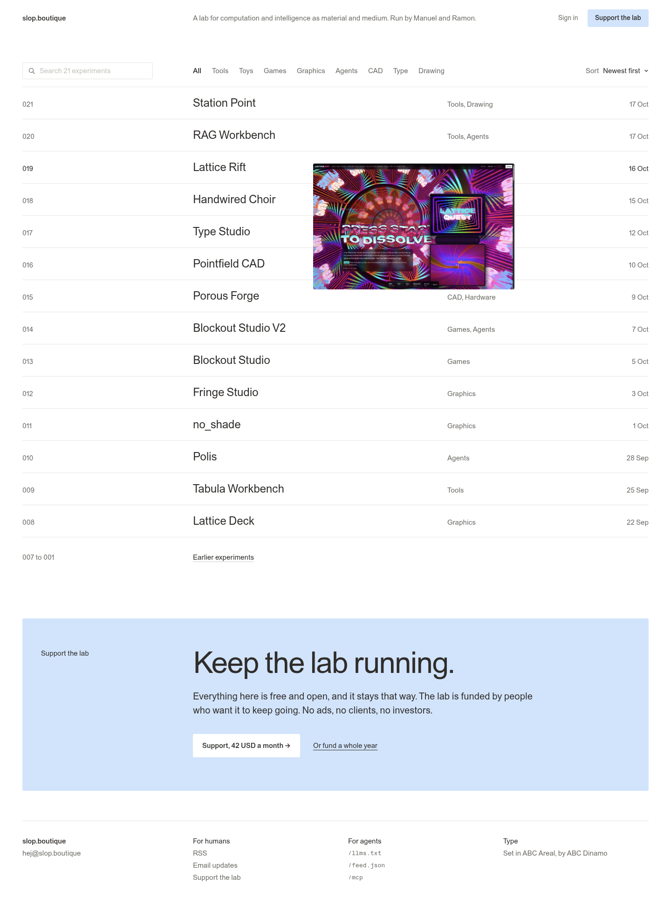
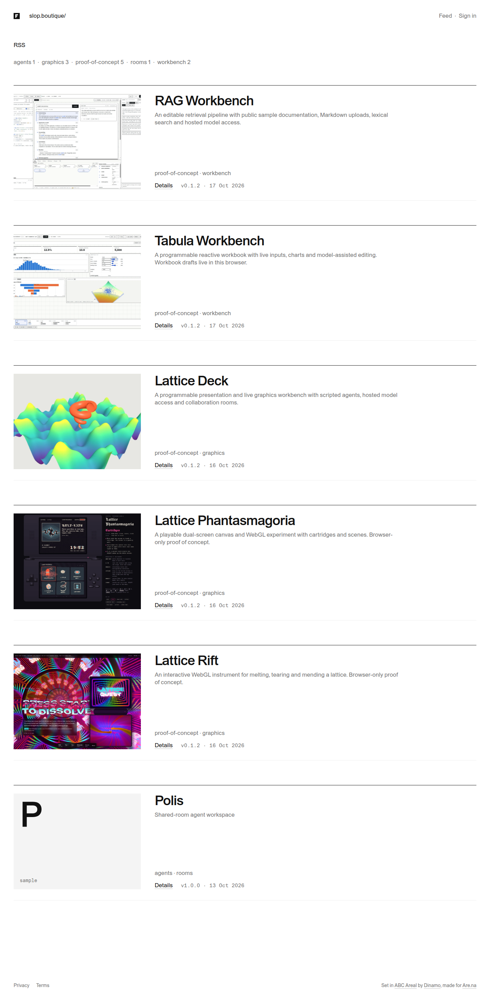
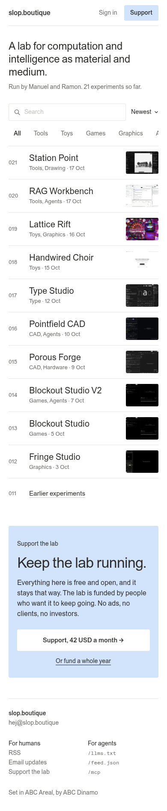
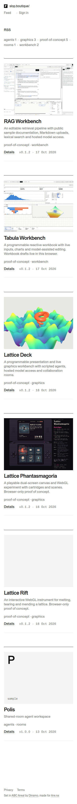
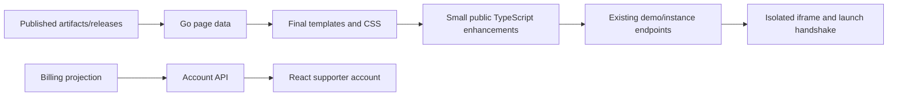
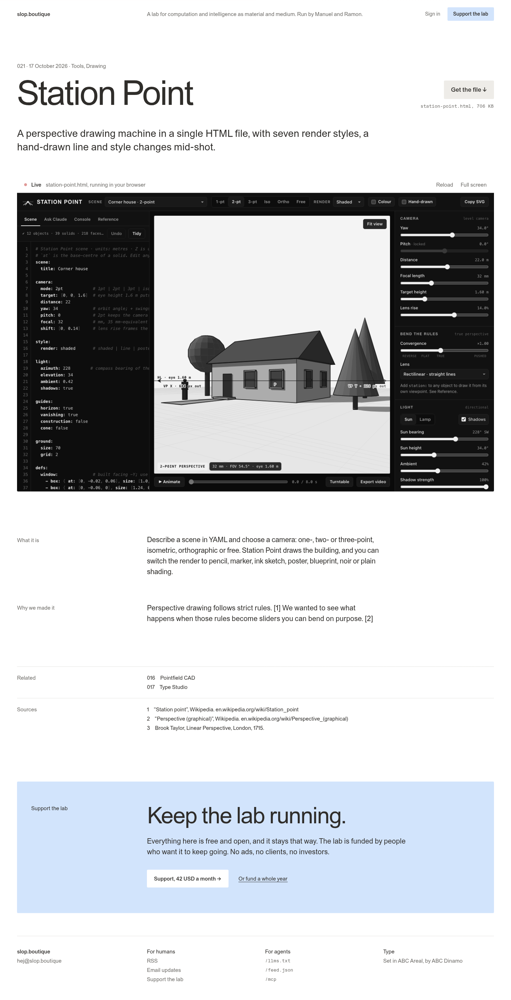
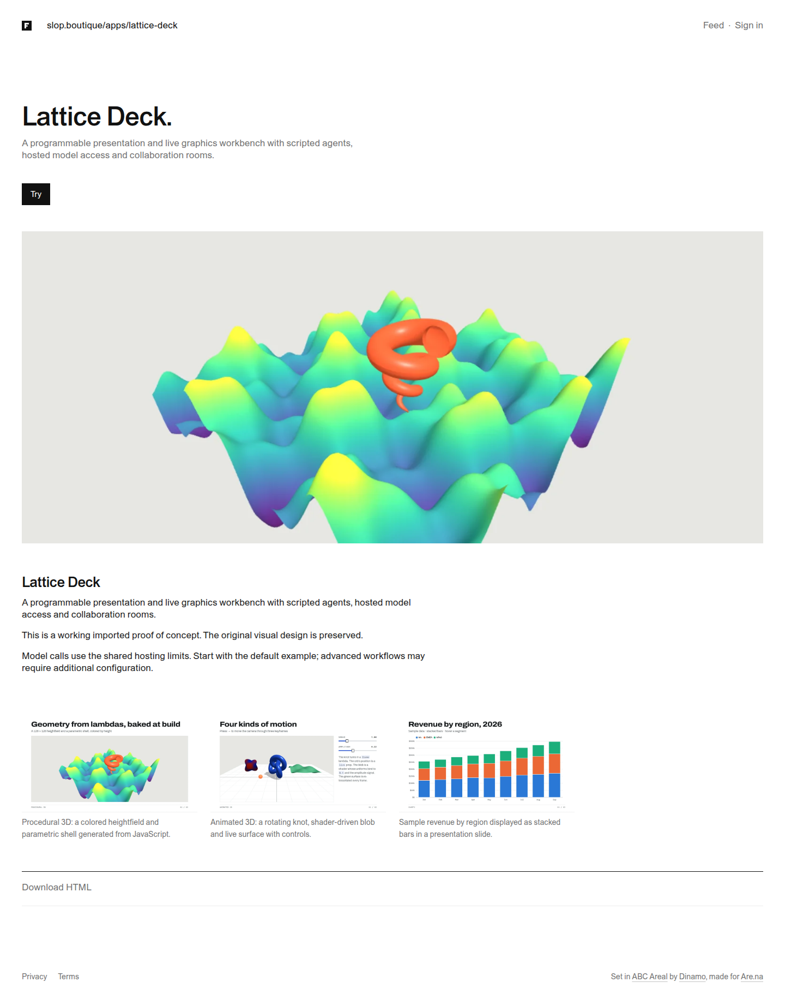

# Final design comparison and implementation plan

## Authority and scope

Ramon’s **Final** page is the visual source of truth: [Paper design](https://app.paper.design/file/01M4XVT9C83GGYK57CMAAAEJJT/p-6-0). This investigation reads its ten artboards, exports their JSX and PNGs, and compares them with fresh production captures at 1440 and 390 CSS pixels. Observations are from 17 October 2026; the repository starts at `57c896c`.

The earlier FRANCOIS-006 document references a different Paper file and sign-in design. Its F mark, address breadcrumb, black primary action, period-suffixed experiment title, and single-line legal footer explain much of the current implementation. Those rules are historical and must not override Final.

This ticket contains investigation and a proposed implementation, **not completed UI changes**. Paper and production were not modified. No payment, sign-in, or demo was started. Signed-in account behavior was inspected in source; its authenticated screen was not captured. Final returned no comment threads with status `all`; comments on other Paper pages were not inventoried.

## The comparison

The existing site uses large image cards with descriptions, versions and separate Details links. Final presents an indexed archive. Experiment pages emphasize the actual application and downloadable file. Supporting the lab becomes a donation relationship rather than a visible product plan.

| Surface | Current site | Final target | Update |
| --- | --- | --- | --- |
| Header | F icon, address breadcrumb, Feed and Sign in | Plain wordmark, lab statement, Sign in, pale-blue Support button | Replace Go and React shells together |
| Desktop archive | Six large cards; 40/42 titles; tag counts and RSS | Number, 24/32 title, categories, date; search/sort; floating preview | New row template and query controls |
| Mobile archive | Large full-width covers and descriptions | Number, 20/24 title, metadata, 76×54 thumbnail | Compact three-column rows |
| Experiment | 48/52 title with added period; Try opens launcher; cover/gallery; bottom download | 96/92 title, index/date/categories, top download, live embed, editorial rows | Restructure detail and embed existing runner |
| Support | Short text and fixed Subscriber plan links; title says Pricing | Principles, adjustable monthly amount, annual funding, contact | New presentation plus payment contract change |
| Sign-in | OIDC redirect; signed-out account offers a button | Branded email form promising a sign-in link | New page and actual email delivery path |
| Account | Heading, Manage subscription, Sign out; staff tokens | Thanks, experiment count, amount/next payment, email, receipts | Supporter summary backed by real data |
| Footer | Privacy, Terms, type credit | Brand/contact, For humans, For agents, type credit | New shared footer and working destinations |
| Support callout | Absent | Pale-blue Keep the lab running section | One reusable block |





The overlaid archive image depicts an active preview state. It does not establish a pointer-following animation. A restrained hover/focus preview is enough. Touch layouts use the inline thumbnails shown in Final, rather than large permanent covers.

## Exact design measurements

These values come from exported JSX and selected computed styles. `sources/paper-*.jsx` preserves all ten artboards; `sources/paper-tokens.css` preserves token declarations. Final has literal overrides: its pale blue is `#CEE5FF`, regardless of the file’s other blue tokens. A generic token sheet is insufficient.

| Property | Desktop 1440 | Mobile 390 | Current |
| --- | --- | --- | --- |
| Page gutter | 48px | 20px | Clamp 20–40px |
| Label/content alignment | 342px label, 24px gap | Stacked | Generic 300px label, 40px gap |
| Wordmark | 15/22, weight 500 | 16/22, weight 500 | Icon plus address |
| Header | 20px vertical padding | 60px tall, bottom rule | 36px top padding; wrapping mobile navigation |
| Archive search | 280×36; controls 56px top/16px bottom | 40px tall; categories below | No search/sort |
| Archive title | 24/32, regular, −.01em | 20/24, regular | 40/42 or 26/30, medium |
| Archive row padding | 18px vertical | 12px vertical | Large image cards |
| Experiment title | 96/92, regular, −.045em | 44/44, medium, −.035em | 48/52 or 34/38 |
| Experiment description | 28/38 | 22/30 | 17/22, muted |
| Live surface depiction | 1344×840 | 350×219 | Separate full-window launcher |
| Editorial body | 20/30, 660px column | Label above prose | General Markdown block |
| Sign-in title | 48/52 | 36/40 | No local sign-in page |
| Support callout title | 64/64 | 34/36 | Absent |
| Callout/action treatment | Pale blue/gray, 3px radius | Same | Square black primary actions |

Shared colors resolve to ink `#2F2D2A`, muted `#6F6C67`, rule `#E7E5E1`, and table/button gray `#EEECE8`. Continue using the already self-hosted ABC Areal and ABC Areal Mono. Implement responsive relationships, not fixed-width artboards pasted into the site. Use semantic headings, anchors, forms and labels; the exported divs are measurement evidence.

The mobile archive adds a 24/30 lab statement and a smaller dynamic experiment count below its header. Other mobile pages keep the compact header without this introduction. Categories should scroll horizontally; copying the design’s clipped overflow would make some filters inaccessible. The mobile footer stacks brand/contact, two parallel link columns, then type credit.





## Existing architecture and implementation approach

Public pages are Go templates populated by `pkg/catalog/pages.go`. `layout.tmpl` contains their shell, `home.tmpl` the feed, `artifact.tmpl` the detail, and `pricing.tmpl` support. Small enhancements live in `ui/catalog/public.ts`, compiled into a hashed static asset. Account, Studio, Admin and instance launch use React/Redux/RTK Query; their separate shell is in `ui/catalog/ui.tsx`. Both use `pkg/catalog/web/static/catalog.css`.

Keep this arrangement. No framework migration, search service, queue, new scheduler, or deployment service is needed. Introduce a few named public-page CSS classes. Avoid broad changes to generic `.row`, `.btn`, `.sheet` or headings that would unexpectedly restyle Studio, analytics and Admin.



### Shared shell, callout and footer

Replace the template and React shells together. The wordmark goes home. Public navigation shows Sign in and Support; authenticated supporters get the thanks/account state. Staff retain reachable Studio/Admin links through their account or staff navigation. Guest demo sessions are not supporter accounts.

Add one Go template definition for the blue callout, used on archive/detail. Its content must align with the global content column despite its inset: the desktop inner label is 302px plus a 24px gap after 40px padding. Reusing the outer 342px label inside that inset would misalign it.

RSS can use existing `/feed.xml`; Account uses `/account`; contact uses the design’s mailto address. Keep Privacy and Terms available as secondary legal links. Email updates needs a real signup/contact destination: no subscription interface was found. Production returned **404** for both `/llms.txt` and `/feed.json`; add small public representations using existing published-content visibility rules. `/mcp` has an optional configured mount; verify deployment availability and authentication before advertising it. Do not weaken its authorization to make a footer link work.

### Archive: ordinary HTML, GET parameters, stable numbers

`feedPage` already loads public content and filters tags, but mixes artifacts and posts and uses the latest release date. Final depicts experiments. Proposed content policy: use the experiment archive at `/` and `/apps`, keep writing at `/journal` and in combined RSS. All three paths currently share the mixed handler, so changing the home template alone is insufficient. This policy is inferred from the artboards, not a specified Paper interaction.

Use a GET form with `q`, `tag`, `sort` and, when needed, bounded `page`. Start with case-insensitive matching over title, description and tags in the already-loaded public list. Six current entries do not need a search index. A native select with newest/oldest is enough initially; the design only specifies the default label, not its menu. Preserve query parameters across search, category and pagination links.

Numbers must remain attached to experiments through filtering, sorting, new releases and additions. There is no archive-number field today. Add a nullable unique integer on artifacts, assign it transactionally on first publication, and backfill published artifacts deterministically by first-publication date and ID. Do not show row position as identity or repurpose SortOrder. Use first publication for the experiment date; release feeds keep their release dates. One new release must not count as another experiment.

```text
all = listed artifacts with published releases
for each artifact:
    number = persisted archive number
    date = earliest published release date
categories = distinct public tags from all
filtered = all matching q and tag
ordered = sort(filtered, selected date order, stable number tie-break)
render bounded page, total count, selected controls and next link
```

Use real categories and an editorial pass to align current `proof-of-concept`, `workbench`, `rooms`, etc. with Ramon’s vocabulary. Do not invent experiments or empty categories to reproduce the 21-entry mockup. Earlier experiments becomes pagination only when enough content exists.

A single decorative desktop preview can use the active row’s cover, with pointer events disabled and a clamped position in the list. Show it on hover and keyboard focus; hide it on exit/blur. No animation is necessary. Mobile uses a 36px number slot, flexible title, 76×54 image, 12px gaps and 13/20 metadata. All navigation must work without preview JavaScript. Escape search values, encode query links and provide empty-results/clear states.

### Experiment: download first, embedded execution, authored prose

Retain `artifactPage`’s latest-release selection and single-download behavior. Extend its download view model with the file’s existing name and size. Put Get the file next to the desktop title and full-width below the mobile description. Serve downloaded HTML as an attachment, never as portal-origin executable content. Current sample releases are downloadable, but other releases still depend on entitlement; Final’s all-free promise requires an explicit public-download rule, not changed copy alone.

The live surface is the largest functional change. Paper embeds a screenshot of an app; its Live/Reload/Full screen labels imply behavior, but the screenshot is not a working runner. The existing runtime isolates HTML on an instance origin. `Launcher` in `ui/catalog/instances.tsx` already implements its challenge exchange, exact origin/source checks, launch-denied state and iframe sandbox.

Reuse that protocol. Extract a small iframe-launch helper used by both the public script and React launcher, rather than load the entire Admin/Studio bundle into the public detail page. This shares the current implementation; it does not add a compatibility layer or second runner.

```text
start this experiment:
    open existing instance for an eligible authenticated user
    otherwise POST /api/demos with artifactId
    obtain instance origin using the existing instance contract
    set iframe source to that origin + /launch
    on a ready message from this exact frame and origin:
        validate challenge
        POST /api/instances/{id}/launch with challenge and CSRF token
        post returned launch code to that exact frame origin
    show Live after success; show service message on denial
```

Demo creation mutates state, may set a guest cookie, spends a visit and occupies an active slot. Do not create one while rendering a GET, prefetching archive links, or showing a hover preview. **Embed startup policy needs an explicit implementation choice:** auto-starting the single visible detail embed matches Final’s depicted Live state but spends a visit on a page view. An inline start over a poster is cheaper but introduces a resting state absent from Final. Keep Ramon’s layout either way; settle startup behavior before enabling automatic creation. Do not silently substitute an unlimited shared instance.

Reload must reuse the active instance and its handshake, not allocate another visit. Fullscreen should use the same iframe wrapper, with a direct instance-page link where fullscreen is unavailable. Preserve expiry, rate limits, LLM/storage kill switches and concise warning states. Lane counts, token budgets and analytics remain server concerns; no customer usage dashboard is needed.

What it is, Why we made it, Related and Sources need actual editorial content. Current `store.Page` only holds body, cover and gallery. A small JSON document extension can hold those two prose fields, related artifact IDs, and source label/URL pairs, using the existing draft/publish flow and Studio editor. Render only public related entries. Keep Markdown for supplementary material; deliberately edit imported content into the new fields instead of parsing arbitrary headings. No separate CMS or citation database is needed.





### Support and account: real contracts behind the controls

Rebuild `pricing.tmpl` around the principles, monthly amount control, yearly funding and contact. Use a numeric input with decrement/increment controls. Server validation sets allowed bounds, currency, interval and precision. The design suggests 42 USD/month; its `999,999.99 USD` yearly figure is unverified commercial intent, not a price to charge automatically. A working contact destination is the smallest honest annual-funding action until a real amount is configured.

Current `POST /api/billing/checkout` accepts `{plan, interval}` and selects a server-configured price. `payments.CheckoutRequest` carries PriceID and the gateway creates subscription-mode Checkout. These cannot implement an arbitrary donation amount. Extend the existing payment boundary deliberately, retaining ownership, reconciliation and idempotency. Existing entitlement projection is price-based: accepting arbitrary amount/price data without changing that projection would produce wrong support status. Support should not unlock public experiments. Keep public access and resource controls explicit and independent of donation amount.

`GET /api/account` already exposes user identity, subscription projections, billing availability and customer existence. It lacks the supporter start date, readable amount/currency, exact next payment date and receipt links needed by Final. Add a small supporter summary with real provider-owned management links. Count distinct artifacts first published since the actual support start; derive the number with a query, without redundant counters. A non-supporter account needs a neutral support invitation, not invented thanks or billing data.

Use the current Stripe customer portal for amount/billing/cancellation management where configured features support it. Identity email changes must go through the identity provider, not merely edit the Stripe billing email. Download all receipts has no current API: implement verified links/export or provide an honest portal destination while pending. Keep staff API token management outside the ordinary supporter view. The signed-out account shell currently has the generic Francois title; update the document title too.

### Sign-in: connect the promise to email delivery

`/auth/login` creates an OIDC state/nonce/PKCE/binding flow and redirects to the configured provider. No first-party magic-link delivery endpoint was found. Final’s Send link form requires identity work. Prefer the existing provider’s passwordless flow if its supported configuration can deliver the branded journey. Otherwise first-party email login needs single-use hashed tokens, expiry, delivery, rate limiting and session creation. Do not ship a local-looking email form that discards its input and starts an unrelated login screen. Provider capability and configuration were not inspected here.

## Shipping sequence

1. **Shell and archive:** update both shells, Final-scoped CSS, callout, compact responsive rows, stable numbers, GET search/sort/tag behavior and real footer destinations. Replace obsolete design assertions. Capture at 1440 and 390 and commit this visible milestone.
2. **Experiment:** top download and file metadata, title/date/category layout, editorial fields/Studio inputs and embedded runner. Resolve startup policy first. Verify start, reload, fullscreen, expiry and paused-service behavior before the milestone commit.
3. **Support, identity and account:** ship working support destinations, validated custom support, truthful account data and real email login. Keep payment and identity changes focused with their specific tests. Do not publish unfinished controls as working promises.

Deployment follows implementation and review through the existing pipeline. This comparison changes no production code or k3s configuration.

## Validation and acceptance

For shell/archive, extend `layout_test.go` and `storefront_test.go` for public visibility, query combinations, stable numbering after filtering/new release, empty states and destinations. `TestArealLayout` explicitly enforces the old footer; update those requirements rather than preserving the wrong design. Compare both target widths and one intermediate width, keyboard navigation, category scrolling and no page overflow. Different real titles/content make strict pixel equality to Station Point inappropriate.

For embeds, retain exact frame origin/source checks and CSRF protection. Test reload without another allocation, demo reuse, expiry and disabled-service messages. Rerun affected hosted/cache tests: private grants and launched HTML must not become cacheable when moved inline. Preserve FRANCOIS-010’s hashed assets, WebP media, gzip and conditional requests.

For billing/authentication, verify amount validation, customer ownership, signed webhooks, accurate supporter projection and receipt links. If first-party magic links are needed, test single use, expiry and delivery failures. Run the project’s required build/test checks when code changes. No runtime code changed in this investigation, so its validation is document/evidence checking, not an application test pass.

## Evidence and file map

- `sources/live-observations.json`: captured URL/status/title/text/heading measurements at both widths and the two observed 404s.
- `sources/live-*.png`: eight production captures. Signed-in account is intentionally not claimed. Full-page capture can leave offscreen lazy images unloaded; these establish layout, not a media-loading benchmark.
- `sources/paper-*.png` and `sources/paper-*.jsx`: all ten Final artboards, paired by name and width.
- `sources/paper-computed-styles.json`, `paper-tokens.css`, `paper-export-receipt.json`: measurement/export receipts; returned token hash `74b865ac`.
- `sources/paper-comments.json`: empty Final comment inventory.
- `scripts/01-capture-live.mjs`: isolated read-only browser capture; no credentials or storage exported. Binary/module paths describe this machine.

| Files | Responsibility |
| --- | --- |
| `pkg/catalog/pages.go`, `routes.go` | Page models, archive route policy, new public destinations |
| `pkg/catalog/web/templates/layout.tmpl`, `home.tmpl` | Public shell, callout, compact archive |
| `pkg/catalog/web/templates/artifact.tmpl`, `pricing.tmpl` | Experiment and support structure |
| `pkg/catalog/web/static/catalog.css` | Final public styles and responsive geometry |
| `ui/catalog/ui.tsx`, `account.tsx` | React shell and supporter account |
| `ui/catalog/public.ts`, `instances.tsx` | Public controls and existing launcher protocol |
| `pkg/catalog/store/releases.go`, `ui/catalog/studio.tsx` | Editorial document and editor changes |
| `pkg/catalog/auth.go`, `demos.go` | Identity and bounded guest execution |
| `pkg/catalog/payments/service.go`, `gateway.go` | Existing billing boundary to extend |
| `pkg/catalog/layout_test.go`, `storefront_test.go` | Current layout rules and visibility tests |

These are existing implementation entry points, not code files changed by this ticket.
