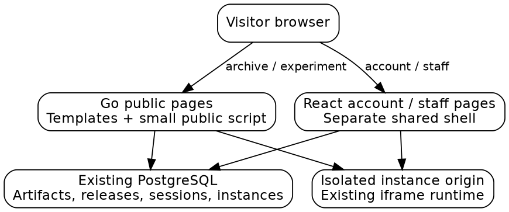
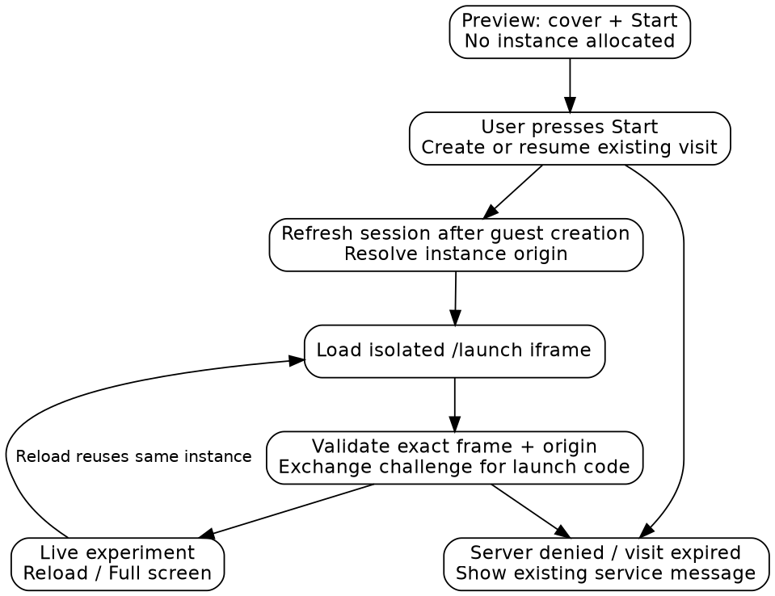

# Implementing Ramon’s Final visual design

## 1. The application you are changing

Slop Boutique publishes interactive HTML experiments. An **artifact** is the catalogue entry for one experiment, such as Lattice Deck. A **release** is a published version of that artifact, containing the HTML file and optional attachments. **Media** are uploaded images or videos used to explain the experiment. These objects exist independently: replacing a cover image does not create a release, and publishing a release does not create another experiment.

The trusted website shows the archive, descriptions and account controls. Executable experiment HTML runs in an iframe on a separate **origin**, meaning a separate scheme, hostname and port from the trusted website. A hosted **instance** supplies an experiment with its own saved state and limited access to server functions. This separation prevents uploaded code from becoming website code. You are changing the website’s presentation and where its existing runner appears, rather than creating a different hosting platform.

Ramon’s [Final page in Paper](https://app.paper.design/file/01M4XVT9C83GGYK57CMAAAEJJT/p-6-0) supplies the target appearance. The earlier comparison ticket, FRANCOIS-011, contains ten exported artboards, exact JSX styles and eight production screenshots. Treat those exports as a measured reference, not production markup to paste into the application. The reader should be able to follow one example: a visitor finds Lattice Deck in a compact archive row, opens its detail page, downloads the current HTML file or starts the existing bounded visit within the page.



This guide prescribes a small implementation. Keep server-rendered public pages, the existing React account interface and the existing hosted runtime. Do not introduce a UI framework, another API service, a content-management system, a search index or a scheduling layer.

## 2. Ticket boundary and the deliverable

The deliverable is the Final public shell, compact archive and experiment layout, with responsive controls and the existing execution flow embedded in the detail page. Support and account receive the same visual language while continuing to expose their real current actions. FRANCOIS-013 owns the working email form, delivery and verification. Authentication logic does not belong in this ticket.

The designs also depict custom donations, receipts and machine-readable links. Those capabilities are not implemented merely by drawing controls. This visual change does not change payment amounts, access rules or identity ownership. Render available billing data and working existing checkout/portal links; omit unavailable controls rather than publish fake amounts, receipt histories or a nonfunctional amount stepper. This is a precise limit on this ticket, not a claim that the current APIs implement every interaction drawn in Final.

The following choices apply now:

- The archive shows experiments; writing remains at `/journal` and in the existing combined RSS feed.
- Search and sort use ordinary URL query parameters and server rendering.
- Archive numbers are display ordinals computed from the complete published set before filtering; artifact IDs remain the actual identifiers.
- The experiment starts when the visitor explicitly presses its inline start control. Page loading and hovering allocate no instance.
- Existing Markdown holds the explanatory content. Use conventional headings to style sections; do not add a document schema or editor subsystem for this change.

The ordinal choice deliberately simplifies FRANCOIS-011’s preliminary persisted-number proposal. Numbers stay the same while filtering or sorting the same archive, but removing/backfilling an experiment can renumber the archive. They are never URLs, foreign keys or permanent identifiers. This visual ticket needs no database migration.

## 3. How the existing page reaches the browser

`pkg/catalog/routes.go:32` registers the public routes. A request to `/` invokes `feedPage`, which collects public artifacts and published content. `pkg/catalog/pages.go:131` renders the resulting page model through Go’s `html/template`. The template engine escapes ordinary text and attributes. `layout.tmpl` supplies the header, document metadata, static links and footer, while `home.tmpl` or `artifact.tmpl` supplies the main content.

Public JavaScript lives in `ui/catalog/public.ts`. It enhances session-sensitive actions without making the whole page a React application. `scripts/build.mjs` builds this source to the embedded public bundle. The account, Studio, Admin and full instance launcher instead enter through `ui/catalog/main.tsx`; their Header and Footer are separately implemented in `ui/catalog/ui.tsx`. Both paths use the same `catalog.css` stylesheet.

This duplication matters. Updating only the Go header leaves account pages looking like the old site. Updating generic heading or row rules can also damage administrative pages. Change the two shells together and use explicit public classes such as `.site-header`, `.archive-row`, `.experiment-header` and `.support-callout`.

| Existing file | Read it for | Change in this ticket |
| --- | --- | --- |
| `pkg/catalog/pages.go:97` | Page and card view models | Add archive display data and file metadata |
| `pkg/catalog/pages.go:200` | Selecting listed artifacts and current releases | Collect first-publication dates while traversing releases |
| `pkg/catalog/pages.go:263` | Combined feed and tag filtering | Separate experiment archive from journal view |
| `pkg/catalog/pages.go:369` | Detail page, gallery and latest download | Build the Final detail view model |
| `pkg/catalog/web/templates/layout.tmpl` | Public shell and card definitions | New header, footer and reusable callout |
| `pkg/catalog/web/templates/home.tmpl` | Current feed body | Archive controls and compact rows |
| `pkg/catalog/web/templates/artifact.tmpl` | Current detail body | Top download, runner and editorial sections |
| `pkg/catalog/web/static/catalog.css` | Existing typography and responsive styles | Scoped Final rules |
| `ui/catalog/ui.tsx` | React shell | Match the public shell |
| `ui/catalog/public.ts` | Try, Open and checkout enhancement | Inline start, preview and runner controls |
| `ui/catalog/instances.tsx` | Existing iframe handshake | Reuse its launch protocol |
| `pkg/catalog/web/embed.go` | Embedded assets and hashed URLs | Preserve existing asset delivery |

The line references describe the source at `dbef98e`; symbols remain the useful anchors after editing.

## 4. The measured design

Final’s desktop artboards are 1440 pixels wide and its mobile artboards are 390 pixels wide. Desktop uses 48px outer gutters; mobile uses 20px. The desktop label column is 342px followed by a 24px gap. For example, the archive’s experiment title aligns with the header’s lab statement and the detail page’s editorial prose. This repeated alignment is a central part of the design.

| Element | Desktop target | Mobile target |
| --- | --- | --- |
| Wordmark | 15/22px, medium | 16/22px, medium |
| Header | 20px vertical padding | 60px height and bottom rule |
| Archive title | 24/32px, regular | 20/24px, regular |
| Archive row padding | 18px vertical | 12px vertical |
| Search | 280×36px | Flexible width, 40px high |
| Experiment title | 96/92px, regular | 44/44px, medium |
| Experiment description | 28/38px | 22/30px |
| Editorial text | 20/30px, 660px column | Stacked label and text |
| Runner depiction | 1344×840px | 350×219px |
| Callout title | 64/64px | 34/36px |

Here `24/32px` means a 24px font size and a 32px line height. Continue using the self-hosted ABC Areal and ABC Areal Mono fonts. Colors are ink `#2F2D2A`, muted `#6F6C67`, rules `#E7E5E1`, gray actions `#EEECE8` and pale-blue support surfaces `#CEE5FF`. The Final blue is a literal override in the artboards; do not substitute an unrelated blue from the file-wide token sheet. Small corners use 3px rounding.

Implement these reference dimensions responsively. At widths where the desktop columns no longer fit, use the mobile composition: numbered row, flexible title/metadata, and a 76×54px thumbnail. Use a practical breakpoint around 900px for the compact composition and verify an intermediate width. This breakpoint is an implementation choice, not a measurement claimed from Paper. Do not give the document a fixed 1440px width or copy the artboard’s clipped overflow.


## 5. Archive data and a complete example

The archive can use data already loaded by `cards`: artifacts, published releases and their media. While traversing published releases, retain both the latest release for launching/downloading and the earliest publication date for the experiment’s archive date. These dates answer different questions. A release update should not make an old experiment appear newly created.

Build the full oldest-first public list using first-publication date and artifact ID as the tie-break. Assign display ordinals starting at one, then filter and sort that numbered list for presentation. No number is stored in PostgreSQL. Do not assign numbers after filtering: searching for Lattice Deck should not rename it to experiment 001 just because it is the only match.

```text
public = artifacts that are listed and have a published release
for each artifact:
    firstPublished = minimum published release date
    currentRelease = latest published release
ordered = sort public by firstPublished ascending, ID ascending
for index, artifact in ordered:
    artifact.displayNumber = index + 1
categories = unique tags across ordered
matches = rows matching q and selected tag
sort matches by selected date direction, ID tie-break
render matches and selected controls
```

A proposed view model, not an existing API response, is:

```go
type ArchiveRow struct {
    Number int
    ID, Title, Categories, Date, Href string
    Cover *store.Media
    FirstPublished time.Time
}
```

`GET /?q=lattice&tag=graphics&sort=oldest` should render only matching public experiments, in oldest-first order, with their original full-list numbers. Match the normalized search text against title, description and tags. The catalogue currently has six entries, so a plain in-memory filter over this already-loaded list is adequate. A normal GET form works without JavaScript and provides shareable, bookmarkable results.

Whitelist `sort` to newest/oldest, defaulting to newest. Preserve `q` and `sort` when changing category and preserve the category when submitting search. Use `url.Values` for query generation and templates for escaping. Empty results show a short message and a Clear filters link. Do not hardcode 21 experiments or include nonexistent categories to reproduce the mockup. With six entries, render all; do not add pagination just to draw Earlier experiments.

The desktop preview is one decorative image for the active row. Make it respond to pointer hover and keyboard focus, keep pointer events disabled, and hide it on exit. Clamp it within the visible page and avoid animation. Every title remains a normal link. On touch widths, hide the floating image and show the inline thumbnail instead.

## 6. Experiment page and the existing runner

The detail header displays the archive number, publication date, categories, unmodified artifact title and short description. Remove the helper that adds a period to the experiment title; Final shows Station Point without punctuation added by the system. Retain sensible wrapping for long real titles such as Lattice Phantasmagoria.

Move the one current HTML download into the header. `ReleaseFile` already has Name and Size. Extend the `download` view model rather than query the file again or construct a new download route. The existing endpoint returns an attachment; keep that behavior so downloaded HTML does not execute as trusted portal content. Keep real attachments available in a secondary list without adding a second copy of the main download.

The embedded runner has three states that can be implemented with a small controller: Preview, Starting, and Live. Preview shows the existing cover and an inline start button. Starting disables duplicate starts. Live contains the same isolated iframe used by the current launcher, with Reload and Full screen controls. A failed or expired visit shows the server’s concise service message and a return/start action as appropriate. Do not label a static screenshot Live.



Use the existing endpoints, with the existing session and CSRF behavior:

| Existing endpoint | Purpose and input |
| --- | --- |
| `GET /api/session` | Read session eligibility and browser CSRF token |
| `POST /api/demos` | Start/resume bounded visit with `{artifactId}` |
| `POST /api/instances/open` | Open eligible signed-in instance with `{releaseId,title}` |
| `GET /api/instances/{id}` | Resolve instance data, including its origin |
| `POST /api/instances/{id}/launch` | Exchange iframe challenge with `{challenge}` |
| Instance origin `/launch` | Load the existing isolated launch page |

```text
on Start:
    set state Starting; disable Start
    get current session
    create/resume eligible instance using the existing action choice
    after a guest visit is created, discard the cached session promise
    fetch a fresh /api/session to get its new CSRF token
    fetch instance data and set iframe to instance.origin + /launch
    on message:
        require event.source == this iframe.contentWindow
        require event.origin == this instance.origin
        require ready type and a string challenge
        request launch code with CSRF header
        post code to this exact origin
    on successful launch: show Live controls
    on denied request: show its service message
```

The current public script caches its session promise. A guest start creates a new browser session, so invalidate that cache and fetch the new session before sending a CSRF-protected launch request. The old separate-page flow gets this refresh naturally; the inline flow must do it explicitly.

Extract only the shared launch-message handling needed by the public controller and React launcher. Preserve the exact origin/source checks and existing iframe sandbox attributes. Reload resets the existing iframe and repeats the handshake; it must not create another instance. Fullscreen targets the same wrapper, with a direct `/instances/{id}` link if the browser cannot provide fullscreen. Do not mount the entire React Admin bundle to support this one public embed.

This explicit start is intentional: a page view or preview hover must not spend demo starts or occupy active slots. Existing budgets, expiry, six-lane model admission and kill switches remain authoritative. Starting an experiment does not imply starting an LLM request; lanes are used only when the experiment actually asks for a model operation.

## 7. Editorial sections, support and the shared shell

Keep `store.Page.Body` as Markdown. Edit the five imported experiments to use `## What it is`, `## Why we made it`, and optional `## Related` and `## Sources` sections. In `pages.go`, a small rendered-view pass can group top-level Markdown heading nodes into label/content sections using the existing Markdown AST, rather than matching HTML with regular expressions. Treat unknown headings and preamble as ordinary supplemental prose. This changes rendering, not the persisted document schema. Draft/publish and the Studio Markdown editor keep working.

Related references are ordinary links to public artifact pages. Sources are ordinary labeled URLs or text citations. A small handful of authored pages does not need new related-item tables or structured citation forms. Keep gallery media in the detail page when they explain an experiment; use the existing gallery and captions rather than discard the collected screenshots.

The header uses the plain wordmark and lab statement. Mobile places the statement beneath the header on the archive only. The footer uses brand/contact, human links, agent links and type credit. RSS points to working `/feed.xml`; Privacy and Terms remain accessible. Do not expose `/llms.txt`, `/feed.json`, Email updates or `/mcp` as working links until a real destination exists and its access has been checked. The preceding investigation observed 404 for the first two.

Support uses Final’s label/content alignment, explanatory copy, principles and blue treatment. Bind its existing configured checkout links and account portal action. Do not add arbitrary amount processing, receipts, or fabricated dates. A signed-in account uses its real display name/email and the existing subscription-management action, with the new shell. Only render a supporter count if the present data genuinely establishes a support start; this ticket does not add a billing projection. Staff tokens, Studio and Admin stay reachable through account/staff navigation.

FRANCOIS-013 implements `/signin` and the actual email fields. This ticket supplies shared form styles and changes public sign-in links to that route only once it works. Until then the existing OIDC link remains a functioning destination. The two tickets share visual classes, not an extra routing abstraction.

## 8. Implementation order, commands and acceptance

Start by changing the Go/React shells and adding scoped CSS. Next implement the archive view model and GET controls, followed by the detail header/download. Integrate the inline runner only after those pages render correctly. Finish with the authored Markdown sections and real-data support/account presentation. Commit at these meaningful boundaries, recording what was checked in the diary.

Use the existing build path:

```sh
pnpm check
pnpm build
go test ./pkg/catalog/... -count=1
go build ./...
```

`pnpm build` regenerates embedded bundles; stage only intentional outputs required by this repository’s normal asset workflow. Integration tests in `catalog_test.go` skip if `TEST_DATABASE_URL` is absent. For implementation verification, use the local test database and explicitly record whether those tests ran or skipped. Do not call a skipped integration run a pass. If starting a server, use tmux, `go run ./cmd/francois catalog serve`, the existing documented local configuration, and `lsof-who -p PORT -k` when stopping/replacing a server.

Acceptance checks are observable:

- At 1440 and 390px, the header, archive, experiment and footer follow Final’s compositions, using real content and no horizontal document overflow.
- Search, tags and sort work together without JavaScript; filtering does not renumber the same full dataset.
- Desktop previews work with keyboard focus; touch categories scroll and thumbnails remain small.
- A detail page offers one current main download, with correct filename and size, before the runner.
- Loading, searching and hovering create zero instances. Starting creates/resumes one; Reload creates none; fullscreen preserves the same running instance.
- Service pause, demo expiry and launch denial show understandable messages and keep the server restrictions intact.
- Go and React shells agree, and Studio/Admin remain usable after shared CSS changes.
- Public pages retain content-hashed static URLs, compressed assets, WebP media and the current private-grant cache rules.

`pkg/catalog/layout_test.go` presently asserts the old single-line footer and old title rules. Update the expected design rather than preserve those obsolete requirements. Add meaningful archive visibility/query and runner-reuse checks to the existing tests. Compare screenshots at both target widths and one intermediate width; different experiment content makes pixel-identical reproduction of Station Point an inappropriate gate.

## 9. Reading references and handoff

The relevant existing code is in the file table above, plus `pkg/catalog/demos.go` for visit creation, `pkg/catalog/hosted/routes.go` for isolated execution, `pkg/catalog/store/releases.go` for artifact/page/release fields, and `pkg/catalog/web/assets_test.go` for static delivery checks. Static assets remain under `/static/`; licensed fonts remain under `/fonts/`.

Use the Final exports and previous comparison as the source of measurements. The preliminary FRANCOIS-011 ideas about permanent numbers, a new editorial schema, custom billing and automatic embed startup are not requirements of this narrower ticket. This guide replaces them with the concrete choices above. The ticket is complete only when the visual changes and listed checks are implemented; delivery of this guide is the design milestone.
