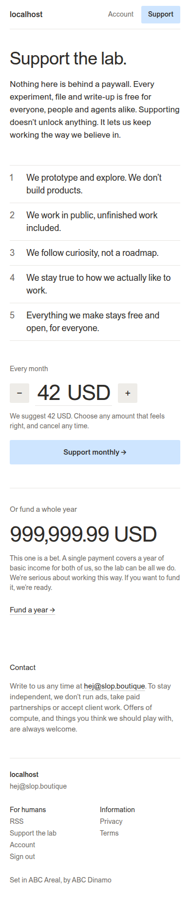
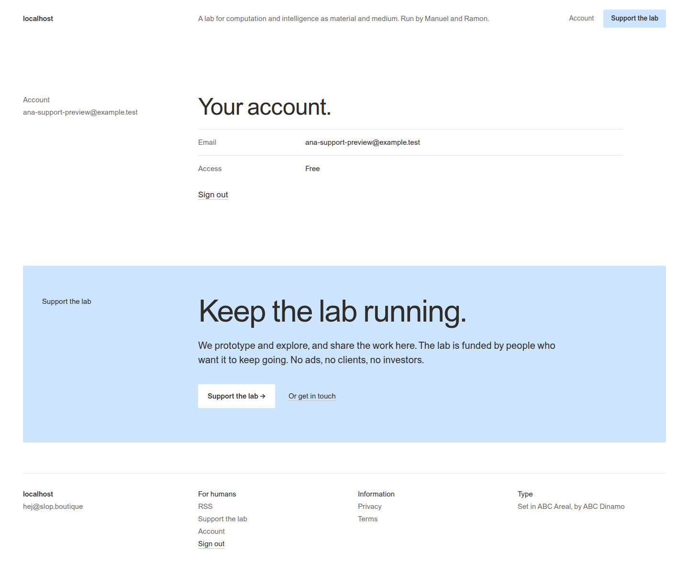
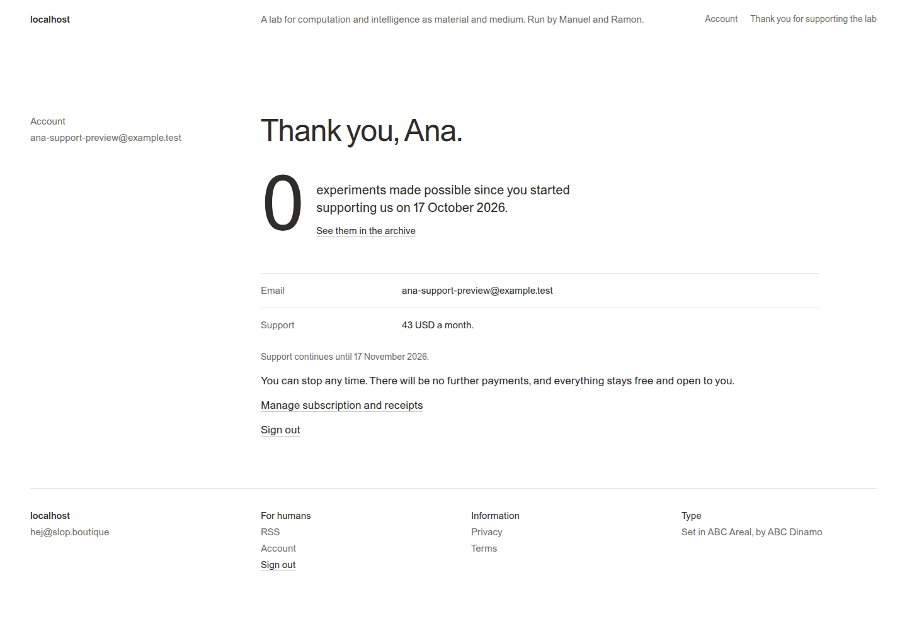
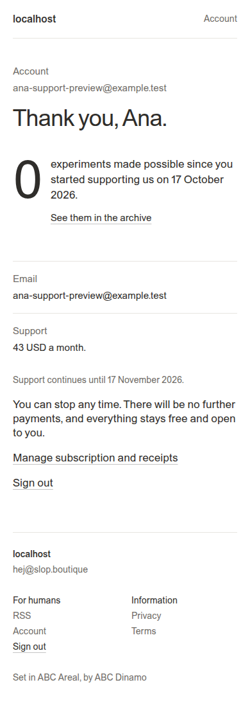

# Restore Ramon’s Final support page

The [single-tier and year-funding follow-up](03-single-subscriber-tier-and-one-time-year-funding.md) supersedes this document’s earlier Free-entitlement and year-contact decisions. The earlier rollout evidence remains historical.

The authoritative reference is [Final in Ramon’s Paper file](https://app.paper.design/file/01M4XVT9C83GGYK57CMAAAEJJT/p-6-0), inspected directly through Paper MCP. Desktop and mobile exports specify a monthly USD input defaulting to 42, minus/plus controls, a pale-blue support action, five principles and a separate year-funding contact action. The current production page only loops over configured fixed-price plans; its single Subscriber plan has an empty label. That is why the intended amount is missing.

## Concrete implementation

Keep the existing Go templates, small public TypeScript bundle, React account page, Stripe gateway and billing reconciliation. Add a monthly-support checkout endpoint alongside the existing plan checkout. A contribution does not grant a higher access plan. Existing plan purchases retain their existing API and rules; the support page presents the contribution workflow.

The browser sends an integer `amountCents` to `POST /api/billing/support`. Accept whole USD amounts from 1 through 9999, enforce those bounds server-side and send Stripe inline `price_data` with currency USD, quantity one and recurring interval month. The server names the product and sets subscription metadata `francois_monthly_support=true`. The browser cannot select metadata, product, currency or recurrence. Reuse the current verified-user, CSRF, customer ownership, open-subscription, checkout admission, idempotency and supersession controls. A changed amount uses a different admission key, so a stale open checkout must be retired before returning another URL.

The existing worker retrieves authoritative Stripe subscriptions and projects the actual price amount and start date. Recognize monthly support only when server-authored metadata, monthly interval, USD and quantity match. Migration 015 adds the amount and start date to the existing projection; no new queue or service is introduced. Preserve actual Stripe price IDs. Never manufacture a canonical price or alias a donation to an access entitlement.

```text
Pricing form → authenticated support endpoint → existing Checkout service
             → Stripe hosted monthly checkout → webhook / existing refresh worker
             → subscription projection → supporter UI
Checkout return → /thank-you → owner-scoped refresh → bounded account polling
```

The return URL is advisory. `/thank-you` uses the account component and displays a checking state until the local authoritative projection confirms active support. A 60-second polling window ends with honest pending feedback if confirmation has not arrived. A query string never establishes supporter state.

## Free account and supporter presentation

Expose a small support summary on the existing account response and a supporter boolean on session responses. Active support requires an active, single-item/single-quantity subscription with a future paid-through boundary. The pricing page, Go public header/footer/callouts and React public shell use that state. Free accounts see the existing blue “Keep the lab running” callout on `/account`; confirmed supporters do not see monthly-support banners. Supporters see Ramon’s thank-you heading, real monthly amount, real start/renewal date and the count of currently public experiments first published since their support began. Do not invent receipts or historical start dates. Receipt downloads and cancellation use the existing Stripe Customer Portal.

The year-funding amount and copy match Paper. Its action opens the lab contact address; it does not initiate a million-dollar payment.

## Files and API contracts

- `pkg/catalog/web/templates/pricing.tmpl`: semantic input, controls and support page copy.
- `pkg/catalog/web/static/catalog.css`: exact exported 56/64px desktop and 44/52px mobile amount typography, 44/40px controls and responsive composition.
- `ui/catalog/public.ts`: input sizing, stepping, selected-amount return through sign-in and hosted checkout submission.
- `pkg/catalog/support.go`: validated endpoint and pure support-summary rules.
- `pkg/catalog/payments/service.go`: shared admission/idempotency and monthly-support checkout.
- `pkg/catalog/payments/gateway.go`: inline recurring price data and authoritative projection.
- `pkg/catalog/store/migrations/015_monthly_support.sql`: projection additions.
- `ui/catalog/account.tsx`, `ui/catalog/ui.tsx`: free callout, thank-you view and supporter shell.

[Stripe Checkout Session create API](https://docs.stripe.com/api/checkout/sessions/create) documents `line_items.price_data`, monthly recurrence and subscription metadata. The installed stripe-go/v86 types are the compile-time contract.

## Qualification boundary

Implement the whole flow first, then run the database-backed suite, TypeScript tests/typecheck, build and required lint. Add focused checks for amount boundaries, same-amount reuse, changed-amount supersession, duplicate subscriptions, projection trust, free/supporter banner visibility and checkout return ownership. Capture the actual local pricing and free/supporter account pages at desktop/mobile widths. An external charge is not a test action; qualify hosted Stripe integration in sandbox mode only.


## Verified result

Implementation is complete on `feat/ramon-support-pricing`. The database-backed full Go suite passed (catalog 15.439s); focused presentation checks also passed after removing unused pricing-plan assembly. TypeScript checks, nine frontend/worker tests, embedded frontend build, Go build, lint and logger checks passed.

Scripts 04–07 preserve the local preview and evidence workflow. Script 05 captured pricing, free account and seeded supporter state at 1440/390px and opened real Stripe sandbox Checkout at the selected 43 USD. Script 06 paid through the actual hosted sandbox form with Stripe’s test card, returned to `/thank-you`, and verified the authoritative 4300-cent subscription projection, free access source, absent support prompts and working Customer Portal. Its test subscription was scheduled to cancel. Script 07 captured clean screenshots from the confirmed real sandbox supporter. That qualification checkpoint preceded production deployment; the subsequent release is recorded below.

Receipts: `sources/implementation/support-browser.json`, `support-sandbox-checkout.json` and `support-go-tests.txt`. All cookies, credentials and hosted checkout URLs remain in private temporary storage and are excluded from ticket evidence.










## Production deployment

Source PR #15 was merged as `08332bb6649ebfba671a46f0a2138d1a54416ca7`. The feature branch was rebased cleanly onto that merge and the local checkout fast-forwarded to main. Official release run 39085953535 published `ghcr.io/go-go-golems/francois:sha-08332bb`; validated GitOps PR #371 merged as `de029e0dd79947aea9d36dcd631b09cfbe9c2902`.

The production receipt at 2026-10-18T01:22:12Z confirms the exact image, one ready replica, Synced/Healthy/Succeeded Argo and migration 015. Both public hostnames serve the 42 USD contribution markup and thank-you route while retaining the existing archive, RSS and three sign-in methods. Live browser captures verify working amount controls and no overflow at 1440/390px. Deployment verification did not submit a payment or an email. See `sources/implementation/support-production.json` and `support-production-pricing-*.png`.
