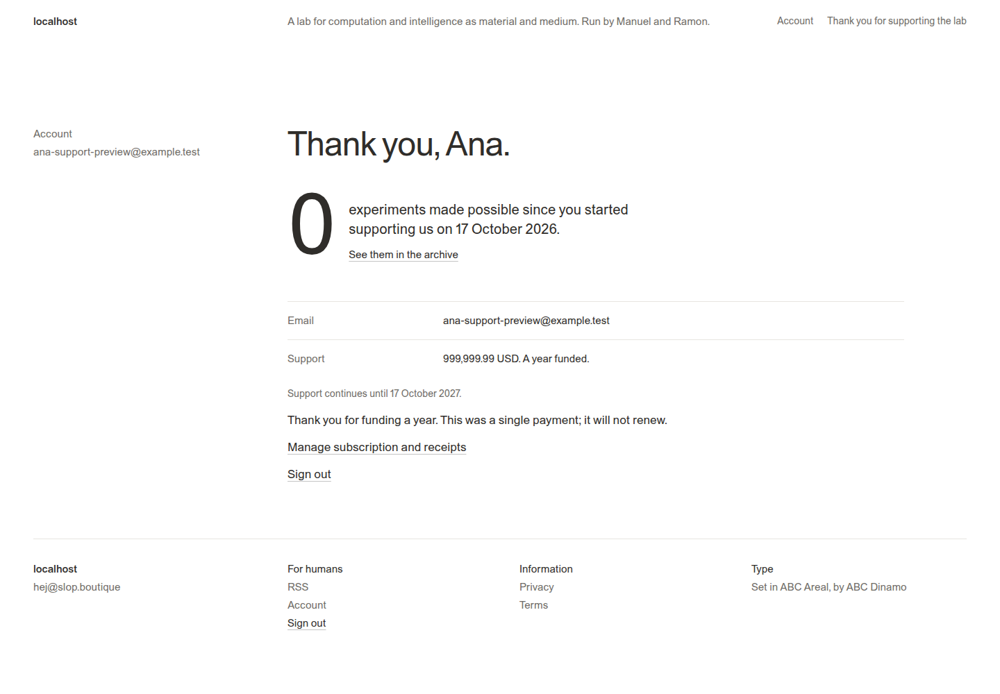
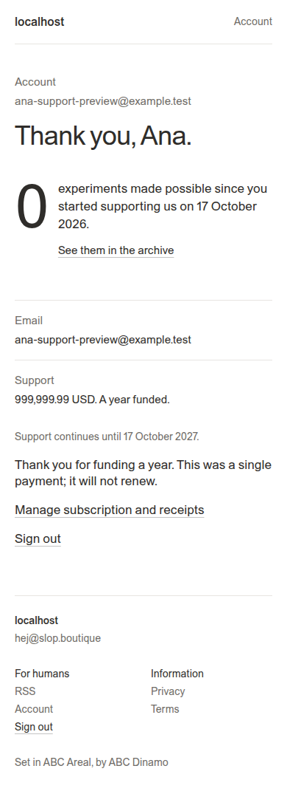

# Single Subscriber tier and one-time year funding

This guide supersedes the earlier choice to keep adjustable monthly support on the Free plan. There is one paid Subscriber tier. Every authoritative active subscription, including inline monthly support prices and existing configured prices, resolves to that same tier. Account role `subscriber` alone is not proof of payment: newly registered free accounts retain Free until billing confirms payment.

Production inspection found one configured paid plan (`subscriber`, rank 1) and two active projected subscriptions, one using the new custom monthly amount. No Stripe subscriptions need rewriting and no user role migration is necessary. Change the billing-policy acceptance for marked monthly support, then resolve a successful subscription decision to the configured Subscriber tier. Existing monthly prices continue to supply their actual payment state; they do not select different tiers.

## Fund a year

Ramon’s 999,999.99 USD action initiates a real Stripe Checkout `mode=payment`, not an annual recurring subscription. The server fixes `unit_amount=99999999`, USD, quantity one and the product description. It sets checkout metadata `francois_year_funding=true` and enables invoice creation for receipts. The browser sends only `kind: year`; it cannot override the price. The amount is Stripe’s documented eight-digit USD maximum: [Stripe supported currencies and maximum charges](https://docs.stripe.com/currencies#minimum-and-maximum-charge-amounts).

Reuse the existing customer mapping, verified-account/CSRF guard, checkout admission, idempotency and supersession. Monthly subscribers can also fund a year because this is an additional one-time payment, not another recurring subscription. Success returns to the existing `/thank-you` route. The billing return is advisory, never evidence of payment.

## Authoritative confirmation and one-year standing

Reuse the durable checkout-attempt row instead of creating another payment service or queue. Migration 016 adds `support_paid_at` and `support_until`. The existing billing worker retrieves the owner-bound Stripe Checkout session, expanding its PaymentIntent/latest charge. Grant standing only if all of these are true:

- The attempt belongs to the mapped local customer/user and uses the fixed year-funding choice.
- Checkout is complete, payment status is paid, currency is USD, total is exactly 99,999,999 cents and server metadata identifies year funding.
- The underlying charge provides a real paid timestamp and is not fully refunded or disputed.

Set the interval from the charge timestamp through one calendar year later. Event completion commits that projection and the existing subscription projections together under the current event lease. Replayed returns/webhooks reuse the same session/attempt and do not extend the year. Failed, unpaid or refunded payments do not grant standing. Include `charge.refunded` events and active year-funding customers in existing reconciliation so the projection can revoke refunded standing and repair missed webhooks.

```text
Year button → existing support endpoint {kind: year}
            → existing Checkout service, one-time 999,999.99 USD
            → Stripe payment → existing customer refresh worker
            → checkout paid/until projection → Subscriber tier + thank-you view
Monthly or existing subscription → billing policy → same Subscriber tier
Free account → no confirmed payment → Free
```

The account summary distinguishes `kind: month` from `kind: year`. A year funder sees the one-time amount, funded-through date and explicit nonrenewal copy. Both types suppress monthly support banners. Keep free-account calls to action and existing Google/GitHub/email sign-in.

## Implementation map

- `pkg/catalog/billing/policy.go`: accept marked monthly support and define fixed year constants/projection data.
- `pkg/catalog/entitlement.go`: resolve confirmed subscribers to the single Subscriber tier.
- `pkg/catalog/payments/gateway.go`: one-time inline checkout; retrieve/validate authoritative charge state.
- `pkg/catalog/payments/service.go`: shared checkout admission and existing worker confirmation.
- `pkg/catalog/store/year_support.go`, migration 016 and `store/billing.go`: owner-bound year standing and atomic projection updates.
- `pkg/catalog/support.go`, `routes.go`: support summary and fixed year checkout dispatch.
- `pricing.tmpl`, `ui/catalog/public.ts`, `account.tsx`: working year action and truthful funded-year presentation.

Qualification happens after implementation: database-backed policy/service/catalog tests, TypeScript/build/lint, then one isolated sandbox checkout at the exact maximum amount and a real monthly subscriber entitlement readback. Do not submit production payments or rewrite Stripe subscriptions as a migration mechanism.


## Qualification result

Implemented and locally qualified on `feat/year-funding-single-subscriber`, initial implementation commit `570439f`. Full PostgreSQL-backed Go suite passed (catalog 28.318s, payments 3.991s), including existing-user policy and new year payment confirmation/refund tests. TypeScript checks, nine frontend tests, embedded asset build, Go build, lint and logcopter checks passed.

The real sandbox run paid 99,999,999 cents through hosted Checkout in one-time payment mode. It confirmed no recurring subscription was created, showed a funded-year thank-you view, retained the single Subscriber plan for the existing monthly supporter, and revoked year standing after a sandbox refund while preserving the monthly Subscriber tier. Desktop/mobile screenshots and `year-funding-sandbox.json` preserve the result. No production payment or deployment occurred in this implementation checkpoint.

The return flow also checks confirmation for the exact owner-bound checkout attempt. An already-active monthly subscription cannot prematurely mark a new year payment as confirmed. Migration 016’s paid-through field supplies that per-attempt proof; the existing bounded polling remains unchanged.




