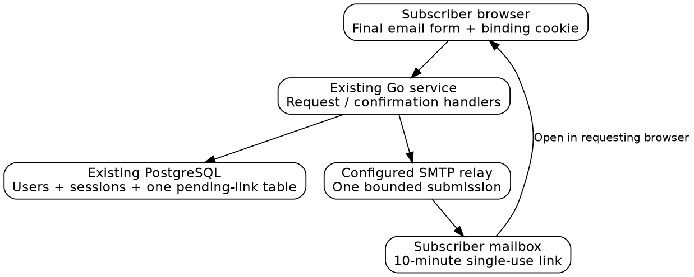
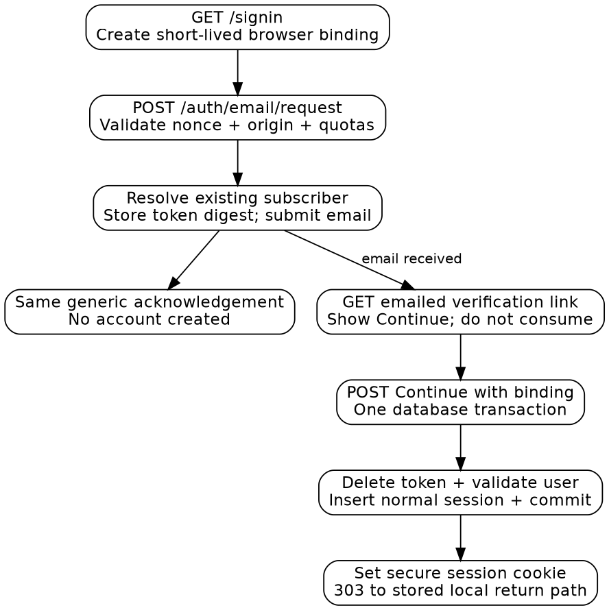

# Email-link sign-in for Slop Boutique

## 1. What the feature does

An email sign-in link proves that a visitor can receive mail at the address associated with an account. The website creates a random, short-lived **token**, sends it to that address, and accepts it once to create a normal signed-in **session**. A session is the server’s record that subsequent browser requests belong to a particular user. The browser carries a session cookie; application code uses the corresponding database record rather than trusting a user ID supplied by the browser.

Slop Boutique already has users, sessions, verified email addresses, cookies, request guards and a database. Its current interactive login delegates authentication to ZITADEL, an identity provider, using OpenID Connect (OIDC). OIDC returns a signed identity with an issuer and subject; that pair identifies the existing Francois user. Adding email login must reuse that same user ID so subscriptions, saved instances and permissions remain attached to the account.

The concrete feature in this ticket is an email form for **existing, enabled subscriber-role accounts with one unambiguous verified email**. It creates no account, links no identities and changes no role or entitlement. Production documentation describes invite-only identity registration, so email sign-in must not silently become public signup. A subscriber-role user can sign in regardless of current payment status; account access and paid/hosted entitlement are separate decisions.

For example, Ana already has a Francois user and verified address. She requests a link, receives it, opens it in the browser where she started, and presses Continue. The token is consumed and the website creates a fresh session for Ana’s existing user ID. The account page and instance APIs continue using the same session guards as before. A random unknown address gets the same public acknowledgement but no account or sign-in email.



The implementation is four HTTP routes, one database table and one direct mail sender inside the existing Go service. No background queue, new identity provider, authentication framework or additional deployment service is required.

## 2. Existing authentication, explained from a request

`pkg/catalog/routes.go` registers `/auth/login`, `/auth/callback`, `/auth/logout` and `/api/session`. `auth.go:186` starts an OIDC authorization request. It stores a short-lived login flow containing a browser binding, nonce, return path and PKCE verifier, and redirects the browser to ZITADEL. A **browser binding** is a random value in an HTTP-only cookie that ties a login flow to the browser that started it. PKCE binds the returned authorization code to the verifier held by the service; a nonce binds the returned identity assertion to this flow.

On callback, `auth.go:212` consumes the matching flow and exchanges the code through `identity.Provider.Exchange`. That method verifies the issuer, subject and token claims, then returns `store.Identity`. `Store.UpsertIdentity` in `store/users.go:41` creates or updates the user keyed by issuer/subject while preserving local role and disabled flags. Finally `Store.CreateSession` stores a digest of a fresh session secret, and the portal sets its HTTP-only cookie.

Requests to protected APIs resolve the cookie through `Store.ResolveSession`. The route guard creates a `Principal`, containing the current user and session, and applies the required role/access checks. State-changing browser requests also need same-origin and CSRF checks. **CSRF** means an attacker’s site attempting to make the browser send authenticated mutations; the existing CSRF token is separate from a session secret.

The email flow starts at a different proof of identity, but ends at the same local session representation. Do not invent a second account table, return a JWT to browser storage, or create an issuer named email. `UserByVerifiedEmail` already performs a case-insensitive lookup and returns a user only when exactly one enabled verified account matches. Use that function rather than write looser matching logic.

| Source reference | Existing responsibility |
| --- | --- |
| `pkg/catalog/auth.go:26` | Cookie names, secure settings and principal resolution |
| `pkg/catalog/auth.go:102` | Route access, browser-origin and CSRF checks |
| `pkg/catalog/auth.go:175` | `safeReturn` local redirect validation |
| `pkg/catalog/identity/oidc.go:83` | Existing authorization request and verified code exchange |
| `pkg/catalog/store/users.go:57` | Unique enabled verified-email lookup |
| `pkg/catalog/store/sessions.go:49` | Creating portal sessions with random secrets and CSRF values |
| `pkg/catalog/store/sessions.go` | Idle/absolute expiry, resolution and revocation |
| `pkg/catalog/store/instances.go` | Runtime grants tied to portal sessions |
| `cmd/francois/cmds/catalog.go` | Glazed configuration and secret-file loading |
| `pkg/catalog/analytics.go:17` | `/auth/` paths excluded from traffic analytics |

Line numbers refer to the source inspected at `dbef98e`. Follow symbols if edits move them.

## 3. The selected design and its limits

Use a first-party opaque link token for subscriber sign-in, then create an ordinary portal session. Retain the existing OIDC entry point for creator/admin login; email sign-in must not reduce authentication requirements for privileged accounts. Both are intentional entry points for different account roles, not fallback adapters. The existing user record, role checks, billing integration and hosted access remain authoritative.

ZITADEL’s documented login application lists email OTP among multifactor methods and passkeys among passwordless methods. That is not evidence that enabling email OTP alone produces Ramon’s passwordless Send link journey. This guide therefore selects the small local flow rather than making the implementation depend on an unverified provider UI configuration. It also avoids building an entire custom ZITADEL login application. [ZITADEL Login App documentation](https://zitadel.com/docs/guides/integrate/login-ui/login-app).

These parameters define the implementation:

| Parameter | Value and behavior |
| --- | --- |
| Eligible account | Existing enabled `subscriber` role, uniquely verified address |
| Link lifetime | 10 minutes |
| Link secret | 32 cryptographically random bytes, encoded as hex |
| Database secret representation | SHA-256 digest via existing `store.Hash` |
| Browser binding | Separate 24-byte random cookie, also stored as a digest |
| Origin | Configured `Site.PortalOrigin()`, never untrusted Host input |
| Return path | `safeReturn`, stored when issuing the link |
| Pending links | One per user; a new request replaces the pending link |
| Mail rate | Three per normalized address per hour; twenty per client address per hour; one hundred globally per hour |
| Send behavior | One synchronous, deadline-bounded SMTP submission; no queue/retries |
| Session | Existing idle/absolute lifetime and CSRF behavior |
| New identity creation | None |

The mail and request deadline is three seconds. Complete syntactically valid, rate-admitted request acknowledgements at the same three-second boundary, whether or not the address is eligible. This avoids the obvious instant unknown-user response versus a slow SMTP response. It is a bounded response policy, not a claim of cryptographic constant-time network behavior. Database or mail failures are logged without secrets and the visitor can retry with the same form. Global mail disablement is a visible service-unavailable state independent of the submitted address.

The rate limiter can reuse the existing small limiter implementation from `demos.go`, with its own instance and key prefixes. Reserve counters under the mutex and release it before database or SMTP work. Count rejected lookup attempts against address/global admission too. Do not hold a shared demo limiter lock while sending mail. A recipient quota that is exhausted produces the same generic acknowledgement without sending; client-address/global exhaustion can produce a general 429 with Retry-After. In the current single-service process, no distributed limiter is required.

## 4. Browser flow and scanner-safe confirmation

The sign-in page has an email field, Send link action, short supporter explanation and the Final shared shell. It renders with Go templates and submits an ordinary form, so the feature works without loading the React Admin application. Validate bounded form input server-side. Use a proper mailbox parser, reject display-name lists/header characters, trim the address and normalize lookup casing; do not apply provider-specific Gmail-style address rewriting.

The email should contain the site name, a single trusted HTTPS link, the ten-minute expiry, and a short statement that unsolicited messages can be ignored. Keep it plain text initially. Do not put roles, user IDs, session secrets or arbitrary redirects into the link. The link carries only its random token; the server already holds the target user, origin and safe return path.

Opening the link performs **no authentication mutation**. Email products often fetch links to inspect them. The GET response displays Continue, and only the form’s POST consumes the token. Require the original binding cookie in both the inspection and redemption paths. Explain that the visitor should open or paste the link in the browser where they requested it. Supporting a different browser without this binding is not part of this small flow.



All entry and confirmation pages set `Cache-Control: no-store`, `Referrer-Policy: no-referrer` and a noindex directive. They load no third-party resources. `/auth/` is already excluded from internal traffic recording; keep raw query strings out of application and ingress logs because the link token is a credential. Apply the no-store header after generic template rendering if `render` would otherwise replace it with `no-cache`.

The browser binding, explicit confirmation and same-origin POST protect against login requests being completed in a different browser, accidental link inspection, and cross-origin form submission. Use the same generic invalid/expired page for missing, expired, consumed or wrong-browser links. These token lifecycle choices are consistent with OWASP’s treatment of short-lived emailed tokens and session secrets; the exact schema, limits and route design here are project decisions. [OWASP emailed-token guidance](https://cheatsheetseries.owasp.org/cheatsheets/Forgot_Password_Cheat_Sheet.html), [OWASP session management](https://cheatsheetseries.owasp.org/cheatsheets/Session_Management_Cheat_Sheet.html).

## 5. Route reference: current and proposed contracts

The following routes are **proposed**, not presently installed:

| Route | Input | Result |
| --- | --- | --- |
| `GET /signin` | Optional local `return` | 200 email form and short-lived browser binding cookie |
| `POST /auth/email/request` | Form `email`, `return`, request nonce | 200 generic acknowledgement after admitted processing; 400 malformed form; 429 general rate limit; 503 mail disabled |
| `GET /auth/email/verify` | Query `token` and binding cookie | 200 confirmation; generic invalid page for unusable link; no consumption |
| `POST /auth/email/verify` | Form `token`, binding cookie | Atomic consumption/session creation, session cookie and 303 to stored local return path |

Use `application/x-www-form-urlencoded`, a 2KiB body limit and Go’s standard form parsing. The request form’s nonce is a copy of the random binding value also held in the HTTP-only cookie; require an exact constant-time match and same origin on POST. The nonce is not the mailed token. A GET to `/signin` creates it if absent; a request without the cookie returns the sign-in form rather than sending mail.

For verification POST, require the binding cookie and exact site origin; token lookup also checks its stored origin. The random token plus browser-bound pending row is the proof being submitted. Read the return path from that row rather than accepting a new one at verification. Use the normal portal session cookie after commit and clear the short-lived email-flow cookie.

Example browser request, with invented values rather than an actual credential:

```http
POST /auth/email/request HTTP/1.1
Content-Type: application/x-www-form-urlencoded
Origin: https://slop.boutique
Cookie: __Host-francois_email_flow=EXAMPLE_BINDING

email=ana%40example.com&return=%2Faccount&nonce=EXAMPLE_BINDING
```

Every eligible and ineligible syntactically valid address gets the same response text: “If this address belongs to an eligible account, a sign-in link will arrive shortly.” The wording avoids claiming delivery before the user receives mail. Never put the submitted email into a subsequent redirect query string.

Existing `GET /auth/login` and `/auth/callback` continue to implement staff OIDC. Existing `POST /auth/logout` revokes the local session and derived runtime grants. For an email-created session, `IDToken` is empty: finish logout locally without attempting provider end-session. A real OIDC session with an ID token retains the existing provider logout behavior.

Update public sign-in links in `pages.go`, `ui/catalog/ui.tsx` and `public.ts` to `/signin?return=...` once the new route is working. Provide an unobtrusive Staff sign-in link to the existing OIDC path. `LoginAvailable` currently means OIDC configured; split the displayed email availability from staff OIDC availability rather than making a mail outage look like total authentication failure.

## 6. Minimal persistence and transaction boundaries

Add the next unused migration under `pkg/catalog/store/migrations/`; at the inspected revision the latest number is 011. Never edit an applied migration: `Store.Migrate` checks its checksum. A proposed schema is:

```sql
CREATE TABLE email_signins (
    user_id text PRIMARY KEY REFERENCES users(id) ON DELETE CASCADE,
    token_hash bytea NOT NULL UNIQUE,
    binding_hash bytea NOT NULL,
    email_snapshot text NOT NULL,
    portal_origin text NOT NULL,
    return_path text NOT NULL,
    expires_at timestamptz NOT NULL,
    created_at timestamptz NOT NULL DEFAULT now()
);
```

One pending row per user is sufficient. Insertion replaces the earlier pending token. Generate token and binding with the existing random helpers; store only their hashes. Use normalized `email_snapshot` to reject a link if the account’s verified address changes before redemption. Include portal origin because this service supports more than one public site with distinct browser cookies.

Issuance is straightforward:

```text
requestLink(form, bindingCookie, configuredSite):
    validate origin, body size, mailbox, nonce and safe return
    reserve address/global/recipient limits
    resolve exactly one enabled verified-email account
    if found and role == subscriber:
        token = random 32 bytes
        upsert pending row for existing user ID
        send trusted-origin link with a three-second deadline
        if send fails: delete row only if token_hash still matches
    return the generic acknowledgement at the response boundary
```

Do not create a user if lookup fails. Recheck uniqueness at redemption as well as issuance: another verified account could acquire the same address during the ten-minute interval. Staff accounts, guests, disabled accounts and ambiguous addresses are all ineligible, without revealing which condition failed to the requester.

Consumption and session insertion belong in **one PostgreSQL transaction**. Calling the current standalone `CreateSession` after consuming the token would lose the link if session insertion fails. Implement one focused store operation, `RedeemEmailSignIn`, which deletes the matching row with `DELETE ... RETURNING`, checks and locks its current user, and inserts a normal session before committing. The token is gone only if the transaction succeeds. Concurrent redemption of the same row yields one successful session at most.

```text
redeem(token, binding, origin):
    begin transaction
    delete pending row where hashes match,
        origin matches and expires_at > now(), returning row
    lock user row; require enabled subscriber and current verified email
    repeat unique verified-email lookup for email_snapshot
    require that lookup resolves to this same user ID
    generate fresh session secret and CSRF token
    insert session using existing idle/absolute expiry rules, id_token = ''
    update user's last_login_at
    commit
    return session secret and stored safe return path
```

Refactor the existing session insertion into a private helper accepting the transaction/query executor if needed to share SQL and lifetime rules. This is a small internal refactor, not a second session format. Handle the transaction commit result before setting a cookie. If an older anonymous demo cookie exists, replace it with the new session; do not transfer another account’s state as part of login.

Role changes need one related correctness fix. An email session issued to a subscriber must not become an admin session merely because an operator later promotes that same user. Make `SetUserRole` revoke that user’s current sessions and runtime grants in its existing database operation, using a transaction. After a role change the user signs in through the appropriate entry point. This avoids adding authentication-method policy fields to every request. Check all production role-write paths, including the bootstrap/operator command, use this operation.

Delete expired pending rows opportunistically when issuing a link. No sweeper goroutine is needed for this small table. Expiration is enforced by the redemption predicate even when expired rows have not yet been removed.

## 7. Mail configuration and code organization

Introduce one narrow mail sender with a method such as `SendSignIn(ctx, address, url) error`. A real implementation and a recording test fake are enough. Put SMTP handling in one file or small package; do not build provider selection or a plugin registry. Establish a context deadline and connection deadlines, require encrypted authenticated submission in production, and never log the SMTP password or link URL.

Add Glazed fields in `cmd/francois/cmds/catalog.go` for `smtp-address`, `smtp-user`, `smtp-password-file` and `signin-from`. Read the password with the existing secret-file mechanism. Use no new environment-variable discovery. The operator supplies a working relay and sender address; those credentials were not inspected or changed for this guide. Missing mail configuration disables the email form with a concise service message while staff OIDC remains available.

| Proposed addition/change | Responsibility |
| --- | --- |
| `pkg/catalog/email_signin.go` | Four handlers, validation, acknowledgement and cookies |
| `pkg/catalog/store/email_signins.go` | Pending row issuance and transactional redemption |
| Next store SQL migration | Only the pending-link table |
| `pkg/catalog/signin_mail.go` | One bounded SMTP sender and message composition |
| `pkg/catalog/web/templates/signin.tmpl` | Form, acknowledgement, confirmation and invalid-link states |
| `pkg/catalog/routes.go`, `pages.go` | Registration, page template selection and login availability |
| `pkg/catalog/server.go` | Sender/configuration and separate limiter ownership |
| `pkg/catalog/store/users.go` | Revoke sessions/grants on role change |
| `pkg/catalog/auth.go` | Local-only logout when no OIDC ID token exists |
| `cmd/francois/cmds/catalog.go` | Glazed fields and secret-file loading |
| Existing UI sign-in link helpers | Send ordinary visitors to the working `/signin` route |

FRANCOIS-012 supplies the Final visual classes and shell. This ticket owns functioning email/confirmation markup. The two can share those CSS classes without sharing identity logic.

## 8. Implementation and test sequence

First add the table and store redemption tests. Next add the recording mail sender and handlers with server-rendered form states. Wire real SMTP configuration only after request/verification tests pass, then update the sign-in links and logout. Finish by verifying the role-change revocation behavior and testing the actual email journey locally. Commit at these coherent milestones and keep exact failure diagnostics in the diary.

Use the existing Go test harness, which creates an isolated database when `TEST_DATABASE_URL` is supplied. Tests skip without that setting, so confirm the integration cases actually execute. This guide reads the harness source but does not load environment variables or start an implementation test run.

```sh
pnpm check
pnpm build
go test ./pkg/catalog/... -count=1
go build ./...
```

Use a local recording SMTP sink for the manual test. Its messages are development evidence, not production delivery. Keep any long-running server or sink in tmux. Read its output with capture-pane and use `lsof-who -p PORT -k` when replacing a server. Do not print a real production token into shared logs or screenshots.

The necessary tests cover behavior rather than mirror helper functions:

- A verified enabled subscriber requests a link and redeems it into a session for the **same user ID**, preserving existing subscriptions/instances.
- Unknown, disabled, duplicate-address, guest and staff lookups return the generic response without sending a sign-in link.
- Wrong origin, mismatched nonce, oversized form and mail-disabled state produce the specified responses.
- GET inspection does not consume a token or set a login session, including repeated scanner-like GETs.
- Missing/wrong browser binding, wrong portal, expiry, changed email, changed role and duplicate redemption fail safely.
- Two concurrent redemption POSTs create exactly one usable session. An insertion failure rolls back token consumption.
- A new request invalidates the old pending link; a failed SMTP send removes only its own matching pending row.
- Mail quotas are applied before sending, and no mutex is held across network I/O.
- The new session has the normal secure cookie, fresh CSRF token and existing lifetime limits; logout revokes it and its runtime grants locally.
- Role promotion revokes all earlier sessions/grants, requiring staff OIDC login before privileged use.
- Private token pages use no-store/no-referrer, and logs/traffic recording contain no full verification URL.

## 9. Completion and source references

The feature is complete when the Final Send link form sends a real bounded email, the confirmation creates the correct existing-user session once, and all listed failure cases behave as specified. Registration, arbitrary donations, identity migration, MFA policy editing and a custom ZITADEL login application are outside this ticket. No later roadmap is required to make this existing-account feature useful.

The current behavior is anchored in `auth.go`, `identity/oidc.go`, `store/users.go`, `store/sessions.go`, `store/instances.go`, `demos.go`, `server.go`, `routes.go`, `pages.go`, `analytics.go` and `cmd/francois/cmds/catalog.go`. `doc/production.md:155` records the current ZITADEL organization/client setup and invite-only policy; it is repository deployment documentation, not an independently queried live configuration. External API documentation was checked on 17 October 2026. The small opaque-token/session design above is the selected implementation, not a claim that email login already exists.
