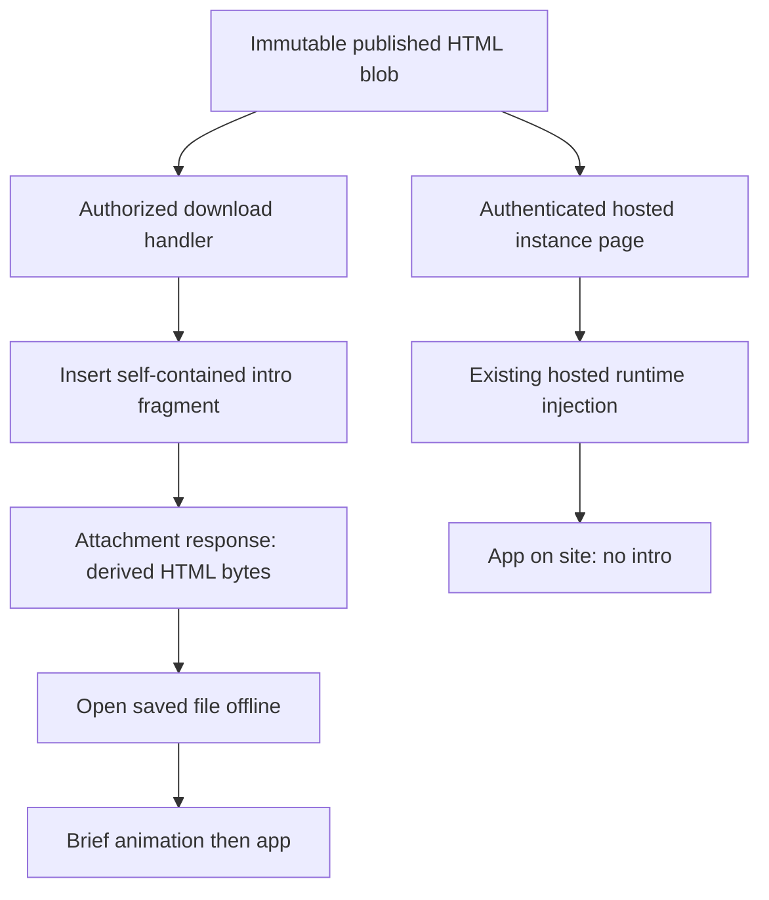

# A short intro for downloaded HTML

## Purpose and exact boundary

When someone downloads a published HTML artifact and opens the saved file, show a brief animated title reading **“slop.boutique - explorations by manuel and ramon.”**, then reveal the app. The animation is a short introduction, not a permanent watermark, tracking pixel or subscription prompt. It appears on each opening of the downloaded HTML document. It requires no network access.

The hosted experiments on the website must not show this intro. The change belongs at the HTTP download boundary, after the existing download authorization succeeds. Do not change uploaded source blobs, authored HTML at publication, the hosted runtime injection, instance startup, editorial pages or attachment downloads. The download is a derived representation of the stored release.

The user requested this ticket after the email-link work. FRANCOIS-013 is implemented and locally qualified in commits 2f2fe66 and 0b1c302. This ticket is now ready for implementation; its animation is not yet in application code.

## Existing system, from upload to opening an app

The publisher accepts authored HTML and its release manifest through the catalog's publishing path. `pkg/catalog/releases/releases.go` validates uploads and stores immutable release files using content-addressed blob keys. `store.ReleaseFile` records a role, name, media type, original size and original SHA-256. The blob is shared by subsequent reads and should never be rewritten to add presentation effects.

There are two distinct consumers of those bytes. A hosted instance uses `pkg/catalog/hosted/routes.go:page`, which authenticates a runtime grant, reads the published HTML and injects the hosted runtime plus private bootstrap configuration. That response runs on an isolated instance origin. An ordinary download uses `pkg/catalog/routes.go:download`, which checks that the release is published, selects its file, calls `mayDownload`, reads the blob and sends an attachment response. This second path is the entire implementation boundary for this feature.

`mayDownload` already handles disabled users, free samples and paid-plan entitlement. Preserve its ordering: a denied request must return its current JSON error before reading/transmitting any artifact bytes. The animation must not introduce a second public export endpoint or a way to bypass download eligibility.



## Selected animation

Use one small HTML/CSS fragment, inserted immediately after the real body start tag. The intro fills the viewport with a calm light background and dark text. The domain appears prominently; the attribution settles beneath it. A small blue accent or lightly staggered letters gives it some character. After roughly **1.6 seconds**, the intro fades away and becomes invisible and non-interactive. Keep the exact requested wording, including names and punctuation.

The existing app may initialize behind the intro. The feature controls the first visible presentation, not application execution or event scheduling. Delaying every arbitrary application's scripts would require rewriting its startup semantics and could break apps. Do not wrap the original application in an iframe, replace its document, intercept its scripts or change its file origin.

CSS alone can implement the animation and disappearance. Use namespaced selectors and keyframes such as `#slop-boutique-download-intro-v1` and `slopBoutiqueIntroExitV1`. Keep every selector inside the intro root; do not add rules for body, input, button or other application elements. The high-z-index fixed overlay should not change layout or scroll position. Use system fonts so the exported file remains self-contained and carries no licensed web-font payload.

Honor `prefers-reduced-motion: reduce` by showing the app immediately. The intro is decorative, so hide it from the accessibility tree and never capture keyboard focus. CSS must make the overlay non-interactive when finished, using visibility and pointer-events as well as opacity. JavaScript is unnecessary: if the application has a JavaScript startup error, it must not leave an undismissable introduction in front of the app. If an authored CSP prevents the injected styling entirely, the app must still remain usable; explicitly inspect this case during implementation rather than inventing a provider-wide CSP override.

```text
intro animation timeline:
    0ms       intro is visible above the initializing app
    0–350ms   domain and attribution settle with a small stagger
    350–1250  wording remains readable
    1250–1600 fade out
    >=1600    opacity 0; visibility hidden; pointer-events none

reduced motion:
    intro root is display:none; show the app immediately
```

This is one fixed branded animation. There is no animation editor, settings table, version-selection service, remote script or per-user preference storage in this ticket.

## Byte transformation and HTML parsing

Add a pure helper in `pkg/catalog/releases/download_intro.go`, provisionally `WithDownloadIntro(source []byte) []byte`. It returns a new byte slice and never mutates the input. Keep the fragment as a constant in that file or an embedded local text asset. Repeated calls on an already transformed document should not add another copy; detect our own precise namespaced marker, not a broad word such as watermark. This is duplicate-injection protection, not a backwards-compatibility layer.

Use `golang.org/x/net/html`'s tokenizer, already used by the hosted injection helper. A regular expression can mistake a body-like string in an authored script/comment for the real body. Track offsets using tokenizer.Raw so the original document is not parsed and reserialized. Insert bytes at a verified body-start boundary and preserve the doctype, encoding declaration, head metadata and every original app byte. Test body attributes, uppercase tags, script strings containing body-like text and fragment-style HTML without an explicit body.

For missing-body inputs, select a deliberate fallback after a real closing head or doctype where available, otherwise before the fragment's first content. Keep the algorithm small and demonstrate it against browser parsing; the goal is preservation of the original document, not building a general HTML rewriting framework. Do not export the hosted injection helper merely to avoid a few lines of tokenizer traversal: the hosted and download transformations have different responsibilities.

```text
WithDownloadIntro(source):
    if the exact intro marker already exists:
        return a safe unchanged representation
    boundary = find real body start using HTML tokenizer offsets
    if body is absent:
        boundary = deliberate fragment/head/doctype fallback
    result = allocate len(source) + len(intro)
    append source[:boundary]
    append intro fragment
    append source[boundary:]
    return result

handler download:
    release = load published release
    file = find requested release file
    enforce current mayDownload policy
    bytes = read immutable blob
    if file.role == "html":
        bytes = WithDownloadIntro(bytes)
    set existing attachment filename and private/no-store cache policy
    set Content-Length to len(bytes)
    set X-Content-SHA256 to SHA256(bytes)
    if HEAD: finish without a body
    otherwise write bytes
```

## Response metadata and integrity

Today the download handler sends the stored file's SHA-256 and the raw byte length. After transformation, the outgoing file has different bytes. Compute **both** Content-Length and X-Content-SHA256 from the actual response representation; a stale checksum would report an integrity mismatch and a stale length could truncate delivery. HEAD and GET must describe exactly the same derived representation.

Keep the immutable database checksum/size associated with the stored source blob. They are still the publisher's source-integrity metadata. Do not overwrite them with an export checksum or create a new release just because the intro template changes. The catalog UI currently uses the source size to label the download; that remains the source file's metadata, while the response headers identify the actual export. Confirm any new catalog/API documentation describes that distinction clearly.

Continue sending application/octet-stream plus Content-Disposition: attachment so the portal does not execute an authored application as a trusted same-origin page. Keep private, no-store: authorization and release state must be rechecked on each download. No ETag or long-lived cache is needed for this small transformation. Non-HTML release files and separately uploaded attachments keep their current bytes and headers.

## File and API map

| File / symbol | Responsibility in this ticket |
| --- | --- |
| `pkg/catalog/routes.go:download` | Apply the transformation only to authorized HTML file downloads; correct outgoing size/hash |
| `pkg/catalog/routes.go:mayDownload` | Existing access policy; preserve ordering and rules |
| `pkg/catalog/releases/download_intro.go` (new) | Pure, byte-preserving namespaced HTML/CSS insertion |
| `pkg/catalog/releases/releases.go:Blobs.Read` | Read immutable source; do not change stored bytes |
| `pkg/catalog/store/releases.go:ReleaseFile` | Source file role, name, hash and size |
| `pkg/catalog/hosted/routes.go:page` | Explicitly excluded hosted response; regression-test absence of intro |
| `pkg/catalog/hosted/routes.go:inject` | Existing tokenizer-offset pattern to inspect, not a shared API to expand |
| `pkg/catalog/catalog_test.go` and nearby download tests | Existing authenticated HTTP integration harness |

Existing download route: `GET` or `HEAD /api/releases/{release}/files/{file}/download`. There is no new HTTP route, database migration, permission, browser runtime API or CLI flag.

## Validation that demonstrates the actual requirement

Test the pure helper against complete HTML, body attributes/case, comments/scripts containing fake tags, no-body fragments and duplicate injection. Verify the original byte sequence is otherwise preserved. For authenticated HTTP integration, assert that a downloaded HTML file has the intro, its SHA-256 and length match the returned bytes, and HEAD returns matching metadata without a body. Existing authorization denials must remain unchanged. Download a non-HTML file/attachment and verify byte identity.

Then open a genuinely saved exported HTML file through file:// in Chromium. Take an early animation screenshot and another after it ends. Assert the authored app is visible, interactive and has its expected startup behavior. Repeat with reduced motion and JavaScript disabled for the intro: the introduction must not obstruct the app indefinitely. Use at least one real imported artifact, not only a blank fixture. Run the corresponding hosted instance and prove the intro marker is absent from its HTML and visible page.

Store the fixture script, redacted browser results and screenshots under this ticket's scripts/ and sources/. Do not save runtime grants or authenticated HTML bootstrap secrets as evidence. Run affected Go tests and the usual build/lint checks; no frontend package or new dependency is necessary for a self-contained CSS fragment.

## Scope and completion

The ticket is complete when the downloaded-file journey shows the exact wording and then the real app, the hosted-site journey remains free of the intro, and authorization/source-integrity/response headers still behave correctly. The design is intentionally one export-time transformation. It does not redesign artifact packaging or make hosted-only APIs work offline.
