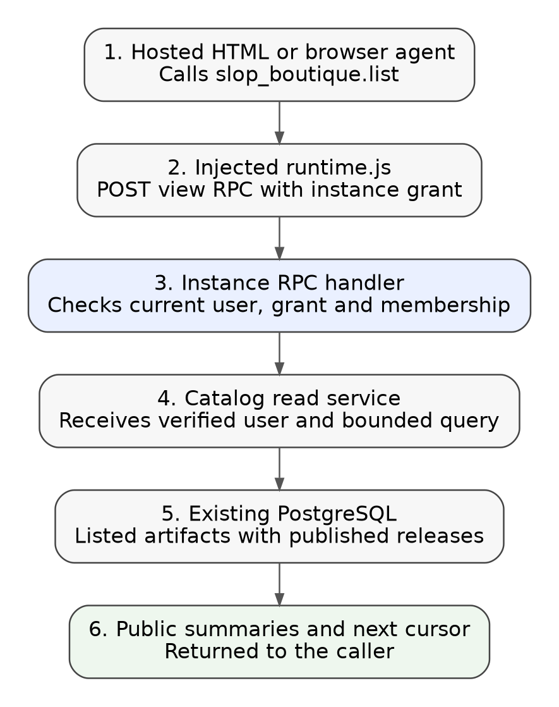
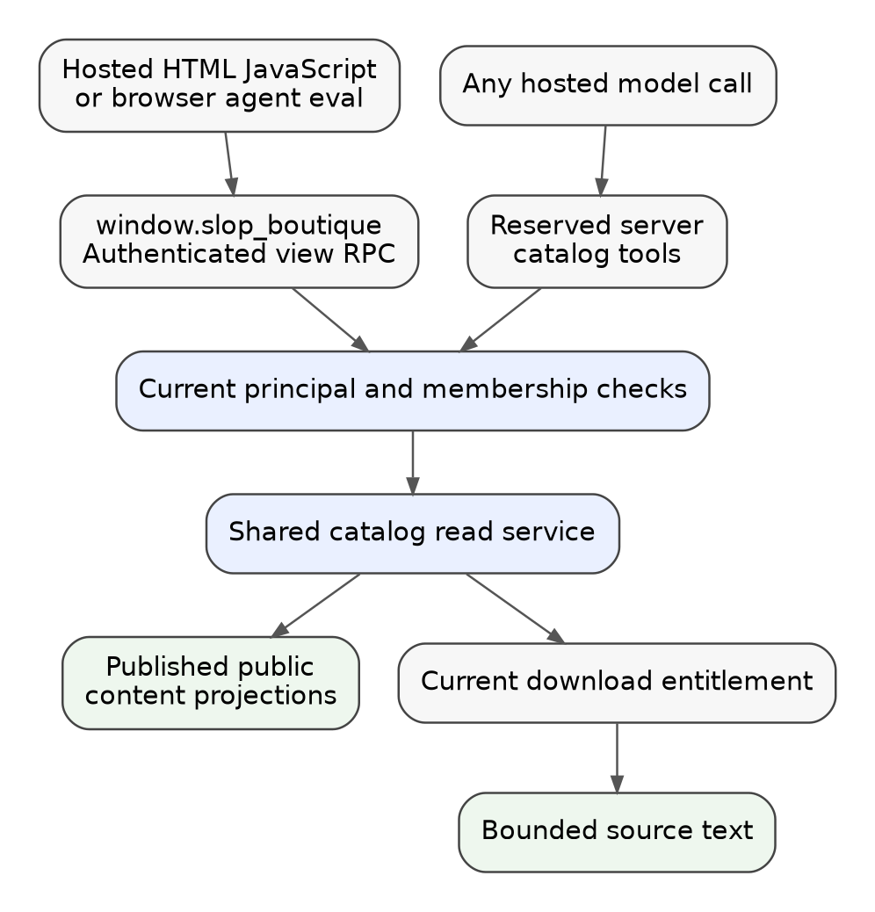

# Recursive catalog API: intern implementation guide

## 1. Purpose and vocabulary

An artifact is an uploaded application with an editorial page and one or more published releases. A release identifies immutable application files. A post is a journal entry with Markdown content. An instance is a running workspace pinned to a release; it has members and an isolated browser origin. An agent is a model call that can invoke tools, including JavaScript execution implemented by its application. These distinctions matter because reading the catalog, downloading application source, and changing a workspace have different permissions.

This ticket makes the browsable site available as structured data inside instances. A JavaScript application can search experiments, read a journal post, and inspect downloadable HTML that its current user is permitted to download. A coding agent can perform the same operations and use the results to build another application. This is the concrete meaning of a recursive app here: application code consumes site content or application source and produces another useful interface using the existing runtime.

The implementation is a read API over existing records, delivered through the authenticated instance RPC transport. It does not expose a database connection. No SQL text, table selector, filesystem path, bearer credential, account export, or privileged publishing endpoint is accepted. A caller receives the editorial content and download access that ordinary browsing provides. Even a staff member using an instance receives this public browsing projection, rather than studio drafts or administration data.

**Status:** researched design, not implemented. Proposed symbols and payloads below are explicitly new contracts. The source inventory records the current implementation on 17 October 2026. Authentication work in FRANCOIS-013 is independent: this API consumes the existing verified runtime principal regardless of how the portal session was established.

## 2. Follow one example through the system

Consider a supporter running RAG Workbench. They ask its agent to create a compact index of the boutique's published experiments and include an excerpt from the latest journal entry. The agent calls a catalog list tool, reads one post, and uses its existing page tools to render the index. Nothing in this sequence allocates another instance or starts another model call merely because a catalog read occurred.

```javascript
// Proposed API, available to hosted application JavaScript.
const experiments = await slop_boutique.list({ kind: "artifact", limit: 10 });
const writing = await slop_boutique.list({ kind: "post", limit: 1 });
const article = writing.items.length
  ? await slop_boutique.read({ kind: "post", id: writing.items[0].id })
  : null;
renderIndex(experiments.items, article?.body.text ?? "");
```

The browser runtime already holds a short-lived instance grant and a view ID. The new JavaScript facade sends `slop_boutique.list` to the same view RPC route used by document and collaboration operations. The server authenticates the grant, rechecks the instance membership and current access, and executes an explicit catalog query. It constructs a small response object rather than serializing the store's domain structs.



The important boundary is at the server. JavaScript cannot select a different user by adding `userId` to the arguments, and an instance owner does not gain download access beyond the entitlement of the caller making the request. The same instance can have members with different plans.

## 3. Read the existing implementation first

The following files are the shortest useful orientation path. Paths are repository relative. The saved source excerpts in `sources/code-evidence.md` preserve the inspected behavior without copying entire source trees.

| File | Current responsibility and relevance |
|---|---|
| `pkg/catalog/store/releases.go` | Defines Artifact, Page, Release and ReleaseFile; separates published page and page draft. |
| `pkg/catalog/store/content.go` | Defines posts, creators and media. Raw structs contain internal fields that must not leak. |
| `pkg/catalog/pages.go` | `artifactPage` requires listed visibility and a published release; `postPage` serves published posts and separately permits editor preview. |
| `pkg/catalog/routes.go` | `mayDownload` and `download` enforce published-release and entitlement checks before release bytes are opened. |
| `pkg/catalog/entitlement.go` | Resolves disabled, guest, free, supporter and staff access; `Entitlement.CanRun` is part of download policy. |
| `pkg/catalog/hosted/runtime.go` | Defines Principal and rechecks grants, users, membership, instance state and entitlement. |
| `pkg/catalog/hosted/rpc.go` | Dispatches view-bound RPC operations and checks capability declarations. |
| `pkg/catalog/hosted/sample.go` | Admits model calls and forwards page tool requests over view events. |
| `ui/src/runtime.ts` | Implements browser transport, tool execution and the injected `window.claude` capability facade. |
| `pkg/piworker/backend.go` and `validate.go` | Define tools and callbacks; enforce descriptors, prompt size and a 16-tool request limit. |
| `examples/imports/rag-workbench/source/agent.js` | Representative coding agent: `runEval` executes an async `new Function` with application scope. |
| `pkg/catalog/releases/releases.go` | Blob Open/Read and Publisher.HTML; file reads require metadata selection before any storage key is used. |

There is no server-side Goja JavaScript sandbox in the inspected implementation. The model worker receives tool descriptions and asks its callback to execute a tool. The RAG agent executes JavaScript in its browser application. Describing this accurately avoids adding a new JavaScript runtime merely to provide catalog access.

The current `claude.use("db")` API accesses an instance's application documents. It must retain that meaning. The site catalog is a separate `slop_boutique` namespace; callers should never confuse site posts with their workspace document paths.

## 4. Small implementation architecture

Add one catalog read service in `pkg/catalog/catalogread` and one runtime facade in `ui/src/runtime-catalog.ts`. The read service depends on the existing store, release blob access, and a callback that evaluates the caller's download permission. The catalog package already imports hosted; hosted must not import catalog and create a cycle. Construct the service in catalog server setup and inject it into hosted.Runtime with a small typed interface. The concrete implementation is shared by HTTP downloads and hosted reads where policy must agree.

```go
// Proposed shape; use concrete DTOs, not any, in implementation.
type CatalogReader interface {
    List(context.Context, store.User, ListArgs) (ListResult, error)
    Read(context.Context, store.User, ReadArgs) (ReadResult, error)
    ReadFile(context.Context, store.User, FileArgs) (FileChunk, error)
}
```

Keep argument/result types in the small read package so hosted and the constructor can use them without circular imports. Use the interface only at this real dependency boundary. Add `var _ CatalogReader = (*Service)(nil)` where the interface is defined or an equivalent compile-time assertion with the importing package's qualified interface.

This API is available to every hosted instance, without editing every old release manifest. Read access to the published site adds no authority beyond the browsing scope specified in this ticket. In `rpc`, treat only the three exact reserved catalog method names as built in, after `rt.view` succeeds. All existing capability checks remain unchanged for existing methods. Do not generally bypass declaration checks for arbitrary `slop_boutique.*` strings. Unknown names return `invalid_argument`.

Install a frozen `window.slop_boutique` object on hosted pages using the existing runtime injection. Install it before authored scripts run, as runtime.js currently is injected into the head. Its functions close over Transport; neither the runtime grant nor the portal session cookie is returned as part of the API. Keep the object nonwritable and nonconfigurable, matching the existing claude facade. A local standalone runner without catalog configuration does not get this global; it is not given production credentials automatically.

## 5. JavaScript and wire contracts

Implement three methods now. `list` searches summaries, `read` returns editorial content plus current release metadata, and `readFile` returns bounded text from an authorized release file or attachment. Each method returns a Promise and rejects with the existing `{code, message}` error convention.

| JavaScript method | RPC method | Important arguments |
|---|---|---|
| `list(args)` | `slop_boutique.list` | kind: artifact/post/creator; q; tag; limit; cursor |
| `read(args)` | `slop_boutique.read` | kind and canonical ID; body offset and length |
| `readFile(args)` | `slop_boutique.read_file` | releaseId, fileId, fileKind: release/attachment, offset, length |

Use IDs returned by list/read. Do not overload IDs with guessed slugs. A read creator response includes its public name, biography and links; it omits linked user ID and uploader fields. No generic media-library listing exists: artifact/post responses provide only their referenced public media URLs and alt text. The public site's brand and links can be returned as a small `site` object on list responses, so apps can attribute results without another API.

```json
{
  "items": [{
    "kind": "artifact", "id": "lattice-deck", "title": "Lattice Deck",
    "summary": "A deck-building experiment", "tags": ["tools"],
    "url": "https://slop.boutique/apps/lattice-deck",
    "publishedAt": "2026-10-16T12:00:00Z"
  }],
  "nextCursor": null,
  "site": {"name": "slop.boutique", "url": "https://slop.boutique"}
}
```

The example values above are illustrative proposed data, not a production receipt. Resolve the absolute public URL from the configured site, never from an untrusted arbitrary argument or request Host header. The application should render titles as text, not innerHTML.

A read artifact response contains id, title, description, tags, credited public creator objects, referenced cover/gallery media, canonical URL, and `body` containing raw Markdown. It also contains the newest published release's ID/version and file descriptors `{id,name,mediaType,size,canRead}`. Descriptors for attachments include their separate fileKind. `canRead` expresses the download decision at that instant and is only a UI hint; each file read rechecks it. Reading metadata never creates an instance and never starts a demo.

`readFile` returns the original immutable published source bytes, subject to the same download entitlement policy. FRANCOIS-014 separately proposes an intro animation applied only to the derived downloaded HTML representation; that proposal is not implemented. Catalog source reads must bypass that download transformation, preserve the original stored source hash, and avoid accumulating intro wrappers when agents create recursive applications. No additional API is needed.

Published journal Markdown is returned as Markdown, not an execution context. Content may contain embedded HTML because existing editorial input supports it; consumers rendering HTML must use the same established sanitization rules or render plain text. An agent treats the content as data supplied by the site, not instructions that can alter tool permissions.

### Bounds and pagination

Use list default 10 and maximum 20; q maximum 200 UTF-8 bytes; tag maximum 100. Sort by first publication descending and ID descending, with creator lists sorted by name and ID. A base64url JSON cursor stores the last sort tuple and the normalized query fields; validate all fields and reject a cursor from a different query. It is a position, not an authorization token. SQL must apply state, visibility and limit before returning rows; do not fetch every release blob or implement browser-side pagination over an unbounded table dump.

Keep each serialized operation result within 24 KiB, below the existing 32 KiB page tool result limit. Bound summary/title/tag/creator fields in projection, explicitly indicate any truncation, and stop list accumulation before exceeding that budget. For a very large title or tag set, truncate display metadata rather than returning oversized tool output. Return a cursor for the last included item; if no item fits, return a stable `content_too_large` error rather than looping.

Body and file text chunks default to 8 KiB and maximum 12 KiB of UTF-8 source bytes. Offsets are byte offsets. Move the end backward to a UTF-8 boundary and return the exact `nextOffset`; reject a starting offset in the middle of a rune. Return `{text,offset,nextOffset,totalBytes,sha256}`. A caller stops when nextOffset is null. The body hash is of the full returned-source representation, so callers can detect edits between chunks. A request with a prior hash that no longer matches returns `content_changed` and the caller restarts. An immutable release file still requires publication and entitlement rechecks on every chunk.

Allow text/html, text/plain, text/markdown, text/css, text/javascript, application/javascript, application/json and text/csv when content validates as UTF-8. For ZIP, images and other binary files return `unsupported_media_type` and metadata; do not add archive extraction or base64 binary transport in this ticket. The five imported applications' runnable HTML can be inspected directly where a published HTML release exists. Download links remain available through the normal site for original binary bundles.

## 6. Permission parity and storage access

The service always receives the verified current user from Principal. Lists expose only listed artifacts that have a published release and posts whose state is published. Creator profiles are public projections. Direct artifact reads apply the same listed/published checks, and direct post reads reject drafts even if the account could edit them through studio. Return `not_found` for missing or hidden content without revealing draft IDs.

File reads resolve the explicit release and verify it is published, then check that the supplied file ID belongs to that release and specified file kind. Next apply the existing rule: disabled users are denied; a free sample is downloadable; other releases require the caller's current entitlement to run the artifact. This preserves `mayDownload` semantics. It is separate from listing: ordinary metadata can be public while HTML bytes are supporter-only.

```text
ReadFile(ctx, user, args):
    validate args and chunk bounds
    release = Store.Release(args.releaseId)
    require release.state == published
    file = select owned release file or attachment by args.fileId
    require file exists
    require DownloadAllowed(ctx, user, release)
    handle = Blobs.Open(file.storageKey)   # only server-selected key
    verify allowed text media type and valid source encoding
    read bounded chunk and return metadata
```

Refactor the decision part of `mayDownload` into a context/user/release helper returning a typed error. Keep its HTTP wrapper to map errors onto today's HTTP status/code; this is an internal separation of policy from response writing, not a compatibility layer. Inject the same policy decision into the read service. Tests must compare existing HTTP download and new readFile outcomes for the same cases.

The existing blob `Read` loads a complete file; avoid repeating that for each chunk. `Blobs.Open` can support bounded reads, but its current Open contract and existing file hash semantics must be reviewed. Ensure file integrity is established at publication or through the existing trusted blob metadata; do not claim a bounded partial read validates the full SHA-256. Reject invalid UTF-8 for requested textual chunks without accidentally treating binary data as executable source. Metadata carries the stored whole-file hash; chunk reading does not recompute it.

Only canonical public page/media URLs are returned as links. Do not include signed download URLs, runtime-grant-bearing URLs, cookies, session IDs, uploader IDs, private storage keys or authorization headers in model-visible data. Authorized source bytes come through readFile instead of a credential-bearing URL. Model tool results use the same DTOs as HTML callers.

No portal-cookie forwarding, permissive CORS or cross-origin browser fetch to the portal is required. Requests go to the current instance origin and carry the existing runtime grant. Existing grant expiry, membership revocation and disabled-user checks remain the first boundary. As the current runtime denies all instance operations after loss of instance access, a user may need to browse the public site directly after losing that access; the new API does not expand instance lifetime.

## 7. Give every hosted model call catalog tools



A global JavaScript object alone is insufficient to give every agent access. Some agents expose a page eval tool, while other applications call `claude.sample` with different tools or none. Automatically add three server-owned tools to each hosted model request: `slop_boutique_list`, `slop_boutique_read`, and `slop_boutique_read_file`. Underscores satisfy the worker's current tool-name regex; dotted names remain the JavaScript/RPC namespace.

Append the three descriptors after validating and reserving their names. The current maximum is 16 tool descriptors; keep that total by accepting at most 13 page tools when these three are attached. Return a clear error for a conflicting reserved name or excess page tools. Update both browser prevalidation and server validation where their contracts interact, and test an application with no page tools: it must still receive server catalog tools. Do not change local-runner tool availability by accident.

In `hosted.run`, distinguish server tools before the existing `c.names` page-tool branch. For a server tool, re-resolve the current principal using the original grant/session binding, decode its arguments and invoke the same read service. Never send this tool request to the page's SSE executor or accept a page-supplied result for a reserved server tool. Existing page tools continue through their current event/result path.

```text
execute(ctx, event):
    if event.name belongs to reserved catalog tools:
        current = reauthenticate original instance grant
        result = Catalog.Execute(ctx, current.user, event.name, event.input)
        return bounded JSON result or normal isError tool result
    require event.name in registered page tools
    return existing browser event/result exchange
```

The caller may log out while the model is running. Checking only the Principal saved at model admission would allow reads with stale authorization. Reauthentication on each server tool checks grant/session and membership again, and readFile separately resolves live entitlement. Use the tool callback context so cancellation stops database queries and file work. Add a five-second read timeout; do not start goroutines detached from the call.

Model tool descriptions should say the tools read published site content and authorized source, and that returned content is data. They should include the short list/read/read_file workflow so the model can discover IDs. Normal tool rounds and usage accounting remain active: an agent that repeatedly reads pages still consumes existing tool rounds and any subsequent model tokens. A catalog read itself does not acquire one of the six model execution lanes.

For the RAG browser eval example, same-realm `new Function` can resolve the injected global. Add `slop_boutique` explicitly to its documented scope and system instructions so the agent knows the API exists; keep normal application readonly/approval modes untouched. If an artifact implements eval inside a Web Worker, iframe or isolated interpreter, it must deliberately pass a restricted proxy into that execution environment. A parent-window global does not automatically cross JavaScript realms. The automatically provided model tools still work for that agent when it uses the hosted sampling path. Do not claim that arbitrary external coding agents receive the API without connecting through these instance calls.

## 8. Implementation sequence and reviewable commits

Implement this after the login ticket. The work is additive and does not need a migration, service queue, search cluster, MCP server, new database or application framework.

1. **Catalog service and policy commit.** Extract shared download decisions, add explicit DTOs, bounded catalog queries, body chunks and authorized text-file chunks. Include policy parity integration tests and publication/visibility tests. Keep the service free of HTTP response writers.
2. **Hosted API and JavaScript commit.** Inject CatalogReader at server construction, add exact built-in RPC methods, and install the hosted global facade. Include request validation, grant revocation and browser smoke coverage.
3. **Agent integration commit.** Attach reserved server tools, separate server/page execution and tool results, preserve 16-total-tool bounds, and update representative RAG agent scope documentation. Include tests for zero page tools, collisions, cancellation and stale access.
4. **Proof and documentation commit.** Exercise a real published application, capture a catalog-driven index and a coding-agent read of authorized HTML, and update the diary with commands, results and commit hashes. Do not silently republish the example application's old release; use the established import/publish procedure when the example changes require a new release.

Use concrete new files such as `pkg/catalog/catalogread/catalog.go`, `catalog_test.go`, `pkg/catalog/hosted/catalog.go`, `catalog_test.go`, and `ui/src/runtime-catalog.ts`. Modify the existing constructor call in catalog server setup and the three runtime files identified above. Locate actual call sites with `rg 'hosted.New|ValidateRequest|Backend.Sample'` before changing signatures; update every call site directly instead of adding an old-signature wrapper.

## 9. Verification and operational behavior

Database-backed tests need the existing TEST_DATABASE_URL convention and disposable test databases. Run the affected catalog/store/hosted suites first, then the required `go test ./...`, `go build ./...`, and the UI's pnpm check/test/build commands at the completed feature boundary. Start browser servers in tmux and stop the selected port with `lsof-who -p PORT -k`, following repository instructions. Capture the relevant tmux output when debugging, rather than losing server diagnostics.

| Scenario | Required result |
|---|---|
| Listed artifact, published release | Appears in list and can be read as editorial content. |
| Unlisted artifact, draft post, withdrawn release | Hidden from appropriate list/read paths; direct IDs do not reveal drafts. |
| Free user, paid HTML | Public metadata remains visible; readFile denied exactly as download. |
| Free sample HTML | Read succeeds for an otherwise valid current instance caller. |
| Different member plans in one instance | Each file read uses that member's entitlement. |
| Logout or membership removal between tool rounds | The next tool read fails; no stale Principal bypass. |
| Page tool spoofs a reserved catalog name | Request rejected before model work starts. |
| Model call has no page tools | Catalog tools execute successfully on the server. |
| UTF-8 content split over chunks | Exact reconstruction using nextOffset; changed body hash causes restart. |
| Huge body, large page, invalid cursor or binary file | Bounded result or explicit stable error; no unbounded blob decode. |
| Unknown RPC capability or method | Existing declaration enforcement remains effective. |
| Catalog-only UI browsing | No model reservation, instance creation or publish side effect. |

Use fixed server-enforced bounds rather than introducing new global settings initially. Log operation name, duration, result count or byte count and stable error code using the existing zerolog conventions. Never log returned HTML, whole Markdown bodies, runtime grants or session tokens. Apply the existing limiter utility at the hosted RPC entry for these methods: a concrete starting allowance is 120 reads per user per minute with 20 burst, shared across that user's instances within the process. Document that process-local limiting multiplies with replicas, as existing limiters do; no distributed queue is introduced. Prefer database statement timeouts and bounded responses over building a new scheduling subsystem.

Existing storage pause controls protect workspace document and asset operations. Catalog editorial reads should follow public browsing availability rather than being accidentally rejected by the private workspace storage switch. Authorized source reads follow release download availability. Do not repurpose a switch to disable public content without changing its documented semantics.

## 10. Definition of done and current limits

The feature is done when a hosted page reads published catalog data through `slop_boutique`, a hosted coding agent reads the same data without application-specific tool registration, and an agent can use authorized HTML text to produce an application through its existing editing/rendering tools. Both access paths must share the same projection and download policy, and revocation tests must pass.

This ticket does not publish generated apps automatically. Existing hosted `artifact.publish` is deliberately unavailable, and changing that would introduce a write permission and moderation decision beyond browsable database exposure. Agents can create local application state, render an interface, or save an HTML export using existing facilities. Granting upload/publish authority requires a separate explicit write contract. Binary ZIP extraction, SQL access, studio preview, billing records, user-session inspection, private instance documents and analytics data are outside this read contract.

No external API dependency was required to reach this design. The primary evidence is the repository source itself, captured with symbols and line-numbered excerpts under `sources/`. The guide distinguishes current code from proposed API names; implementation still needs the test and browser evidence listed above.
