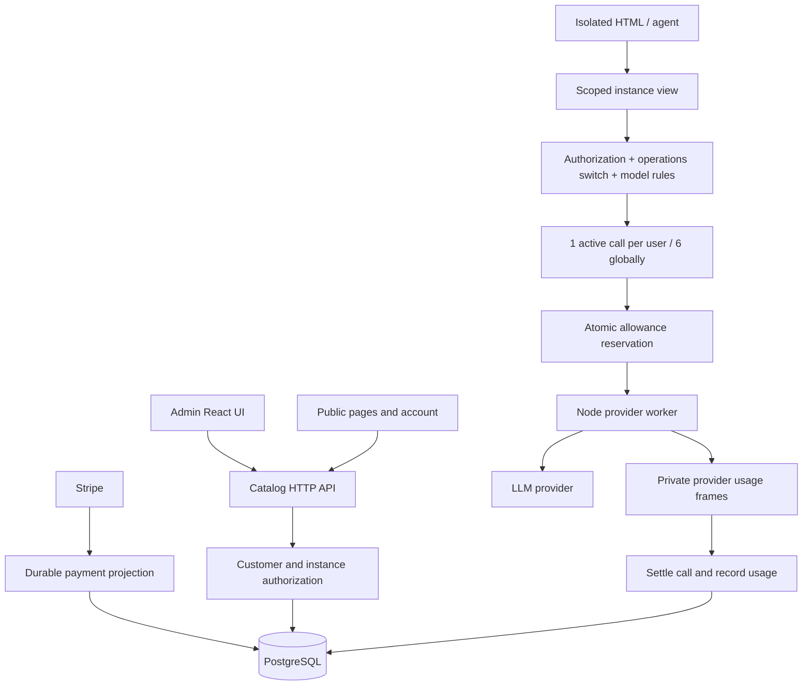

# Free and Paying: simplify the policy, then make the admin explain it

## Conclusion and scope

The business model is smaller than the implementation. The application still has a configurable ranked subscription catalog, price-to-plan mappings, named complimentary plans, model credit tariffs and separate demo allowances. That machinery is excessive for two customer classes. At the same time, the existing allowance is not a token ceiling: it charges a configured number of credits for a logical request, independently of the tokens consumed by its provider rounds.

The admin interface exposes those implementation concepts together and leaves the administrator to calculate the effective result. This is a product design problem. Reducing the number of visible fields without simplifying their meaning would leave the problem in place.

The recommended change is contained: one customer summary, two fixed sets of limits, a documented token accounting unit, and an admin page organized around the effective decision. Keep the existing application, PostgreSQL transactions, six-call admission gate, isolated HTML runner and payment synchronization. Do not add a service, queue, scheduler or policy framework.

This is a source-based assessment of the hosted service, local runner, worker, storage, publishing, authentication, payments, interfaces and operations. It is not a production load measurement. Source was inspected on `feat/year-funding-single-subscriber`, starting at `d847ba4`; the PR 16 corrections described below are being committed separately. The broad simplification proposed here has **not** been implemented.

## 1. System map

The hosted application is principally `pkg/catalog`. Its public pages use server-rendered templates and a small public script; account, studio and admin interfaces use React/RTK Query in `ui/catalog`. PostgreSQL owns identities, payment projections, settings, artifacts, instances, documents and model-call accounting. The JavaScript worker calls the model provider through the shared `pkg/piworker` client. This is a single application with a subprocess, rather than a fleet of per-customer runtimes.

The local runner in `pkg/host` and `pkg/store` is a separate mode using SQLite and loopback artifact origins. Its queue and hosting behavior must not be mistaken for production's hosted admission gate. Shared browser runtime code is under `ui/src`; the standalone and hosted implementations have different authentication and persistence boundaries.



A hosted request enters `pkg/catalog/hosted/sample.go:79`. It validates the scoped view, sample capability and request, checks active settings and the sampling switch, resolves an approved model, obtains the caller's budget, checks the model against that budget, acquires concurrency, reserves credits and starts the backend call. The worker may perform several provider rounds and browser tool exchanges. Settlement records usage and charges the original credit reservation.

The concurrency gate covers the entire logical call, including waiting for browser tools. Six admitted calls therefore do not imply six provider requests actively generating tokens at every instant. Keep the simple busy response for launch; this observation does not justify adding scheduling infrastructure.

## 2. Findings

### 2.1 Customer class, administrative role and paid access are conflated

**Problem.** A normal account has role `subscriber` even when it is Free. Staff resolve to the highest plan. `Paid()` includes complimentary grants and staff, so it does not mean money was paid. The admin exposes these overlapping meanings as separate fields without explaining the effective result.

**Where to look.** `pkg/catalog/entitlement.go:42–100`, `ui/catalog/admin.tsx:145–280`, `pkg/catalog/billing`, `pkg/catalog/store/billing.go`.

**Example, current source:**

```go
case u.Role == "admin" || u.Role == "creator":
    return Entitlement{Plan: doc.Highest(), Source: SourceStaff, Decision: d}
// Paid reports access beyond the free plan (staff, subscription, grant).
case SourceStaff, SourceSubscription, SourceTrial, SourceComplimentary:
    return true
```

**Why it matters.** An administrator can see Subscriber and reasonably infer a paying customer. Changing a role can also change runtime limits. Complimentary access can suppress support prompts without representing a payment. These are different facts and should be named accordingly.

**Cleanup sketch:**

```text
customerClass = Free | Paying
staffRole = User | Creator | Admin
accessEnabled = !user.disabled
supporterAccess = confirmedPaidThrough > now OR manualAccessUntil > now
class = supporterAccess ? Paying : Free
limits = settings.limits[class]
```

Use the label **Paying access — complimentary until DATE** when a manual grant supplies the Paying limits. Preserve the distinction in the API between actual payment and an access override. Staff permissions should allow editing and administration; whether staff use Paying limits should be an explicit fixed rule, not a highest-rank side effect.

### 2.2 A ranked product catalog remains behind a two-class storefront

**Problem.** Settings support multiple public/private plans, rank ordering, per-plan model lists, instance/member quotas, month/day credits and Stripe price mappings. Artifacts have required plans. The current storefront no longer needs a selectable catalog of subscription products.

**Where to look.** `pkg/catalog/settings/settings.go:78–90, 250–300`, `pkg/catalog/entitlement.go:58–100`, `ui/catalog/admin.tsx` plan editor around line 850, artifact required-plan handling in `pkg/catalog/server.go:304`.

**Example, current source:**

```go
func (e Entitlement) CanRun(a store.Artifact, doc settings.Document) bool {
    // Disabled, guest and staff handling precedes this comparison.
    return e.Plan.Rank >= doc.RequiredRank(a.RequiredPlan)
}
```

**Why it matters.** The administrator must understand rank, public visibility, grant-only tiers and price acceptance to predict access. PR 16's original `Highest()` implementation illustrated the risk: adding a higher private tier could silently promote all subscribers. The review correction selects the explicit public `subscriber` key; it fixes that defect but does not remove the generic machinery.

**Cleanup sketch:**

```text
settings.limits.free = { dailyTokens, savedWorkspaces, storageBytes }
settings.limits.paying = { dailyTokens, savedWorkspaces, storageBytes }
all ordinary published artifacts use the same customer access rule
Stripe payment amount never selects a different entitlement tier
```

Remove rank and arbitrary customer-plan creation from the active model. Remove the customer-tier restriction on ordinary published artifacts when implementing this change. Keep draft/editor permissions and withdrawn-release handling: publication authorization is a separate concern. Use a direct schema/data migration; do not build compatibility adapters for retired plans.

### 2.3 Credits are neither measured tokens nor a reliable token allowance

**Problem.** A request reserves and consumes `model.Credits`. Its actual token usage does not change the charge. Input size, output length and round count can differ substantially for the same credit price.

**Where to look.** `pkg/catalog/hosted/sample.go:139–147`, `pkg/catalog/store/usage.go:54–153`, `worker/src/main.ts:233–295`.

**Example, current source:**

```go
Credits: model.Credits, Included: budget.Monthly, Daily: budget.Daily
// Settlement increments used by res.Credits, while persisting token fields.
```

```typescript
const rounds = Math.min(Math.max(r.maxRounds || 5, 1), 10);
maxTokens: Math.min(model.maxTokens, 8192),
```

**Why it matters.** With five rounds, the output allowance can reach 40,960 tokens for a request billed at the same credit price as a short single-round answer. That is an upper allowance, not measured consumption. Repeated inputs also consume provider capacity. The present 8,192 limit is per provider round, not per user, day or complete logical request.

**Cleanup sketch:**

```text
define quota unit explicitly
before a run: atomically reserve its maximum permitted generated tokens
worker receives remainingGeneratedTokens for the whole run
before each round: maxOutput = min(roundCap, remainingGeneratedTokens)
after each round: subtract actual generated tokens
on completion: settle actual usage and release unused reservation
```

For this six-lane service, the simplest hard ceiling is **generated/output tokens per UTC day**, with a hard output limit across the entire logical run. Continue recording input, output, cache and cost separately. This is a recommendation, not an assertion that output-only accounting equals total model usage. Label it “generated tokens” everywhere.

If the required ceiling is total provider-reported tokens, include normalized input/cache semantics and enforce the remaining budget before each provider round. Input estimates and missing usage create uncertainty: a post-call total can stop the next request but is a soft ceiling for the current one. Do not describe that as an exact hard limit. A provider-independent strict total cap requires a trustworthy input bound/tokenizer and treatment of cache and reasoning usage; that is additional work rather than a free consequence of recording usage.

Keep the daily generated-token limit for the straightforward implementation; record total provider usage for internal analysis. Avoid adding monthly ceilings unless there is an actual monthly fairness requirement. If both periods are retained, display both and their UTC reset dates explicitly.

### 2.4 The admin displays ingredients instead of the decision

**Problem.** The detail page contains role, billing decision, plan/source, subscriptions, grants, allowance, instances and audit history. It has no single answer to whether a specific user can use AI now. Increasing credits can leave workspace access denied; paying status alone does not overcome a pause, missing owner access or exhausted demo.

**Where to look.** `ui/catalog/admin.tsx:145–280`, `pkg/catalog/admin.go:167–192`, `pkg/catalog/server.go:265–337`.

**Example, current UI source:**

```tsx
<option value="subscriber">Subscriber</option>
<option value="">the highest plan</option>
<span className="muted">credits because</span>
```

**Why it matters.** Each control acts on a different layer. The administrator must mentally execute backend authorization and accounting rules. Better explanatory tooltips alone would preserve that burden.

**Cleanup sketch:**

```text
CustomerSummary {
  class, accessEnabled, accessSource, paidThrough,
  ai: { allowed, blockingReason, used, reserved, limit, resetsAt },
  workspace: { allowed, blockingReason, owned, limit }
}
render summary first; show payment contracts and raw identifiers under Details
```

Do not make `ai.allowed` a promise that a call will succeed: a global lane can become busy after the page loads. Return the snapshot time and distinguish account eligibility from transient capacity. For instance-specific restrictions, show the named instance and its blocking reason rather than pretending a customer-only summary resolves owner and artifact conditions.

### 2.5 Admin query failures can masquerade as legitimate state

**Problem.** After loading the user, the detail handler discards errors from entitlement, subscriptions, grants, allowance and other queries.

**Where to look.** `pkg/catalog/admin.go:174–183`, `adminUser`.

**Example, current source:**

```go
e, doc, _ := s.entitlement(ctx, u)
subs, _ := s.Store.Subscriptions(ctx, u.ID)
allowance, _ := s.Store.AllowanceFor(ctx, u.ID,
    e.Plan.MonthlyCredits, e.Plan.DailyCredits)
```

**Why it matters.** Empty or zero values can appear authoritative when the database query actually failed. That is especially dangerous in a screen intended to explain customer access.

**Cleanup sketch:**

```text
summary, err = loadCustomerSummary(ctx, user)
if err: return explicit service error; do not synthesize Free or zero allowance
optional audit-history failure: show History unavailable, independently
```

Handle core access/payment/allowance failure as a failed summary. Optional history can have an explicit partial error. No new generic aggregation framework is needed.

### 2.6 Payment presentation has drifted from access projection

**Problem.** `userSupport` can prefer year funding for the account summary, while access is resolved separately. The admin lists recurring subscriptions but does not expose the same year-funding summary. A year payment and an existing recurring contract can coexist.

**Where to look.** `pkg/catalog/support.go:46–69`, `pkg/catalog/admin.go:174–192`, `ui/catalog/account.tsx`, `pkg/catalog/store/year_support.go`.

**Example, current source:**

```go
if year.Until != nil {
    out.Active = true
    out.Kind = "year"
    out.AmountCents = billing.YearFundingCents
    out.Until = year.Until
}
```

**Why it matters.** Access standing and future charges are different. Before the PR 16 correction, year presentation could hide continued monthly renewal. Separately, an empty recurring-subscription list is not proof the user is Free.

**Cleanup sketch:**

```text
CustomerSummary.access = effective access with source and expiry
CustomerSummary.payments = recurring contracts + confirmed year payments
Account and Admin consume the same summary
never infer no future charge from the most recent contribution kind
```

Keep Stripe's durable event inbox, authoritative refresh and retry. Removing reliable payment synchronization would make the system smaller but less correct. Simplify its application-facing result instead.

### 2.7 Workspace rules introduce hidden policy dependencies

**Problem.** Workspace access checks both caller and owner entitlement. Capacity counts use the owner's plan, while model calls draw from the caller's allowance. Downgrades preserve the oldest N workspaces by creation order. Suspended workspace rows are still included in the position query.

**Where to look.** `pkg/catalog/server.go:304–337`, `pkg/catalog/entitlement.go:138`, `pkg/catalog/store/instances.go:133–136`.

**Example, current source:**

```go
SELECT count(*) FROM instances
WHERE owner_user_id=$1 AND kind='workspace'
AND (created_at, id) <= ($2, $3)
```

**Why it matters.** A paying caller can encounter an owner-related block. Suspending an instance need not free its quota slot. Those rules are not evident from the user credit panel, so administrators can make changes that do not solve the reported problem.

**Cleanup sketch:**

```text
saved workspace = persistent data + pinned release + membership
AI quota belongs to the caller
workspace owner controls sharing and storage
show an explicit owner/capacity reason for blocked existing workspaces
```

Keep existing membership security. For launch, do not redesign collaboration as part of the token work. State workspace-count behavior plainly, and avoid automatic oldest-N freezing if a simpler explicit read-only policy meets the product need. Changing that rule needs a deliberate migration and behavior decision, rather than an incidental quota refactor.

## 3. What the administrator should see

The Users list should show name/email, **Free / Paying**, **Enabled / Disabled**, daily generated tokens used/limit, and paid-through or complimentary expiry. Administrative role can be a small separate badge. It must not be the customer's commercial status.

The first detail section should look like this. Values are illustrative, not production measurements:

```text
Alex — Paying access
Enabled · monthly payment confirmed · access through 18 November

AI: eligible now
Generated today: 12,000 used + 2,000 reserved / 50,000
Resets: 19 October, 00:00 UTC
At most 8,192 generated tokens per run · 1 active run per user

Saved workspaces: 2 / 5
[Disable account] [Change daily ceiling] [Grant Paying access until…]

Payments, staff permissions, sessions, identifiers and audit history: Details
```

There should be one visible daily-ceiling control, expressed as an absolute number. If an override is present, show the effective value, the normal Free/Paying default, its expiry and **Reset to default**. Do not expose both an unexplained additive credit balance and an absolute ceiling.

Before saving, show a short derived effect: “Tomorrow's daily ceiling becomes 50,000 generated tokens. Today's recorded usage remains 12,000. This does not start or cancel a Stripe subscription.” A customer disabled at the account level should get a direct explanation that increasing their allowance will not enable calls. This effect preview can be calculated by the same small summary function; it does not require a workflow engine.

Keep session revocation and payment reconciliation in Details. Preserve an explicit staff-role editor for real administrative work, with a description of the permissions it grants. Do not offer a general plan/rank editor on the customer page.

## 4. Instance cost and runtime controls

An instance is not a Kubernetes pod. It is chiefly persistent database identity, release selection, membership and document/asset namespaces. Idle instances consume stored data and metadata. Live views add SSE connections, goroutines and bounded event buffers. Calls occupy the shared model admission gate, including tool waits. Stored assets consume the configured persistent storage; large documents and many active views affect database and memory use separately.

The operational switches for model sampling, storage writes and new visits are useful. Retain their small public warning messages. A global sampling pause takes precedence over a customer's Paying status; the admin summary should display that fact. Retain request sizes, image count/bytes, tool count/schema sizes, run deadline, round cap and live-view limits. Tokens alone do not bound storage or long-running browser interactions.

The hosted global counter is in memory. It is adequate for the current single active application process. Do not silently increase replicas and assume the same six-call limit becomes cluster-wide. That deployment constraint belongs in the runbook; it does not justify Redis or a scheduler for the current deployment.

## 5. Preserve these implementation boundaries

| Area | Preserve | Simplify |
|---|---|---|
| Authentication | Email proof, GitHub/Google SSO, session revocation | Customer status independent of identity role |
| HTML runtime | Isolated origin, scoped grants, capability and membership checks | Explain access failures consistently |
| Model execution | Bounded worker/tool protocol, cancellation, 6 global / 1 per user admission | Fixed-credit tariff and duplicate plan model gates |
| Accounting | Atomic reservation, idempotent settlement, recovery | Accounting unit and customer-facing policy dimensions |
| Payments | Authoritative Stripe state, event deduplication, durable retry | Price-to-many-plan product catalog |
| Storage | Tenant namespaces, quotas, write pause | Visible settings and customer explanation |
| Publishing | Immutable releases, editor authorization, withdrawal behavior | Customer rank restrictions on ordinary public artifacts |
| Analytics | Internal traffic and provider usage records | Keep it separate from quota authority |
| Interfaces | CLI/MCP and browser API calling the same domain rules | Avoid independent policy logic in each interface |
| Local runner | Local SQLite and loopback isolation | Defer consolidation of hosted/local RPC duplication |

The reservation transaction is particularly important. Replacing it with `if sum(tokens) < limit: run()` allows simultaneous requests to pass the same check. Keep reservation and settlement in the existing database. On cancellation or crash, distinguish known usage from unknown provider usage; zero is not evidence of zero consumption. The current recovery already distinguishes unstarted reservations from calls that started and need review. Preserve that safety property when changing units.

## 6. Concrete implementation order

1. **One summary and an understandable admin page.** Implement a small `customerSummary(ctx, user)` with explicit error propagation. Reuse confirmed payment/access facts and allowance reads. Return Free/Paying access, payment source/expiry, enabled state and clear eligibility reasons. Render that first. Include one-off year standing and existing recurring charges. Keep advanced payment/session history below.
2. **A real, named token ceiling.** Use generated tokens per UTC day for the simple hard-cap implementation, retaining all provider usage fields. Pass a call-wide output budget to the worker, cap every round against remaining budget, reserve atomically and settle measured output. Keep six global/one per-user concurrency. Tests should cover simultaneous admission, multi-round exhaustion, cancellation, unknown usage and day-boundary reservations.
3. **Remove the generic customer catalog.** Store only Free and Paying limits. Remove rank, per-price entitlement tiers, named plan grants, per-plan model tariffs and misleading plan visibility controls. A complimentary override grants the same Paying limits until a date. Migrate settings/artifact requirements directly and update CLI/MCP contracts together. No compatibility layer.

This order provides immediate administrative clarity while keeping behavior changes reviewable. It does not require reorganizing the entire backend, changing the public site into a usage product or introducing another infrastructure component.

## 7. API and file reference

These are current routes, not promises that every old field should survive the simplification:

| API | Current purpose | Recommended treatment |
|---|---|---|
| `GET /api/admin/users` | Search/filter users | Fixed customer class plus separate staff role |
| `GET /api/admin/users/{id}` | Aggregated detail | Authoritative summary; explicit failures |
| `PATCH /api/admin/users/{id}` | Role/disabled mutations | Separate permissions from customer status |
| `POST /api/admin/users/{id}/access-grants` | Named-plan complimentary access | One Paying-access override with expiry |
| `DELETE /api/admin/users/{id}/access-grants` | Revoke grants | End manual access without altering Stripe |
| `POST /api/views/{view}/calls` | Hosted model request | Call-wide generated-token budget |

Primary implementation reading order:

- `pkg/catalog/settings/settings.go`: configuration, defaults and validation.
- `pkg/catalog/entitlement.go`: role/payment/grant resolution and budget selection.
- `pkg/catalog/server.go`, `store/instances.go`: instance authorization and owner capacity.
- `pkg/catalog/hosted/sample.go`, `hosted/runtime.go`, `hosted/views.go`: admission and call/view lifecycle.
- `pkg/catalog/store/usage.go`: transaction authority, usage ledger and recovery.
- `worker/src/main.ts`, `pkg/piworker/client.go`: provider rounds and usage transport.
- `pkg/catalog/support.go`, `payments`, `store/year_support.go`: payment standing and presentation.
- `pkg/catalog/admin.go`, `ui/catalog/admin.tsx`: current management projection and controls.
- `pkg/host`, `pkg/store`, `ui/src/runtime*`: standalone mode and shared browser protocol.

## 8. Review evidence and limits

PR 16 had two concrete automated findings: comment `4305397470` concerned hidden ongoing monthly renewal after year funding; comment `4305397478` concerned selecting a private highest plan for ordinary subscribers. The corrections display the continuing recurring contracts on the year-funded account and resolve confirmed subscribers only to the designated public `subscriber` plan. They are focused fixes, not the simplification proposed in this report.

Catalog PostgreSQL regression tests passed after updating fixtures to the explicit Subscriber key. Frontend type checking, ten frontend/worker tests and the embedded asset build passed. A stopped local PostgreSQL fixture and remaining `plan=pro` test query strings caused intermediate failures; the diary records them. No production payment, load experiment, broad policy migration or production deployment is claimed by this assessment.
