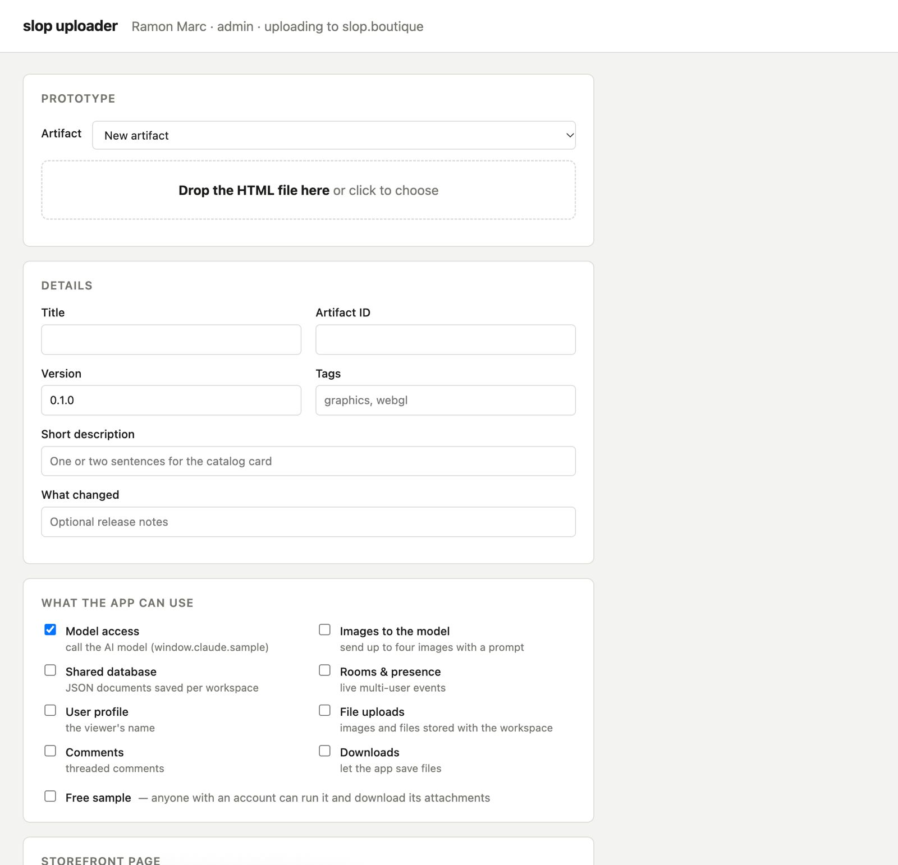

# Slop uploader: analysis, design, and implementation guide

## 1. What we are building

Build a focused uploader inside the existing creator Studio, at `/studio/upload`. It should look and behave like the supplied Slop Uploader reference: a calm form with a large HTML drop area, sensible metadata defaults, capability checkboxes, cover and gallery previews, a Markdown write-up, attachments, and three clear actions: **Check**, **Save draft**, and **Publish**. The implementation uses the existing Go server and React/RTK Query application. The only proposed backend contract change is exposing the existing upload limits through the existing Studio identity endpoint.

This document is detailed because the implementer is new to the project. The implementation itself is deliberately small: one uploader screen, a few pure form helpers, narrowly extracted shared Studio fields, and a sequential submit handler. There is no upload service, job queue, resumable-upload protocol, additional database schema, or new authentication system.

**Delivery decision:** the supplied ZIP is a standalone localhost application, whereas this guide targets an integrated Studio screen. The preferred delivery was asked during investigation; no answer had arrived when drafting, so Studio is an explicit design assumption. The visual reference and all of its source files are preserved. If the requested delivery is actually a local desktop utility, confirm that before implementing this route; do not ship both applications as part of this ticket.

**Evidence baseline:** repository revision `fbb4f72ffd3917bf6e4f2229c5043a9b176b29ea`, inspected on 20 October 2026. Source references describe that local revision, not a claim about the deployed production version. This ticket delivers a design and implementation guide; the new uploader is not implemented by this investigation.

## 2. Understand the system before changing it

Slop Boutique publishes small HTML applications. An **artifact** is the stable catalog identity, such as `lattice-rift`. It owns the title, description, tags, creator credits, public-page content, and policy settings. Its ID determines the public address `/apps/lattice-rift`.

A **release** is a version of that artifact. It contains the authored HTML file, a capability manifest, release notes, a version label, and an access flag called `freeSample`. Releases move from draft to published and can later be withdrawn. Publishing a replacement means creating a new release; the uploader must not rewrite the bytes of an existing release. Version labels are unique within an artifact and are not required to be semantic versions.

A **page** is the artifact's editorial presentation: Markdown body, cover media ID, and an ordered gallery of media IDs. The database stores a published page and, optionally, a separate page draft. This is distinct from the release draft. A **media item** is an uploaded image or video used in a page. An **attachment** is a downloadable file attached to one specific release, such as a manual or ZIP of supporting material. Uploading a ZIP as an attachment does not build it into a runnable application.

A **capability manifest** declares the hosted functionality the HTML intends to use, such as model calls, workspace data, or rooms. Checking a box declares a capability; it does not rewrite the HTML to call that API or waive the user's resource limits. A **workspace/instance** is a running, isolated copy of a release. The uploader creates release records; it uses the existing isolated preview flow when the editor wants to execute a draft.

```text
Artifact: lattice-rift
  |
  +-- catalog metadata: title, description, tags, creators
  +-- page: published body / cover / ordered gallery
  +-- pageDraft: optional unpublished editorial changes
  |
  +-- Release 0.1.0 [published]
  |     +-- authored HTML + manifest
  |     +-- attachments
  |
  +-- Release 0.1.1 [draft]
        +-- new authored HTML + manifest
        +-- this release's attachments

Media library: image/video records referenced by page IDs
Blob storage: actual bytes, addressed by SHA-256
```

Read `pkg/catalog/store/releases.go:16` for these data structures, `pkg/catalog/releases/releases.go:326` for draft creation, and `pkg/catalog/studio.go:33` for the HTTP routes. These three files explain most of the persistence model needed for this task.

## 3. What the supplied reference provides

The JPEG establishes the intended visual hierarchy: a white header with identity text, a light neutral canvas, restrained borders, large readable controls, and clearly separated form sections. It shows the top of the form through the beginning of the storefront section. The ZIP contains the remaining interface, so the lower sections are source-backed rather than inferred from the cropped image.

{width=85%}

The archive contains a small Node server and plain JavaScript client:

| Input file, relative to `sources/prototype/slop-uploader/` | Responsibility |
| --- | --- |
| `README.md` | Local startup, token setup, and intended workflow |
| `server.mjs` | Serves the form and proxies selected API routes using a local personal token |
| `public/index.html` | Complete section order, field labels, and action buttons |
| `public/style.css` | Neutral panels, two-column fields, drop zones, thumbnails, progress sidebar |
| `public/app.js` | Artifact prefill, file selection, validation, upload sequence, and progress reporting |
| `public/lib.js` | Slugs, version suggestions, manifests, titles, and tag parsing |
| `test/lib.test.mjs` | Pure helper tests |
| `test/server.test.mjs` | Local proxy tests using a fake token and fake upstream |

The original files are under `sources/slop-uploader.jpeg` and `sources/slop-uploader.zip`. `sources/input-manifest.json` records their SHA-256 hashes. The extracted source is a reference snapshot; production changes belong in the application source tree.

The local server is a useful proof of concept: it keeps a `studio`-scoped token on the server and checks localhost Host/Origin plus a per-process secret. The integrated implementation does not need this server because the portal already has a signed-in session and CSRF handling. Do not copy its environment-variable loader, token proxy, standalone package manifest, or root-level asset URLs into production.

## 4. Existing implementation and reuse points

The Studio is already a React application. `ui/catalog/main.tsx:12` dispatches `/studio` routes to `Studio`; `ui/catalog/studio.tsx:20` selects the Studio section. The server already serves `/studio/` through its SPA handler (`pkg/catalog/routes.go:28`). Adding `/studio/upload` therefore needs a Studio route branch, not another server or top-level application.

`ui/catalog/studio-api.ts:67` injects creator endpoints into the shared RTK Query API. `ui/catalog/api.ts:354` obtains the CSRF token through the session flow and attaches it to mutations. Reuse these hooks and call `.unwrap()` in the uploader's submit handler so failures stop the sequence. Avoid a second fetch wrapper with different error handling.

The existing Studio splits the relevant work across artifact details, page editing, releases, attachments, and the media library. These remain useful for maintenance and recovery. The new screen combines the common initial-upload path rather than removing every specialized editor.

| Current code | Reuse or change |
| --- | --- |
| `Studio`, `Artifacts`, `Releases` in `ui/catalog/studio.tsx` | Add Upload entry points and route; preserve release history and recovery controls |
| `MarkdownField`, `useMarkdownPreview` at `studio.tsx:421` | Extract narrowly for shared use; guard against stale preview responses |
| `MediaPicker`, `MediaThumb`, media display helpers at `studio.tsx:610` | Share the existing library picker; add staged local-file thumbnails in the uploader |
| `ui/catalog/studio-api.ts` | Use existing query/mutation hooks; extend the `Limits` type |
| `pkg/catalog/studio.go:105` | Extend `studioMe.limits` with the already-enforced HTML and count limits |
| `pkg/catalog/admin.go:87` | Existing multipart release decoder, also used by Studio |
| `pkg/catalog/releases/releases.go:202` | Authoritative HTML and manifest checks |
| `pkg/catalog/attachments.go:40` | Upload attachment bytes and enforce count/size limits |
| `pkg/catalog/content/media.go:14` | Authoritative accepted media types and byte sniffing |
| `pkg/catalog/web/static/catalog.css` | Add scoped uploader styles using the established site typography |
| `scripts/build.mjs` and `pkg/catalog/web/embed.go` | Build and embed the existing catalog bundle; assets remain under `/static/` |

## 5. Findings that matter to this implementation

### 5.1 The prototype's draft promise is too broad

Its README says Save as draft publishes nothing. However, `public/app.js:run` always PATCHes artifact title, description, and tags. `Store.UpdateArtifact` explicitly updates live artifact metadata. Page body/cover/gallery are draftable, but title/description/tags are not.

Keep the existing persistence semantics in this ticket. For an existing artifact, show a short note beside the details section: **“Title, description and tags update when you save. The release and page remain drafts until published.”** For a new artifact, its initial metadata is created with the release upload; it does not become a normal public catalog entry until a release is published. Do not add a new metadata-draft schema just to make the existing button label broader than the data model supports.

### 5.2 Free-sample wording must match the clarified policy

The reference says a free sample lets anyone with an account run it and download attachments. That is inaccurate for the current policy. Use **“Public download”** as the human-facing label, with **“Anyone can download this release and its attachments, including during early access. Hosted runs keep the normal access rules.”** The request field remains `freeSample`; no compatibility alias is needed.

Free accounts can download ordinary published releases after early access. Explicit samples permit anonymous downloads as well, including during early access. Disabled-account checks and all hosted execution limits continue to apply. See `pkg/catalog/routes.go:252`, `pkg/catalog/entitlement.go:86`, and `pkg/catalog/early_access_test.go:13`.

### 5.3 Checkbox conversion loses existing manifest information

The prototype reads only known checkbox names and reconstructs a new manifest from defaults. A local experiment confirmed that `{user:{scopes:["profile","email"]}}` becomes `{user:{scopes:["profile"]}}`, and extra `sample` options disappear. The test named “manifest round-trips” only covers a small predefined subset; it does not establish lossless editing.

Keep the full manifest object in form state. A checkbox modifies only its own namespace or option. Offer a collapsed **Manifest JSON** textarea for precise editing. Preserve unchanged options; reject invalid JSON before upload. This preserves current authored configuration and is not a backwards-compatibility adapter.

### 5.4 Artifact switching can mix uploads

`selectArtifact` resets much of the form but retains the selected HTML and attachments. It also has no stale-response protection. A slow response for artifact A can overwrite the form after artifact B was selected. The user can therefore unintentionally combine A's files with B's metadata.

Changing the artifact resets the staged HTML, attachments, new media selections, checks, and submission status. If there are edits, ask once before discarding them. Keep a selection generation counter, or use a keyed component/query and ignore obsolete results. A filename match should offer **“Upload a version of lattice-rift?”**, not silently switch ownership targets.

### 5.5 A partly completed upload is not one transaction

The prototype uploads media, creates a release, adds attachments, updates metadata, saves a page draft, publishes the page, then publishes the release. Every HTTP call commits independently. A failure after the release upload leaves a real release ID; pressing Publish again from the beginning can hit `version_exists`. A release-publish timeout may mean the release is already live, so the UI must not unconditionally call it a draft.

Use a simple sequential operation with recorded successful IDs and stage results. Once a release exists, recovery goes to its Studio editor rather than replaying the entire form. For a lost response during release creation or publication, refetch the artifact's releases and report the observed state; do not blindly repeat the mutation. No rollback service or durable workflow engine is warranted.

### 5.6 Smaller corrections

- Read HTML as text to suggest a title; never execute it inside the uploader. Preserve an explicitly edited title and ID.
- Revoke thumbnail object URLs on removal/reset/unmount. The prototype never revokes them.
- Disable the entire form while saving, not just its three action buttons. Snapshot values and file references before the first request.
- Keep successful-upload status separate from a later failure to refresh the artifact list.
- Enforce 20 attachments and 24 gallery items in the UI; the prototype omits the attachment count check.
- Populate from the latest **published** release for new-version defaults; if none exists, use the newest draft. Draft creation time alone should not silently change the defaults for an established artifact.
- Version suggestion is a convenience. Increment `major.minor.patch` for ordinary numeric versions, otherwise leave an explicit editable suggestion and validate uniqueness. Do not present the prototype's numeric-fragment sorter as semantic-version ordering.

## 6. Screen and interaction design

Use the supplied section order and spacing. On desktop the form is the main column, with a compact progress panel appearing beside it once an operation starts. At narrow widths, place progress immediately below the actions. Use two columns for paired fields when there is enough width; below roughly 640px use one column for details and capability controls. Scope CSS under `.slop-uploader` to avoid changing every Studio input.

The supplied neutral panels are the visual reference. Retain the site's installed typography and established button/focus styles. There is no reason to introduce a second design system or CSS framework for one screen.

### Entry points and defaults

Add **Upload artifact** beside the artifact list heading. Add **Upload new version** in an artifact's release section, linking to `/studio/upload?artifact=<id>`. The header displays the actual signed-in user's name and current site host, not a hardcoded name or destination.

For a new artifact: default version `0.1.0`, Model access selected, public download off, no media or attachments. Suggest title from the HTML `<title>` and ID from its normalized slug, but never overwrite fields the user has changed. An existing artifact locks its ID, loads title/description/tags, and loads its current page draft if one exists; show **“Editing an existing page draft”** in that case. An existing draft is not silently discarded or treated as already published.

### Field ownership

| Section | Fields | Stored on |
| --- | --- | --- |
| Prototype | Artifact choice, one authored HTML file | Artifact selection and release files |
| Details | Title, immutable ID, version, tags, description, release notes | Artifact metadata except version/notes, which belong to the release |
| Capabilities | Model, images, workspace data, rooms, profile, assets, comments, downloads | Release manifest |
| Access | Public download checkbox | Release `freeSample` |
| Storefront | Cover, ordered gallery, Markdown body | Artifact page draft, then page publication |
| Attachments | Multiple files, optional labels | New release only |

Keep visibility, featured placement, creator administration, demo configuration, and early-access dates in the existing artifact editor. They are supported by the system but not required in this upload form. Link **More artifact settings** to the existing Details tab. The uploader must preserve those values by omitting them from its PATCH.

A new release starts with no attachments; it does not implicitly duplicate every attachment from the previous release. Cover/gallery references are preserved because they belong to the artifact page. Users can choose existing media from the library or stage new files directly in the form.

### Accessibility and usable feedback

Use real labelled inputs. The drop zone must support keyboard activation and a visible file chooser alternative. Focus the first invalid control; associate messages with `aria-describedby`. Use text and icons as well as color for check results. Put progress updates in a polite live region. Make removal and ordering controls explicit buttons with descriptive accessible names. Gallery ordering can use Move up/Move down; drag sorting is unnecessary.

Do not display invented percentage progress: RTK Query's fetch transport does not supply upload byte progress. Show factual stages such as **“Uploading cover”**, **“Saving release”**, and **“Publishing release”**. Retain the progress log and recovery links after failure.

## 7. Architecture and ownership

```text
Browser at /studio/upload
  React form state: text, File objects, selection, stage results
       |
       | RTK Query hooks + existing session/CSRF
       v
Go /api/studio/* handlers
  guard: enabled account + creator/admin role
  editable/mayUpload: ownership of this artifact
       |
       +--> Publisher.Check: validate authored HTML / manifest
       +--> Publisher.CreateDraft: store bytes, create draft
       +--> Store: artifact/page/release/attachment metadata in PostgreSQL
       +--> Blobs: content-addressed files on existing release volume

Existing /studio/a/<id>?tab=releases
  recovery, isolated preview, release history, publish/withdraw
```

Use React local state for unsaved form fields, files, and operation status. File and Blob objects must not be placed in Redux state. RTK Query remains responsible for server records and invalidation. The root Redux store continues to own the existing route/notice behavior; no global uploader slice is needed.

**Decision: reuse the Studio session and API.** The local proxy and a Studio screen are both plausible, but the latter avoids token setup and another process while retaining the exact upload workflow. This is the design assumption described in Section 1.

**Decision: sequential existing mutations.** The APIs already expose every required write. A new all-in-one multipart endpoint would duplicate authorization, validation, and storage logic and still could not make filesystem writes transactional with PostgreSQL. Keep the visible partial-success behavior precise instead.

**Decision: preserve the full release manifest.** Checkbox state is a view over an editable manifest object. The user must explicitly turn off a capability before its declaration is removed.

## 8. HTTP API reference

All routes below already exist except the three additional fields proposed for `/api/studio/me`. Cookie-authenticated mutations require the existing same-origin and `X-CSRF-Token` checks. The standalone reference uses a bearer token with `studio` scope instead; token scope does not grant creator rights to an ordinary customer. The backend still checks role, enabled state, and object ownership.

| Request | Body or response | Uploader use |
| --- | --- | --- |
| `GET /api/session` | Authenticated user and CSRF token | Existing application bootstrap |
| `GET /api/studio/me` | `{user, creator, limits}` | Identity, missing creator-profile notice, upload limits |
| `GET /api/studio/artifacts` | Editable artifact summaries | Artifact selector |
| `GET /api/studio/artifacts/{id}` | `{artifact, creators, releases}` | Prefill and state reconciliation |
| `POST /api/studio/releases/check` | Release multipart; returns `{checks, blocking, manifest, size}` | Validation without stored artifacts/blobs |
| `POST /api/studio/releases` | Same multipart; returns `201` with release ID, files, checks | Create a draft, creating the artifact if necessary |
| `POST /api/studio/media` | Multipart `file`, optional `alt`; returns media record | Upload cover/gallery files |
| `POST /api/studio/releases/{id}/attachments` | Multipart `file`, optional `label`; returns attachment record | Attach supporting files to the new release |
| `PATCH /api/studio/artifacts/{id}` | `{title, description, tags}` | Save live catalog details only |
| `PUT /api/studio/artifacts/{id}/draft` | `{body, cover, gallery}` | Save page draft |
| `POST /api/studio/artifacts/{id}/draft/publish` | No body | Publish that page draft |
| `POST /api/studio/releases/{id}/publish` | No body; returns public release record | Make the release available |
| `POST /api/studio/releases/{id}/preview` | No body; returns instance record | Existing isolated Studio preview |
| `POST /api/studio/markdown` | `{markdown}`; returns `{html}` | Server-rendered write-up preview |
| `GET /api/studio/media` | Media records | Shared library picker |

The upload response is a public release projection with checks, not the complete Studio detail record. Do not assume it contains `createdAt`, `manifest`, `freeSample`, or editor-only attachment URLs. Use the form snapshot while saving and refetch the artifact detail after completion. Tighten TypeScript result types where the current broad `Release` type suggests fields the response does not provide.

### Release multipart example

```typescript
const form = new FormData();
form.set("artifactId", values.id);
form.set("title", values.title);
form.set("description", values.description);
form.set("tags", values.tags.join(","));
form.set("version", values.version);
form.set("changelog", values.changelog);
form.set("freeSample", String(values.publicDownload));
form.set("manifestJson", JSON.stringify(values.manifest));
form.set("html", values.html, values.html.name);
await uploadRelease(form).unwrap();
```

Do not set `Content-Type` manually for `FormData`; the browser supplies its boundary. `manifestJson` is the straightforward browser form field. The existing API also accepts a file part named `manifest`, but the new screen need not add another import control.

### The one small backend contract change

Extend the existing limits object, using server constants/settings rather than creating new configurable limits:

```json
{
  "limits": {
    "maxHTMLBytes": 16777216,
    "maxMediaBytes": 26214400,
    "maxAttachmentBytes": 104857600,
    "maxGalleryItems": 24,
    "maxAttachments": 20
  }
}
```

The byte values above illustrate defaults, not hardcoded effective production values. Read the first three from current settings. Use `maxGallery` and `maxAttachments` for the counts. Update `studioMe`, `ui/catalog/studio-api.ts:Limits`, and `pkg/catalog/client/types.go:StudioMe` together: the Go client has strict response decoding. No migration is required, and there is no old-shape adapter.

### Validation rules and errors

| Field | Existing rule |
| --- | --- |
| Artifact ID | `^[a-z0-9][a-z0-9_-]{0,63}$` |
| Version | `^[A-Za-z0-9][A-Za-z0-9._+-]{0,39}$`; unique per artifact |
| Title | Nonempty; Go checks at most 120 UTF-8 bytes |
| Description / notes | At most 2,000 / 8,000 UTF-8 bytes |
| HTML | Nonempty complete HTML; effective `maxHTMLBytes`; source must pass release validation |
| Manifest JSON | At most 64 KiB; known capability namespaces |
| Page Markdown | At most 100 KiB |
| Gallery / attachments | At most 24 / 20 items |
| Media | PNG, JPEG, GIF, WebP, MP4, WebM, detected from bytes |
| Media alt / attachment label | Alt at most 300 bytes; attachment label at most 200 Unicode code points |

Use `TextEncoder` for client checks that mirror byte limits. A DOM `maxLength` is not a UTF-8 byte limit. Server validation remains authoritative. Tag normalization should trim, lowercase, remove empties/duplicates, and respect the backend's maximum of 12 tags.

Important failures include `401 login_required`, `403 creator_required` or `not_editor`, `409 creator_profile_required`, `409 version_exists`, `422 invalid_release`, `413 too_large`, `415 media_type`, and `409 too_many_attachments`. The release multipart decoder currently reports malformed/oversized input as `400 invalid_upload`; do not assume every oversized upload returns 413. Show returned `checks` when available and preserve the server's concrete message.

## 9. Capability editing without data loss

| Checkbox | Manifest edit |
| --- | --- |
| Model access | Add/remove `sample` |
| Images to model | Toggle `sample.images`; enabling it also enables `sample` |
| Workspace database | Add/remove `db` |
| Rooms and presence | Add/remove `room` |
| User profile | Add/remove `user`; new default `{scopes:["profile"]}` |
| File uploads | Add/remove `assets` |
| Comments | Add/remove `comments` |
| Downloads generated by the app | Add/remove `downloads:true` |

“Downloads generated by the app” is distinct from the release's **Public download** flag. The first is a runtime declaration; the second controls downloading the published release files and attachments.

```typescript
function toggleCapability(original, key, on) {
  const next = structuredClone(original);
  if (key === "images") {
    if (on) next.sample = { ...(next.sample ?? {}), images: true };
    else if (next.sample) delete next.sample.images;
  } else if (on) {
    next[key] ??= defaultDeclaration(key);
  } else {
    delete next[key]; // only an explicit user action removes the namespace
  }
  return next;
}
```

Before this helper runs, ensure checkbox-controlled namespaces have editable shapes. If an existing declaration has an unusual shape, retain it in the JSON editor and explain that it must be edited there; do not silently coerce it. The server accepts `files` and `artifact` namespaces with warnings, but hosted project files and artifact republishing are unavailable. Preserve those declarations if present; do not add misleading “enable server files” or “republish code” checkboxes.

## 10. Save, publish, and recovery flow

The submit handler validates a frozen form snapshot, runs the server check, uploads any new media, creates the draft release, adds its attachments, saves artifact details, and saves the page draft when changed. Publish then publishes the page if there is a draft, followed by the release. Keeping the release publication last means files are not downloadable before attachment/setup steps have finished.

This ordering has an explicit tradeoff: for an existing public artifact, publishing its page can succeed before release publication fails. The progress panel must state that the page changed and the release's status must be checked. It is not an atomic launch. Adding atomic editorial/release publication is outside this ticket.

```text
Editing
  |
  +-- Check --> validation results --> Editing
  |
  +-- Save draft / Publish
         |
         v
       Checking --> media --> draft release --> attachments
                                                |
                                                v
                                      metadata --> page draft
                                                |
                            +-------------------+------------------+
                            |                                      |
                        Save draft                              Publish
                            |                                      |
                        Saved draft                         publish page draft
                            |                                      |
                       Open in Studio                       publish release
                                                                   |
                                                                  Live

Failure before release ID: retain staged values and uploaded media IDs
Failure after release ID: report saved stages and offer Finish in Studio
Lost mutation response: refetch releases before claiming a state
```

### Submission pseudocode

```typescript
async function submit(mode) {
  if (busy || result.releaseId) return;
  const input = snapshotAndValidate(form); // copy values; keep File refs
  setBusy(true);                          // disable selector and all fields
  const completed = [];
  let releaseId = "";
  let creatingRelease = false;
  try {
    const check = await stage("Checking HTML", () => checkRelease(input));
    showChecks(check.checks);
    if (check.blocking || mode === "check") return;

    const page = await uploadStagedMedia(input.page); // reuse known media IDs
    creatingRelease = true;
    const release = await stage("Saving release", () => uploadRelease(input));
    releaseId = release.id;
    creatingRelease = false;
    rememberRelease(releaseId);

    for (const attachment of input.attachments)
      await stage("Attaching " + attachment.name,
                  () => attach(releaseId, attachment));

    if (catalogDetailsChanged(input))
      await stage("Saving catalog details", () => patchArtifact(input));
    const pageChanged = !equalPage(page, input.loadedPage);
    if (pageChanged)
      await stage("Saving page draft", () => savePage(input.id, page));

    if (mode === "publish") {
      if (pageChanged || input.hadPageDraft)
        await stage("Publishing page", () => publishPage(input.id));
      await stage("Publishing release", () => publishRelease(releaseId));
    }
    showSuccess(mode, input.id, releaseId);
  } catch (error) {
    // Reconciliation is a read, not an automatic replay of a mutation.
    const actual = await bestEffortReloadArtifact(input.id);
    showFailureWithCompletedStages(error, completed, actual);
    if (releaseId || creatingRelease)
      showStudioRecovery(input.id); // uncertain create also stops blind retry
    else
      allowRetryBeforeReleaseCreation();
  } finally {
    setBusy(false);
  }
}
```

This is explanatory pseudocode: `stage` must append confirmed successes to the same `completed` array and record the failing stage. Distinguish a successful Check from a blocking Check. Success followed by a list-refresh failure remains a successful upload with a refresh warning.

For a successful Save draft, offer **Open draft in Studio** and **Upload another**. For a successful Publish, offer the public artifact link and **Open in Studio**. Reset the form only on Upload another, preserving the success receipt until then. Do not automatically create a second version when a user repeats the previous click.

### Partial-failure behavior

| Failure point | What can exist | Honest UI response |
| --- | --- | --- |
| Server check | No stored release/media from this operation | Show checks and allow correction |
| Media upload | Some library media records | Keep their IDs and retry remaining files |
| Create release, definite validation error | Media, and possibly artifact shell if storage failed later | Show error; use observed state before retry |
| Create release, lost response | A draft may exist | Refetch by artifact/version; offer Studio recovery |
| Attachment or details save | Draft release plus earlier successful uploads | Show saved release and completed stages |
| Page publish | Draft release and saved page draft; catalog details may already be live | Link to Studio and show the failed step |
| Release publish | Page may be live; release may be draft or published | Refetch and report actual state |
| Refresh after success | Successful upload/publication | Keep success; offer Refresh |

Do not automatically delete media or withdraw a release on failure. Those are separate user actions, and a network error does not establish that the previous mutation failed. Unreferenced uploaded media can be managed in the existing media library.

## 11. Concrete file changes

Use this as the initial implementation checklist, not as an instruction to build abstractions for hypothetical future screens.

1. Add `ui/catalog/uploader.tsx`: the form, staged file/media state, progress panel, and sequential handler. Keep a small number of local subcomponents for the five visible sections.
2. Add `ui/catalog/uploader-model.ts`: pure slug/title/version/tag helpers, byte-limit validation, and manifest edits. Port useful prototype logic with the corrections above.
3. Extract only the required shared fields from `studio.tsx` into `ui/catalog/studio-fields.tsx`: Markdown preview and media-picker dependencies. Update existing callers so the extracted code has one implementation. Keep asset references and API hooks unchanged.
4. Update `ui/catalog/studio.tsx`: route `/studio/upload`, navigation/action links, optional `artifact` query parameter, and missing-profile behavior.
5. Update `ui/catalog/studio-api.ts`: limits fields and truthful mutation result types. Reuse all current endpoints.
6. Update `pkg/catalog/studio.go:studioMe` and `pkg/catalog/client/types.go:StudioMe` for the limits response. Derive values from existing settings/constants.
7. Add scoped rules to `pkg/catalog/web/static/catalog.css`. Preserve `/static/` asset delivery; the existing build embeds the catalog application.
8. Add `tests/uploader.test.ts` and import it from `tests/run.ts`. Extend the existing Studio contract test for limits and run the focused integration cases once after wiring the screen.

The precise proposed filenames are new work. All other paths in the source map below are existing files inspected for this guide.

## 12. Implementation order

**Phase 1 — usable form.** Add the route and entry points, reuse signed-in identity and artifact queries, implement new/existing artifact selection, text fields, authored-HTML selection, and capability editing. Make stale selections and dirty-state resets correct before adding uploads. At this point Check should call the actual server validation endpoint.

**Phase 2 — media and save.** Add staged cover/gallery/attachment controls, library selection, server Markdown preview, and the complete draft-save sequence. Extend the limits contract. Ensure partial failures retain usable progress and Studio links.

**Phase 3 — publish and finish.** Wire the two existing publish operations in the documented order. Implement uncertain-response reconciliation, truthful success states, and Upload another. Complete narrow-screen and keyboard behavior. Then run the integration gate rather than repeatedly testing every individual field change.

This is a frontend feature with a small response-contract addition. It does not require infrastructure, secrets, queues, a new service, or production database migration. Use the existing build and release process when implementation is later approved for deployment.

## 13. Verification and acceptance criteria

Test observable user behavior, particularly transitions and failure boundaries. Do not merely snapshot the JSX tree.

### Pure helper and controller checks

- A title suggestion cannot overwrite user-edited title/ID fields.
- Switching artifacts resets files/attachments and ignores stale loading responses.
- Unchanged manifest options survive checkbox edits; images implies model access.
- Invalid UTF-8 byte lengths and configured file/count limits block submission.
- A second click while busy cannot create another request sequence.
- Before-release failure reuses uploaded media IDs; after-release failure cannot replay creation.
- A publication response lost after success is reconciled as published when the read confirms it.

### Existing backend tests to run or extend

`pkg/catalog/studio_test.go` covers creator ownership, release uploads, draft/page operations, and concurrent artifact creation. Extend its `/api/studio/me` assertions for new limits. `pkg/catalog/client_contract_test.go` checks the Go client's real wire contract. `pkg/catalog/attachments_test.go`, `videos_test.go`, and `early_access_test.go` cover file/media handling and the policy the UI must describe.

```sh
pnpm check
pnpm test
pnpm build
# Set TEST_DATABASE_URL to an explicitly chosen local test database first.
go test ./pkg/catalog ./pkg/catalog/client -count=1
git diff --check
```

The catalog fixture creates isolated test databases on the supplied PostgreSQL server. Never point `TEST_DATABASE_URL` at production. A skipped database test is not evidence that the workflow works.

### Browser scenarios

1. An administrator creates a new artifact from HTML with a cover, multiple gallery images, a write-up and two attachments; Check stores nothing, Save draft returns a usable Studio link, and Publish exposes the intended release.
2. A credited creator uploads a new version, preserves artifact ID and existing manifest options, and retains page media by ID. A creator without a linked profile gets a clear new-artifact restriction.
3. An uncredited creator cannot modify another artifact, even with a manually constructed request.
4. Inject failure after the release is created; verify the UI names the saved draft and does not create another version on retry. Separately simulate a lost publication response.
5. Verify an existing page draft is clearly identified and that the live-metadata note is shown for existing artifacts.
6. Verify the Public download wording against actual anonymous/Free early-access download behavior and hosted-run restrictions.
7. Check at approximately 1440px and 390px, including keyboard-only file selection, visible focus, error focus, thumbnails, removal, and progress messages. Record which screenshots use mocked APIs and which use real local storage.

The feature is accepted when a creator can complete the common upload path without moving among multiple tabs, publication status is truthful, and failures leave an obvious recovery route. It is not accepted merely because a standalone mockup renders.

## 14. Source reading map

Line numbers refer to the inspected baseline; symbol names are the stable navigation aid.

| File and starting line | What to read |
| --- | --- |
| `ui/catalog/main.tsx:12` | Route ownership and provider setup |
| `ui/catalog/studio.tsx:20` | Studio permissions, routing and navigation |
| `ui/catalog/studio.tsx:194` | Artifact editor and its existing tabs |
| `ui/catalog/studio.tsx:421` | Markdown preview and field reuse |
| `ui/catalog/studio.tsx:623` | MediaPicker and library controls |
| `ui/catalog/studio.tsx:898` | Existing release form and history |
| `ui/catalog/studio.tsx:1238` | Attachment upload/order/delete UI |
| `ui/catalog/studio-api.ts:67` | Studio RTK Query endpoints |
| `ui/catalog/api.ts:354` | Shared CSRF-aware request layer |
| `pkg/catalog/auth.go:102` | Authentication, role, scope and CSRF enforcement |
| `pkg/catalog/studio.go:33` | Complete Studio HTTP route table |
| `pkg/catalog/studio.go:105` | Studio identity and limits response |
| `pkg/catalog/studio.go:248` | Artifact PATCH fields and immediate persistence |
| `pkg/catalog/studio.go:409` | Page draft save/publish |
| `pkg/catalog/studio.go:525` | Upload authorization, including creator ownership |
| `pkg/catalog/studio.go:554` | Check, upload, publish and error responses |
| `pkg/catalog/admin.go:87` | Shared multipart decoding |
| `pkg/catalog/releases/releases.go:202` | Upload validation and capability checks |
| `pkg/catalog/releases/releases.go:326` | Blob storage and draft creation |
| `pkg/catalog/store/releases.go:16` | Artifact, Page, Release and file types |
| `pkg/catalog/store/releases.go:125` | Immediate artifact settings versus page draft writes |
| `pkg/catalog/store/releases.go:309` | Publication transaction and first-publication early access |
| `pkg/catalog/attachments.go:40` | Attachment storage and count enforcement |
| `pkg/catalog/content/media.go:14` | Supported media types |
| `pkg/catalog/client/types.go:269` | StudioMe client response contract |
| `pkg/catalog/web/embed.go:10` | Embedded frontend assets |
| `scripts/build.mjs:29` | Catalog bundle generation |

The preserved prototype files explain the requested UX; the Go handlers and store methods define what the real system currently guarantees. When they disagree, update the UX and guide consciously rather than assuming the prototype's comments are backend contracts.

## Implementation completion — 20 October 2026

The Studio variant described here is implemented on `feat/slop-uploader`. The form is `ui/catalog/uploader.tsx`; pure field/manifest helpers are in `uploader-model.ts`, and the sequential mutation/reconciliation code is in `uploader-submit.ts`. Shared Markdown/media fields moved to `studio-fields.tsx`. CSS remains in the project's existing `pkg/catalog/web/static/catalog.css`, and the built bundle is committed alongside it.

The implementation uses local React state for files and RTK Query for persisted objects. It supports existing-artifact prefilling, numeric next-version suggestions, full-manifest editing, public download, staged cover/gallery, attachment uploads, Check, Save draft, Publish, and recovery links. The artifact selector explicitly resets staged files. HTML title/ID autofill respects touched fields. Version creation does not silently replace a release. Unknown manifest namespaces survive checkbox edits.

A small implementation choice differs from the optional filename-matching suggestion: selecting an existing ID is explicit in the artifact selector. If a new artifact's ID already exists, validation asks the author to select it above. There is no automatic file transfer across artifact switches. Media selected from disk is staged; the shared library picker still offers its existing immediate-upload control, whose uploaded records remain in the library.

Verification includes 18 frontend tests, TypeScript compilation, production bundling, the full PostgreSQL-backed Go suite, lint, generated-contract checks and a deterministic Chromium interaction script. The screenshots and receipt in `sources/implementation/` use the actual built UI with mocked APIs; real persistence and authorization are checked separately by Go tests. The implementation diary records failures and their fixes. This completion note does not assert production deployment.
